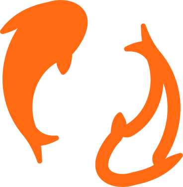

<p align="center">
  
</p>

<h1 align="center">Koidrive</h1>

<p align="center">
  <strong>File sync you deploy to your own Cloudflare account.</strong><br>
  Koidrive keeps folders in sync between your Macs and Linux machines and stores the files in your own R2 bucket.
</p>

<p align="center">
  <a href="#why-koidrive">Why Koidrive</a> ·
  <a href="#koidrive-and-dropbox-side-by-side">Koidrive and Dropbox</a> ·
  <a href="#what-it-costs">What it costs</a> ·
  <a href="#get-started">Get started</a> ·
  <a href="docs/guide/README.md">User guide</a>
</p>

> [!WARNING]
> **Not released yet.** There is no packaged release of 0.1.0, and the protocol and storage format may change before it. Keep another copy of anything you sync.

## Why Koidrive

**Pay for storage, not for seats.** Koidrive is free and open source. It runs on your Cloudflare account, so Cloudflare bills you for the storage you use, plus requests past R2's free monthly allowance, with no egress fee. R2 gives you 10 GB a month free and charges $0.015 per GB-month after that. Dropbox sells storage in fixed tiers, and its team plans charge for every person.

**Your files, in your account.** Koidrive stores your files as chunks in an R2 bucket you own. A Durable Object in the same account keeps each space's history. Cloudflare hosts both, in your account, and no other company stores your files. The code is yours to read, change and run. If you stop using Koidrive, every linked folder still holds ordinary files.

**Built not to lose your files.** When two machines edit the same file, Koidrive keeps both versions. When one machine deletes a file that another just edited, the edit stays. A large delete waits for your answer before it reaches your other machines. Deleted files and old versions stay in the trash for 30 days. Every pull request runs a simulation that loses, repeats and reorders messages and crashes devices. It fails if any device loses a write.

**Agents work in the same folder.** A linked folder holds plain files. An agent that edits files can work in it, and Koidrive syncs its changes like yours. The `koi` command prints JSON for status, decisions, trash, versions, restores, usage, devices and spaces, and an agent can answer a held delete with `koi resolve`. See [Coming next](#coming-next) for what we're adding.

## What you get

**Set it up once.** One command deploys the server to your Cloudflare account and signs in your first machine. Each new machine joins with a one-time code. Then you link a folder.

**The same files on every machine.** An edit on your Mac reaches your Linux machine as soon as both are online, and the same goes the other way. New files, edits, renames, moves and deletes all sync.

**Mistakes you can undo.** If you delete a file or save over the wrong one, the deleted file or the earlier version stays for 30 days. One command brings it back.

**Big deletes wait for you.** If one machine deletes a large part of a folder at once, Koidrive holds the deletion on that machine and asks you before it reaches the others. When two machines change the same file at the same time, you keep both versions.

**Agents can use it too.** An agent can edit files in a synced folder, and the `koi` command answers in JSON for scripts and agents.

The [user guide](docs/guide/README.md) explains how each of these works.

## Koidrive and Dropbox, side by side

Dropbox does much more, and charges per person for it. Koidrive does the core of file sync and keeps the files in your account. The Dropbox prices below are from [dropbox.com/plans](https://www.dropbox.com/plans) on 2026-11-11.

### Price and ownership

| | Koidrive | Dropbox |
|---|---|---|
| **Price** | Free and open source. You pay Cloudflare for storage. The first 10 GB is free, then $0.015 per GB-month | Basic is free with 2 GB. Plus is $9.99 a month for one person with 2 TB, and Standard $15 and Advanced $24 per person a month, all billed yearly |
| **Where your files live** | An R2 bucket in your Cloudflare account | Dropbox's cloud |
| **Source code** | Apache-2.0, with the server under AGPL-3.0, on GitHub | Closed |
| **Deleted files and old versions** | 30 days | 30 days on Plus, 180 days on Standard, 1 year on Advanced |

### Everyday sync

| | Koidrive | Dropbox |
|---|---|---|
| **Two-way sync of whole folders** | Yes | Yes |
| **Both copies kept on a conflict** | Yes | Yes |
| **Trash and version history** | 30 days | 30 days to 1 year |
| **macOS on Apple silicon** | Command line, and a menu bar app in progress | Yes |
| **Linux** | Command line and daemon | Yes |

### Where Dropbox does more

| | Koidrive | Dropbox |
|---|---|---|
| **Sharing with other people and teams** | No | Shared folders, team folders, groups and roles |
| **Files on demand** | Planned after 0.1 | Online-only files |
| **Windows, iPhone and Android** | No | Yes |
| **Web interface** | No | Yes |
| **Share links** | Yes, read-only. | Yes, with passwords and expiry |
| **Admin tools** | No | Device approvals, remote wipe and account transfer |
| **Support** | GitHub issues | Yes |

Choose Dropbox if you share folders with a team or open your files on a phone. Choose Koidrive if you want your folders on your own machines, stored in an account you control, with a bill only from Cloudflare.

## What it costs

Koidrive is free. Cloudflare runs it, at its own prices:

| | What you pay Cloudflare |
|---|---|
| **The server** | $0 on the [Workers Free](https://developers.cloudflare.com/workers/platform/pricing/) plan, within its daily allowances. When a space reaches one, its folders wait until the allowance resets at 00:00 UTC, and your changes stay on disk until then. See [Limits](docs/guide/limits.md) |
| **Storage** | The first 10 GB-month on [R2](https://developers.cloudflare.com/r2/pricing/) is free, then $0.015 per GB-month. 100 GB costs about $1.35 a month, and 500 GB about $7.35 |
| **Requests** | R2 includes 1 million writes and 10 million reads a month, then charges $4.50 per million writes and $0.36 per million reads |
| **Downloads** | No egress fee. Each download counts as read requests |

Files in the trash and old versions count as storage for the 30 days Koidrive keeps them. `koi space usage` shows how much each space stores.

## Get started

You need a Cloudflare account with R2 turned on, and a Mac or a Linux machine.

1. **Install the `koi` command.**

   ```sh
   curl -fsSL https://koidrive.com/install.sh | sh
   ```

   Downloads start with the first release. Until then, [build from source](docs/guide/install.md#build-from-source).

2. **Set up your server and this machine.**

   ```sh
   koi setup
   ```

   This deploys the server to your Cloudflare account and signs in this machine as your first device. Koidrive's public Cloudflare login doesn't exist yet, so for now follow [Without the Cloudflare login](docs/guide/setup.md#without-the-cloudflare-login).

3. **Link a folder.**

   ```sh
   mkdir -p ~/Koidrive
   koi space create Koidrive
   koi folder link ~/Koidrive --space Koidrive
   ```

   The folder syncs in the background, including after a restart (on macOS, while you're logged in). See [Background sync](docs/guide/install.md#background-sync).

4. **Add your other machines.** On a machine that is signed in, run `koi device invite`. It prints a command with a pairing code. Run that command on the new machine, then link a folder there too.

The [user guide](docs/guide/README.md) covers conflicts, the trash, devices, limits and how to remove everything.

## Coming next

- For agents, `koi status --check` with exit codes for scripts, conflict decisions that an agent can answer, a machine-readable list of every command, and a skill that teaches an agent to use Koidrive.
- Files on demand on macOS.
- A packaged release with a signed Mac app.

## Repository layout

| Path | Contents | License |
|---|---|---|
| [spec/](spec/) | Protocol schema in Protocol Buffers | Apache-2.0 |
| [core/](core/) | Rust sync engine crates | Apache-2.0 |
| [cli/](cli/) | Command-line client and daemon | Apache-2.0 |
| [server/](server/) | Worker and Durable Objects in TypeScript | AGPL-3.0-or-later |
| [apps/](apps/) | Desktop apps | Apache-2.0 |

## License, contributing and trademarks

The server in [server/](server/) uses the GNU AGPL v3.0 or later, and everything else uses the Apache License 2.0. [LICENSE](LICENSE) explains the split.

Anyone can open an issue. Until 1.0, only the project owner and invited maintainers open pull requests. See [CONTRIBUTING.md](CONTRIBUTING.md). Report vulnerabilities privately, as [SECURITY.md](SECURITY.md) describes.

Cloudflare, Cloudflare Workers, Durable Objects and R2 are trademarks of Cloudflare, Inc. Dropbox is a trademark of Dropbox, Inc. Koidrive is an independent project, not affiliated with or endorsed by either company.
