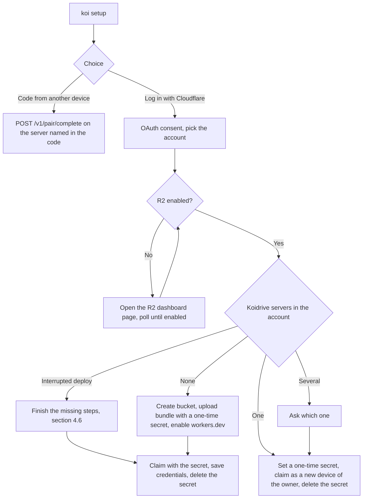

# CLI-first setup design

Status: draft for review. Scope: making `brew install koidrive` followed by `koi setup` the default way to install Koidrive on macOS and Linux, with the deploy button as a second path. It covers the Cloudflare login, the server deploy and claim, adding devices, upgrades, and how the CLI and the macOS app are distributed. Out of scope: implementing the commands, README and website text, and buying or verifying a domain. The server side builds on [deploy-and-upgrade.md](deploy-and-upgrade.md).

Every step below ran against the test account "Koidrive deploy test" on 2026-11-10 with a private OAuth client and a throwaway prototype: branch [`spike/cli-setup-oauth`](https://github.com/koidrive/koidrive/tree/spike/cli-setup-oauth/spike/cli-setup) at commit a5d0a2370ec8377d4a0ef053b255d9663dabf3e9. "Measured" means a call in that run returned the value quoted. Anything else carries a source or is labelled *unverified*.

## Summary

- One OAuth login (Authorization Code with PKCE, public client, no secret) is enough to deploy the server, claim it and upgrade it later. The CLI needs no Node, no Wrangler and no API token. The measured setup took 13 seconds from the first API call to a claimed server with the secret deleted again.
- The client needs four scopes: `account-settings.read`, `workers-scripts.admin`, `workers-r2.write` and `offline_access`. Workers Editor (`workers-scripts.edit`) is not enough, because script upload and asset upload return 403 under it. Koidrive uses Workers Admin (section 11, decision 1).
- The loopback redirect works on `http://127.0.0.1` with any port. The device-code grant is not available to third-party clients, so a headless Linux machine joins with a pairing code from a device that has a browser by default, or pastes the redirect URL with `--no-browser`.
- The claim moves from the Worker log to a one-time Worker secret. The server needs one small change, so that a correct `KOIDRIVE_RECOVERY_KEY` also claims a server that has no owner yet. Adding a device to an existing owner through the same secret already works on main.
- `koi setup` finds an existing server by a script tag (`koidrive-server`) and confirms it with `GET /v1/server`. With no server it deploys and claims one. With one it adds this device. A run that stopped halfway resumes from a small state file that holds no secrets (section 4.6).
- Upgrades upload a newer bundle under the same names. Bindings, secrets and data survive, and storage migrations run when each Durable Object adopts the new code, which Cloudflare now defers for up to 300 seconds by default.
- Before Koidrive can ship this to everyone, the OAuth client must become public. That needs a verified domain on the client URL (koidrive.com, bought before launch), a logo and a name, and promotion is permanent.
- Section 11 records the project owner's decisions and lists the points still waiting for one.

## 1. Commands

```
koi setup                  # on a terminal, asks: log in with Cloudflare, or enter a code from another device;
                                # otherwise lists the commands below and asks nothing
koi setup --interactive    # the guided setup, explicitly; fails without a terminal
koi join <pairing code>    # joins the server named in the code
koi server deploy          # Cloudflare login, then deploy and claim; fails if a server exists
koi server add-device      # Cloudflare login, then add this device to the existing server
koi server upgrade         # Cloudflare login, then upload this CLI's server bundle
koi server delete          # Cloudflare login, then delete the Worker, empty and delete the bucket
```

`koi setup` on a terminal (stdin and stderr, without `--json` or the `CI` variable) offers two choices. "Log in with Cloudflare" runs the OAuth flow (section 2), then looks for a Koidrive server in the chosen account (section 6):



The pairing code carries the server address, so a new device needs nothing else. Today `POST /v1/pair/start` returns an 8-character code such as `K7QM-2XPD` that is valid for 600 seconds (measured on the deployed server). The CLI shows it as `<code>@<host>`, for example `K7QM-2XPD@koidrive.alice.workers.dev` (decision 3). A QR code in the macOS app comes later. The CLI splits on the last `@` and prepends `https://`. The code alone still works with `--server`. The existing `koi pair --server --code --name` becomes `koi join`, and `pair` is removed in the same change. `koi setup <code>`, a second spelling of `join`, was removed later.

The explicit subcommands that need no Cloudflare login never ask questions, so scripts can use them. Where `koi setup` would ask, they stop instead and print the command or flag that goes on: `server add-device` on a server that needs an upgrade first (section 4.5) prints `koi server upgrade`. Each one that needs Cloudflare runs the login itself (section 5), and only with `--interactive` and a terminal on stdin and stderr. Otherwise, with or without `--json`, it never opens a browser: it stops with `auth_required` (exit 4) and names the same command with `--interactive`.

## 2. Cloudflare login

The CLI uses the endpoints Cloudflare documents for OAuth clients ([Integrate](#ref-integrate)): `https://dash.cloudflare.com/oauth2/auth`, `/oauth2/token` and `/oauth2/revoke`. Third-party clients may use only the Authorization Code flow, and CLI apps must use PKCE with `S256` and the token method `none` ([Create an OAuth client](#ref-client)).

Login sequence, as the prototype ran it:

1. Generate a 32-byte verifier, its S256 challenge and a random `state`.
2. Listen on `127.0.0.1` on a free port and open the authorize URL in the browser with `response_type=code`, the client id, `redirect_uri=http://127.0.0.1:<port>/oauth/callback`, the scopes, the state and the challenge.
3. The user signs in, picks the account and selects Authorize. The callback carries `code`, `scope` and `state`.
4. Check the state, then exchange the code once at the token endpoint with the verifier.

Measured behaviour:

| Question | Result |
|---|---|
| Loopback redirect | `http://127.0.0.1:<any port>/oauth/callback` is accepted. A full login on port 49152, which is not registered, succeeded. `http://localhost` is accepted only on the exact registered port, and `http://[::1]` is refused unless registered. Other paths and hosts are refused with `invalid_request`. |
| Device-code grant | Discovery lists `/oauth2/device/auth`, but a request returns `invalid_grant`: "The requested OAuth 2.0 Client does not have the 'urn:ietf:params:oauth:grant-type:device_code' grant". The client API allows only `authorization_code` and `refresh_token` ([Create OAuth client API](#ref-client-api)). |
| Consent page | Shows an account picker, the requested permissions in groups ("Account & Billing 1, Developer Platform 2, OAuth scopes 1" for our four scopes), and for this client the warning "This application has not verified ownership of any domain". |
| Token response | `token_type: bearer`, `expires_in: 3600`, `scope` with the granted scopes, a refresh token, no ID token and no account id. |
| Which account | `GET /client/v4/accounts` returns only the account picked on the consent page. |
| Code replay | Exchanging the same code a second time returns `invalid_grant` and revokes every token issued from that code. The access token then gets `9109 Invalid access token` and the refresh token `invalid_grant`. RFC 6749 section 4.1.2 recommends this. |
| Refresh | Each refresh rotates the refresh token. Reusing the old refresh token right after a rotation still worked. Reusing one 5 minutes after its rotation returned "The refresh token was already used" and revoked the whole grant, including the newest access token. |
| Narrowing on refresh | A `scope` parameter on a refresh request is ignored. The new token keeps the full grant. |
| Revoke | `POST /oauth2/revoke` with the refresh token, then the access token: both return 200. The access token then gets 403 and the refresh token `invalid_grant`. |
| PKCE enforcement at the authorize step | Requests with `code_challenge_method=plain` and with no challenge both reached the login page. Whether the token endpoint then refuses them is *unverified*. The CLI always sends S256. |

Rules this gives the implementation:

- Exchange each code exactly once. After a timeout or a lost response, start a new login instead of resending the exchange, or the user loses the grant.
- Treat a lost refresh response the same way. The CLI does not resend the old refresh token, because a late reuse revokes the grant. It starts a new login.
- Keep the grant inside one process. The CLI revokes it when the command ends (decision 2), so a command normally finishes on its first access token. A command that outlives the hour, for example one waiting on the R2 checkout, refreshes once in the same process and uses only the newest refresh token. Two processes refreshing from the same old token would risk revoking the grant.
- Read the granted `scope` from the token response and stop with a clear message if a required scope is missing. Optional scopes can be declined on the consent page ([Authorizing an application](#ref-authorizing)).

**Headless Linux.** The device grant is not available, so a machine without a browser has three options:

1. Join with a pairing code from a device that has a browser. A server needs one Cloudflare login, not one per device. This is the default (decision 4).
2. `koi setup --interactive --no-browser` (decision 4) prints the authorize URL. Pasting needs `--interactive` and a terminal, and without them the command stops with `auth_required`. The user opens it on any machine, and the final redirect to `127.0.0.1` fails to load there. The user copies that page's address and pastes it into the CLI, which checks the state and exchanges the code. *Unverified* end to end; it relies only on the code and state in the URL, which the prototype received.
3. SSH port forwarding (`ssh -L <port>:127.0.0.1:<port> host`) with `--port <port>`, so the laptop's browser reaches the CLI's listener.

A hosted HTTPS page that shows the code to copy would also work, but it needs a domain and a server, and it is not needed while option 2 exists.

## 3. Scopes

| Scope (dashboard name) | Needed for | Evidence |
|---|---|---|
| `account-settings.read` (Account Settings Read) | `GET /accounts` to learn which account was picked | 200 with this scope (measured). |
| `workers-scripts.admin` (Workers Admin) | Script upload, asset upload session, secrets, workers.dev route, settings, script delete, DO namespace list | Each returned 200 under this scope (measured). |
| `workers-r2.write` (Workers R2 Storage Write) | R2 check (bucket list), bucket create, object list and delete, bucket delete | Each returned 200 under this scope (measured). |
| `offline_access` | The refresh token | Cloudflare adds it to the client when `refresh_token` is a grant type ([Create OAuth client API](#ref-client-api)). Requested explicitly in every measured login. |

Not needed: User Details Read (`GET /user` returns 403 without it; only useful to show the user's email), Workers Observability Write (the upload's `observability` block applied without it), and Workers Routes (the workers.dev route goes through `POST .../scripts/<name>/subdomain`).

Workers Editor (`workers-scripts.edit`) was the first choice and failed: `POST .../assets-upload-session` and `PUT .../workers/scripts/<name>` returned 403 "No access to the specified resource." even for a five-line Worker with no bindings. The API reference lists only Workers Scripts Write for the asset session ([Assets upload](#ref-assets-api)). `GET /client/v4/oauth/scopes` lists `workers-scripts.write` as "Workers Scripts Write", but the dashboard's scope picker does not offer it, and the authorize endpoint refuses it with `invalid_scope` for a client created in the dashboard. Workers Admin is broader than Scripts Write, and Koidrive accepts it (decision 1). A client with `workers-scripts.write` is not pursued.

**What the grant can reach.** Cloudflare does not limit the grant to Koidrive's resources. On the account picked at consent, whoever holds the grant can upload, replace and delete any Worker, set and delete any Worker's secrets, and list and delete objects in every R2 bucket and delete the buckets. On a Koidrive server, setting `KOIDRIVE_RECOVERY_KEY` adds a device for the owner, which gives that device the owner's files. The tag and the `/v1/server` check of section 6 keep the CLI itself on Koidrive's resources, but the token does not. The grant lives for one command (section 7), which keeps this window short. Section 11 lists this for the owner.

## 4. Deploy and claim

### 4.1 R2

`GET /accounts/<id>/r2/buckets` returned 200 on the test account, where R2 is active. R2 cannot be enabled through the API: on an account where it was never enabled, creating a bucket fails with "Please enable R2 Subscription for your account. [code: 10042]" ([workers-sdk#15468](#ref-r2-cli)). The CLI treats error 10042 on the bucket list as "R2 is off", opens `https://dash.cloudflare.com/<account id>/r2/overview`, says that the checkout there includes free monthly usage and bills beyond it ([R2 get started](#ref-r2)), and polls the bucket list every 5 seconds until it succeeds. *Unverified*: that the bucket list (and not only bucket creation) returns 10042, and that this dashboard URL opens the R2 overview. The test account has R2 active, so the "off" branch could not be observed.

### 4.2 Release bundle

The release job builds the server once with `wrangler deploy --dry-run --outdir` and packs:

- `worker/worker.js`: the bundled Worker module, 418 KiB (97 KiB gzipped) on main.
- `assets/`: `server/web/dist`, the share-link viewer.
- `manifest.json`: the server version, main module, compatibility date, Durable Object classes, R2 binding name and default bucket name, the migration list, the assets binding and the observability settings, read from `server/wrangler.jsonc`. The prototype's [`make-manifest.mjs`](https://github.com/koidrive/koidrive/blob/spike/cli-setup-oauth/spike/cli-setup/make-manifest.mjs) shows the shape.

The CLI embeds the bundle for its own version (decision 5): CLI 0.3.0 deploys and upgrades to server 0.3.0. That keeps the deploy offline once the CLI is installed, and the bundle is covered by the same checksum as the CLI. A CI check compares the manifest with `wrangler.jsonc`, so the button path and the CLI path cannot drift.

### 4.3 Upload

All calls go to `https://api.cloudflare.com/client/v4/accounts/<id>` with `Authorization: Bearer <access token>`:

1. `POST /r2/buckets` with `{"name": <bucket>}`.
2. `POST /workers/scripts/<name>/assets-upload-session` with a manifest of path, hash and size. The upload JWT comes back with buckets of hashes to upload. Wrangler hashes with BLAKE3; the prototype used the first 32 hex digits of SHA-256 and the API accepted them.
3. `POST /workers/assets/upload?base64=true` per bucket with the upload JWT, base64 file contents as multipart parts. The last call returns 201 and a completion JWT ([Direct uploads](#ref-direct-upload)). When the session lists no buckets because every file is already uploaded, the session response itself carries the completion JWT, and the CLI makes no upload call. Cloudflare documents this case: "If all assets have been previously uploaded, `buckets` will be empty, and `jwt` will contain a completion token" ([Direct uploads](#ref-direct-upload)). The prototype uses the session's JWT in that case too, but no log of such a run survives.
4. `PUT /workers/scripts/<name>` with a multipart body that holds the module and this metadata (the secret's value elided):

```json
{
  "main_module": "worker.js",
  "compatibility_date": "2026-11-01",
  "bindings": [
    { "type": "durable_object_namespace", "name": "ACCOUNT", "class_name": "AccountDO" },
    { "type": "durable_object_namespace", "name": "SPACE", "class_name": "SpaceDO" },
    { "type": "r2_bucket", "name": "BUCKET", "bucket_name": "<bucket>" },
    { "type": "secret_text", "name": "KOIDRIVE_RECOVERY_KEY", "text": "<one-time secret>" },
    { "type": "assets", "name": "ASSETS" }
  ],
  "tags": ["koidrive-server"],
  "keep_bindings": ["secret_text", "secret_key"],
  "migrations": { "new_tag": "v1", "steps": [{ "new_sqlite_classes": ["AccountDO", "SpaceDO"] }] },
  "observability": { "enabled": true, "redact_query_string": true },
  "assets": { "jwt": "<completion JWT>", "config": { "_headers": "<contents of _headers>" } }
}
```

5. `POST /workers/scripts/<name>/subdomain` with `{"enabled": true, "previews_enabled": false}`, then `GET /workers/subdomain` for the account's subdomain. The server URL is `https://<name>.<subdomain>.workers.dev`.
6. Poll `GET <url>/v1/server`. The first request returned 404, the next one, 3.6 seconds later, returned `ServerInfo`.

The upload response echoed `migration_tag: v1`, the tag, `has_assets: true` and the observability block. `GET .../settings` afterwards showed `logs.persist: true`, `invocation_logs: true` and `redact_query_string: true`, and `GET /viewer/` returned 200 `text/html` from the uploaded assets.

**Migrations.** The rule matches Wrangler's. With no tag on the script, send every step with `new_tag` set to the last tag. With a tag, send the steps after it with `old_tag`, or nothing when it is already the last tag. A deployed tag that the bundle does not know means the deployment is newer than the CLI, and the CLI stops.

### 4.4 Claim with a one-time secret

The secret travels in the same upload as the code, so the Worker never runs without it. The `/setup` page stays, though, so the secret is not the only way to claim the new server. Anyone who opens `/setup` before the CLI claims gets a claim code printed to the Worker log, and whoever can read that log can claim first. That group is wider than the people who can replace the Worker. It includes account members and API tokens with the Workers Metadata Read-Only role, which can read logs but not deploy. deploy-and-upgrade.md section 2 already accepts this group for button deploys, and CLI deploys inherit the same exposure. The window lasts from enabling workers.dev to the first successful claim, a few seconds in the measured run. Section 11 lists whether CLI deploys should turn `/setup` off.

The CLI generates 32 random bytes and sends them base64url-encoded (43 characters, above the server's 32-character floor), then:

1. `POST <url>/v1/claim` with `{"code": <secret>, "userName": ..., "deviceName": ..., "platform": ...}`, the JSON form of `ClaimRequest`. The first attempt returned 200 with the owner's `userId` and the device's `deviceId` (measured).
2. Store the device credentials and wait until the store reports them written: the Keychain call returns, or the file is renamed into place and synced. The prototype saved the credentials before it deleted the secret, in this order.
3. `DELETE /workers/scripts/<name>/secrets/KOIDRIVE_RECOVERY_KEY`, then `GET .../secrets` to confirm that `KOIDRIVE_RECOVERY_KEY` is no longer in the list. Other secrets the owner set stay. A 404 counts as deleted. A replay of the same secret afterwards returned 403 "this deployment already has an owner".

The CLI retries the claim only while the server cannot see the key yet. Two refusals mean that: "no valid claim code; open /setup to issue one" on an unclaimed server whose Account DO still runs code without the key claim, and "this deployment already has an owner" while a new secret propagates. The refusal "this recovery key was already used; set a new one" means the key is spent, and section 4.6 handles it. The CLI never retries a spent key.

**Server change.** Main is not enough. On an unclaimed deployment, `redeemClaim` checks only claim codes from `/setup`, so the recovery key is ignored. On a Worker running main with the secret in its upload, 20 claims over 63 seconds were all refused with "no valid claim code; open /setup to issue one" (measured). The prototype's patch (12 lines in `server/src/account/claim.ts`) lets a correct, unused key claim an unclaimed deployment. It records the key as used, deletes any claim code, and creates the owner and the device in the same transaction. With it, the claim succeeded. The trust argument of deploy-and-upgrade.md section 2 carries over unchanged, because whoever can set the Worker's secrets can already replace its code. Spec section 15.2 needs one sentence for it. The `/setup` claim code stays for button deploys.

The change also needs the Durable Object to run the new code. On the Worker that went from main to the patched build, claims kept failing for 60 seconds after the upload while `/v1/server` already showed the new version. A claim about 100 seconds after the upload, following half a minute without requests, succeeded. Since 2026-10-30, an active Durable Object keeps its current code for up to 300 seconds after a deploy unless the upload sets `code_update_strategy` ([Code updates](#ref-do-updates)). Our retries every 3 seconds kept the Account DO active, so it kept the old claim logic. The secret itself was in place: `/v1/claim` runs in the Worker, which reads `env.KOIDRIVE_RECOVERY_KEY` and passes it to the Durable Object. A fresh deploy is not affected, because the Account DO starts on the new code.

### 4.5 Existing server: add this device

When `koi setup` finds a claimed server, it first lists the script's secrets. If `KOIDRIVE_RECOVERY_KEY` is already set and the state file does not record that this CLI set it, the owner set it for recovery ([deploy-and-upgrade.md §2](deploy-and-upgrade.md)), and the CLI stops rather than replace it. It says so and asks the owner to use that key or delete it first. Otherwise it sets a one-time secret with `PUT /workers/scripts/<name>/secrets` (`{"name": "KOIDRIVE_RECOVERY_KEY", "text": ..., "type": "secret_text"}`), claims, and deletes the secret. On a claimed server this is today's recovery path, so main can already add the device. The CLI claims only on a server that handles setup attempts (section 4.6), and the readiness check below makes sure of that. In the measured run, after a second login, the first claim 0.2 seconds after setting the secret was refused, and the next one 3.4 seconds after returned a device with the same `userId` as the first device. That device listed the space the first device had created. The CLI retries the claim for up to 60 seconds, then saves the credentials and deletes the secret in the order of section 4.4.

`GET /v1/server` returns `claimed`, so the CLI tells an unclaimed server from a claimed one before it sets the secret. An unclaimed server found in the account, such as a button deploy nobody claimed, takes the fresh-claim path of section 4.4. If its `server_version` predates the key-claim change, the CLI first upgrades it to the embedded bundle (section 5), after asking. The Account DO then keeps the old claim logic for up to 300 seconds, so this case retries for up to 330 seconds instead of 60.

**Readiness for setup attempts.** Before every claim, on a new server or an existing one, the CLI reads `ServerInfo.setup_attempts`. The Account DO reports this field itself, not the Worker, so it says what the code that runs the claim supports, including during the 300-second adoption window after an upgrade. When it is false, the CLI upgrades the server to its embedded bundle first, after asking, and polls `GET /v1/server` every 5 seconds until the field is true, for up to 330 seconds. A server the CLI just deployed starts on the new code and passes at once. If the user declines the upgrade, setup stops without claiming. The CLI explains that this server cannot yet make a retried claim end with one device, prints the command that upgrades it later (`koi server upgrade`), and exits with a non-zero status. So every claim the CLI makes is attempt-aware, and the one-device rule of section 4.6 holds without exceptions.

Recovery adds a device; it does not revoke the others ([deploy-and-upgrade.md §2](deploy-and-upgrade.md)). This branch makes that path the normal way to add a device. The server already lists and revokes devices: `GET /v1/devices` and `DELETE /v1/devices/{device_id}` in `server/src/worker.ts`, backed by `AccountDO.revokeDevice`. The CLI and app commands that use them ship in the same release as this setup path (decision 8).

### 4.6 Interrupted runs

A deploy, an add-device run or an uninstall can stop at any step: a crash, Ctrl-C, a lost network. The CLI keeps a state file, `setup-state.json` in its state directory, which belongs to this machine and is never shared, and writes it with an atomic rename before each step that creates or deletes something. The file holds the account id, the script name, the bucket name (and during an uninstall the script's creation time and the bucket's jurisdiction and creation date), the last finished step, whether a one-time secret may still be set, and a setup attempt id. It holds no secret. A rerun on the same machine reads it and continues. No command replaces the state file of another run that has not finished. A deploy or add-device run stops at an uninstall, a deploy of another Worker, or a run in another account. An uninstall stops at a deploy, a run in another account, or an unfinished uninstall when `--bucket` names a bucket. Each stops before it calls the account, names that run and the file, and says how to finish it. On another machine, section 6 finds the same resources from the account.

The setup attempt id is 16 random bytes the CLI creates before its first claim and keeps until a claim's credentials are saved. Every claim of that attempt sends it as `ClaimRequest.setup_attempt`, a new optional field. The CLI claims only after the readiness check of section 4.5 has passed, and stops when it cannot pass. In the claim's transaction, the server stores it on the new device and selects every earlier device with the same attempt id that has never refreshed a token (`last_seen_ms` is null, as on every new device row). Once the claim commits, it revokes them with `AccountDO.revokeDevice`. If the Account DO stops between the commit and the revocation, those devices stay unrevoked, but they remain unusable. Those devices came from claims whose credentials never reached storage, so nobody can use them. A device that has refreshed a token is never touched, so the rule cannot remove a device that works. However many claim responses get lost, the attempt ends with one device. If a later claim of the same attempt revokes a claim's device before that claim responds, the earlier claim is refused with `FORBIDDEN` instead of returning credentials that no longer work, and its client sets a new key and claims again. The id is not a secret: only a caller who also presents a valid one-time key can make the server revoke anything with it.

A run can also stop after it saved a claim's credentials and before it wrote that to the state file. A rerun that claimed again would revoke the saved device, which has not refreshed a token yet. So before each claim, the CLI reads its credential store. A saved credential for this server proves nothing by itself: the device may have been revoked since, or the credential may belong to an earlier deployment at the same URL. The CLI sends it to the live server with `POST /v1/token` and acts on the answer:

- **An access token.** This machine is already a device of this server, from this attempt's claim or an earlier setup, and the store holds only one credential. The CLI skips the claim and says so. It deletes the one-time secret only if the state file records that this CLI set it (section 4.5), then deletes the state file. The refresh sets the device's `last_seen_ms`, so no later claim of the attempt can revoke it.
- **`UNAUTHENTICATED`** ("unknown device or refresh credential", which `AccountDO.refreshAccess` returns for a revoked or unknown device). The CLI removes the credential from the store and claims with the setup attempt id as usual. It removes the credential only while the store still holds that device's credential, so a credential another run saved meanwhile stays.
- **Anything else**: a network error, a timeout, a 5xx, `RETRY_LATER`, or a store it cannot read. The CLI cannot tell whether the saved device works, so it keeps the state file, changes nothing in the account or the store, names the error and asks the user to run the command again.

| Stopped after | What exists in the account | What a rerun does |
|---|---|---|
| Bucket create | An empty bucket, no script | Creates the bucket the state file names. That name is `koidrive-` and 16 random hex digits, written to the state file before the first create, so no other application holds it. A 409 for it means an earlier try of this deploy created the bucket and its answer was lost, and the run goes on with that bucket. |
| Asset upload | The bucket, uploaded asset files that no script uses yet | Starts a new upload session. Files already uploaded are skipped. When Cloudflare already holds every file, the session lists none to upload and carries the completion JWT (section 4.3; documented, not measured). |
| Script upload | A tagged script bound to the bucket, with a one-time secret, no workers.dev route | Section 6 finds it from the tag and the bucket binding. The secret's value died with the process, so the CLI sets a new one, enables workers.dev and claims as in section 4.4. |
| workers.dev enabled | An unclaimed server that answers `GET /v1/server` | Sets a new secret and claims as in section 4.4. |
| Claim sent, but the response was lost or the credentials were not saved | A claimed server, a spent key, a device whose credentials nobody holds | Sets a new secret and claims again with the same setup attempt id, as a new device of the owner (section 4.5). That claim revokes the unused device, so the server ends with one device from this attempt. |
| Credentials saved, secret not deleted | A claimed server whose secret is a spent key | Deletes the secret. A spent key cannot claim again, because the server records used keys. |
| Uninstall | See section 5 | Continues the uninstall from the step after the last finished one. |

The CLI never takes over a resource it cannot tie to Koidrive. A script counts as a Koidrive server when it has the tag and binds a bucket, or when it answers `GET /v1/server`. A bucket counts as Koidrive's when the state file names it or a Koidrive script binds it. A deploy names its bucket `koidrive-` and 16 random hex digits (64 bits), so it never creates or adopts a bucket another application made. The Worker gets the default name `koidrive` when it is free, and otherwise the next free name, `koidrive-2` and so on. The state file records both names. Before it uploads the script, a run checks the recorded Worker name again. A Worker under it that has the tag and binds the recorded bucket is this deploy's own upload, and the run uploads over it. Any other Worker under it means another application took the name since, so the run moves to the next free Worker name. An unbound bucket that the state file does not name is reported and left alone.

## 5. Upgrade and delete

`koi server upgrade`:

1. Log in, find the server (section 6), and read `GET .../scripts/<name>/settings` for the bucket name and the current bindings.
2. Read `GET <url>/v1/server`. If the server reports a newer `server_version` than the embedded bundle, stop: the newer server may have run storage migrations that the older code cannot read, even under the same Durable Object migration tag. The CLI tells the user to install a newer CLI.
3. If the script has no `koidrive-server` tag, it came from the deploy button, which also created a repository whose pushes Workers Builds deploys ([deploy-and-upgrade.md](deploy-and-upgrade.md)). A later push to that repository would replace the CLI's upload with that repository's code. The CLI's scopes do not cover Workers Builds, so it cannot see or change that connection; *unverified* whether any granted scope could. It warns the user to update that repository too or disconnect its builds, and asks before it goes on (`--yes` in scripts).
4. Upload the assets and the bundle under the same script name with the same bucket, `keep_bindings: ["secret_text", "secret_key"]`, and the migration diff from section 4.3.
5. Poll `/v1/server` until it reports the new version.

The measured upgrade from 0.0.1 to 0.0.2 kept the space created before it, and the device token still refreshed. A Worker first deployed from the release in #34 (no assets, no observability, the oldest Account DO schema) was upgraded to main, then to the patched build. Each upload added what the release adds (assets, observability) and kept the DO tag at v1. The claim on that storage succeeded with the patched build. That claim writes to `used_recovery_keys`, a table only the newer storage steps create, so the Account DO migrated the storage written by the #34 release. `keep_bindings` kept a secret's value across an upload that did not send it, since a claim with that secret succeeded after the upload.

Because of the deferred code update, an upgrade is complete for each Durable Object only after it adopts the new code, within 300 seconds by default. The CLI sets `code_update_strategy` explicitly (`{"mode": "deferred", "max_delay": 300}`), so the behaviour does not depend on Cloudflare's default, and it tells the user that open sync sessions move to the new release within 5 minutes. The API accepted `{"mode": "immediate"}` in a measured upload; it resets active objects at once and drops their WebSockets, so it is not the default.

`koi server delete` must empty the bucket before it deletes it. `DELETE /r2/buckets/<bucket>` on a bucket the server had written to returned 409 with "10008 ... is not empty". Creating a space writes `spaces/<space id>/meta/<id>/space.json`. `GET /r2/buckets/<bucket>/objects` and `DELETE .../objects/<key>` worked under `workers-r2.write`. `DELETE /workers/scripts/<name>?force=true` also removed the Worker's two Durable Object namespaces, and the namespace list was empty afterwards.

The Worker is the only place that names the bucket, so the CLI records the bucket before it deletes the Worker:

1. Find the server (section 6), read the bucket name and its jurisdiction from the R2 binding in its settings, count the objects, and ask for confirmation, naming the bucket, its jurisdiction and the number of objects, because the uninstall deletes the owner's files. The prompt says that everything in the bucket is deleted, including anything another application stored there through R2's S3 API ([S3 API compatibility](#ref-r2-s3)), which no Worker binding shows. `--yes` skips the confirmation.
2. Write the state file with the script, its `created_on` time from the script list ([List Workers](#ref-scripts)), the bucket, its jurisdiction, and its `creation_date` from `GET /r2/buckets/<bucket>` ([Get Bucket](#ref-r2-bucket)).
3. If a script with the recorded name exists, compare its `created_on` with the state file. A different time means a new Worker was deployed under that name after an earlier run deleted this one. The CLI then leaves that Worker alone, names it and goes on to step 4, whose check keeps the bucket if the new Worker binds it. Otherwise it deletes the Worker with `?force=true`, which stops all writes to the bucket from it. The API has no conditional delete, so a deploy in the moment between the check and the delete is not caught.
4. Read the bucket with `GET /r2/buckets/<bucket>` and compare its `creation_date` with the state file. A different date means the bucket was deleted and a new one created under the same name, which R2 allows: the CLI deletes nothing in it, names it, deletes the state file and ends. Then read the settings of every script still in the account. If one binds the bucket in the same jurisdiction, another Worker uses it: the CLI keeps the bucket and its objects, names that Worker, deletes the state file and ends. It also lists the whole bucket. The server writes only keys under `spaces/`, so a key outside it means another application stores data there, and the CLI keeps the bucket the same way and names the first such key. The check runs here, after the Worker is gone and right before the first object is deleted, so every path to step 5 passes it.
5. List the bucket with `per_page=1000` and delete each key, following `cursor` until a list comes back empty ([List objects](#ref-r2-list)). The measured run deleted one object, so the multi-page case is *unverified*.
6. Delete the bucket, then the state file.

R2 allows buckets with the same name in different jurisdictions, and a bucket outside the default one needs the `cf-r2-jurisdiction` header on every API call ([Data location](#ref-r2-location)). The CLI sends the recorded jurisdiction on every R2 call of the uninstall. That the script settings return the binding's `jurisdiction`, as a Wrangler binding sets it, was not measured; *unverified*.

Every delete treats 404 as done, so a rerun repeats a finished step without error. A rerun with the state file starts at step 3, so it passes the check of step 4 again before it deletes anything in the bucket. If step 4 or 5 finds that the bucket no longer exists, the bucket was deleted before the run stopped, so the CLI deletes the state file and reports the uninstall as complete. The exact R2 error for a missing bucket was not measured; *unverified*. Any other error, such as a 403 or a network failure, keeps the state file for the next rerun. On another machine, or after the state file is lost, the Worker is gone and nothing in the account links the bucket to it. `koi server delete --bucket <name>` then empties and deletes the named bucket after the same confirmation and the check of step 4, recording its `creation_date` first. `--jurisdiction <name>` names a jurisdiction other than the default one. The CLI does not guess the name or the jurisdiction.

## 6. Finding a Koidrive server in an account

An account may hold other Workers. The upload sets `tags: ["koidrive-server"]`, and `GET /workers/scripts` returns each script's `tags` (measured: `{"id": "koidrive-proto", "tags": ["koidrive-server"], "migration_tag": "v1", "has_assets": true}`). The CLI keeps the scripts with that tag, then calls `GET <workers.dev URL>/v1/server` on each and keeps those that answer with a valid `ServerInfo`. A tag alone is not proof, since anyone with the account can tag a script. A tagged script that binds a bucket but has no workers.dev route is a deploy that stopped halfway (section 4.6). `koi setup` finishes it: it turns on the route, waits for the server to answer and adds this device as section 4.5 describes. `koi server add-device` stops and names `koi setup`. A Worker deployed with the button has no tag, and the owner may have renamed it. So the CLI also reads the settings of each untagged script and keeps those that bind Durable Object namespaces of the classes `AccountDO` and `SpaceDO`, then checks them with `/v1/server` the same way. It adds the tag on the next upgrade. With several matches the CLI lists their names and URLs and asks. `--worker <name>` picks one in scripts.

## 7. Credentials on the device

- The Cloudflare grant is needed for deploy, add-device, upgrade and uninstall, which are rare. Each of these commands logs in, keeps the tokens in memory only, and revokes the grant when it ends (decision 2). No Workers Admin credential stays on disk, and `koi server upgrade` logs in again.
- The CLI revokes on success, on failure, and on Ctrl-C or `SIGTERM`. It sends `POST /oauth2/revoke` with the refresh token, then with the access token. If revocation fails, it retries three times, then prints that the grant is still active, that the access token expires within an hour, and that the user can revoke it under Manage OAuth authorizations in the dashboard ([Authorizing an application](#ref-authorizing)).
- A process that is killed, or a machine that loses power, leaves the grant active on Cloudflare's side. Nothing on the device holds its tokens any more, but the grant stays until the refresh token expires or the user revokes it in the dashboard. Deleting local tokens does not revoke a grant.
- The refresh token's lifetime was not measured and Cloudflare does not document it; *unverified*. A third-party report measured the same one-hour access token ([Mailda](#ref-mailda)).
- Koidrive device credentials (`DeviceCredentials`) stay where the CLI and the app keep them today. The Cloudflare grant never reaches the Koidrive server.

## 8. Changes by directory

**`server/`**

- `account/claim.ts`: a correct, unused recovery key claims an unclaimed deployment (section 4.4). Tests next to the existing bootstrap tests cover a claim by key on an unclaimed server, refusal of a used key, refusal of a short key, and that the key path never counts as a wrong claim code.
- `account/claim.ts` and the devices table: store `setup_attempt` on a device made by a key claim, select the unused devices of the same attempt in the claim's transaction, and revoke them once it commits (section 4.6). The Account DO reports `ServerInfo.setup_attempts`. Tests cover several lost responses followed by a successful claim ending with one device, and that a device that has refreshed a token stays.
- `wrangler.jsonc`: add `durable_objects.code_update_strategy` so button deploys and CLI deploys behave the same.
- `scripts/`: the manifest generator, and a CI check that the manifest matches `wrangler.jsonc`.
- Spec section 15.2: one sentence for the key claim and one for `setup_attempt`.
- `spec/proto`: `ClaimRequest` gains `string setup_attempt = 5`, and `ServerInfo` gains `bool setup_attempts = 6`, which the Account DO fills (section 4.5). Added fields are not breaking changes for `buf breaking`.

**`cli/` and `core/`**

- A new crate, `core/cloudflare`, with the OAuth client (PKCE, loopback listener, paste-URL fallback, tokens kept in memory and revoked on exit), the state file of section 4.6, a small API client over `reqwest` (already a dependency of `core/net`), the bundle upload and the server discovery. It holds no Koidrive protocol logic, so the macOS app can call it through `core/ffi`.
- `cli/`: the commands of section 1, the embedded bundle, and `pair` renamed to `join` with the address-carrying code. The claim and pairing calls reuse `core/net`.

**`apps/macos/`**

The setup screen (`SetupModel`) gains "Log in with Cloudflare" next to "Enter a code from another device". Both call the same Rust code as the CLI through the FFI. The app opens the default browser and receives the callback on the loopback listener in Rust. A custom URL scheme callback (`koidrive://`), which `ASWebAuthenticationSession` would want, is refused by Cloudflare's client form according to a third-party report ([ubitools](#ref-ubitools)); *unverified*. The existing claim-code entry stays for servers deployed with the button.

## 9. Distribution

**Homebrew.** Koidrive starts in its own tap (decision 7). The repository `koidrive/homebrew-tap` (tap name `koidrive/tap`) carries a `koidrive` formula that builds the CLI from the tagged source archive, with bottles for macOS arm64 and Linux x86_64 and arm64 built by the tap's GitHub Actions ([Taps](#ref-tap)). Users run `brew install koidrive/tap/koidrive`. The short `brew install koidrive` needs the formula in homebrew/core, which requires a stable tagged release, a build from source on Homebrew's macOS and Linux CI, and a DFSG-compatible licence ([Acceptable formulae](#ref-core)); Apache-2.0 and AGPL-3.0-or-later both qualify. The name was free on 2026-11-11: `brew info koidrive` found no formula and no cask. Koidrive submits the formula to homebrew/core once its usage meets Homebrew's notability bar (decision 7). Those thresholds were not checked; *unverified*.

**macOS app.** The DMG from `release-macos.yml` goes into the tap as the cask `koidrive-app` (decision 7): `brew install --cask koidrive/tap/koidrive-app`. homebrew/core does not accept formulae whose main output is a `.app` ([Acceptable formulae](#ref-core)).

**Linux without Homebrew.** Each release also attaches static `x86_64` and `aarch64` musl binaries with SHA-256 checksums. `.deb`, `.rpm` and a systemd user unit for `koi _daemon` can follow. Release work is out of scope here.

## 10. What a public client needs before launch

The prototype used a private client, which only members of the test account can authorize ([Create an OAuth client](#ref-client)). Before anyone else can use `koi setup`, the client must become public, which needs:

- A client name, a logo, a client URL and at least one scope.
- Domain verification of the client URL: a DNS `TXT` record `cloudflare_oauth_client_publisher=<value>`, which Cloudflare polls for up to two days. After verification the domain cannot change ([Create an OAuth client](#ref-client)).
- Promotion to public, which cannot be undone. The API accepts only `public` for `visibility` and does not support demotion ([Update OAuth client](#ref-client-update)).

Until then the consent page shows the amber "has not verified ownership of any domain" warning, as it did for every login in this run. The public client uses the client URL domain koidrive.com, which the project owner buys before launch and keeps on the project owner's main account (decision 9). Until then the private client on the test account stays, for development only. Account administrators can turn off public OAuth app access for their account ([Authorizing an application](#ref-authorizing)); for them the CLI needs a fallback that accepts an API token with the same permissions (`--api-token`, read from an environment variable).

## 11. Decisions

The project owner decided the open points on 2026-11-10:

1. Scopes. Koidrive uses Workers Admin (`workers-scripts.admin`). It does not try a client created through the API with `workers-scripts.write`.
2. Cloudflare grant. Every command that needs Cloudflare logs in and revokes the grant when it ends. `koi server upgrade` logs in again (section 7).
3. Pairing code. The format is `<code>@<host>` (section 1). A QR code in the macOS app comes later.
4. Headless Linux. Joining with a code from another device is the default. The paste-URL login sits behind `--no-browser` (section 2).
5. Server bundle. The CLI embeds the bundle for its own version (section 4.2).
6. Secret name. The one-time claim secret keeps the name `KOIDRIVE_RECOVERY_KEY` (section 4.4).
7. Homebrew. The formula `koidrive` is for the CLI and the cask `koidrive-app` for the macOS app, both in the tap `koidrive/tap`. Koidrive submits to homebrew/core once usage meets its notability bar (section 9).
8. Lost devices. The CLI and app commands that revoke a lost device ship in the same release as this setup path. The server side already exists (section 4.5).
9. Public client. Its client URL uses koidrive.com, which the project owner buys before launch on the project owner's main account. Until then the private test client stays (section 10).

Still open for the owner. The design assumes the first answer to each of these:

- Reach of the grant. Decision 1 came before section 3 described what a Workers Admin and R2 Write grant can do outside Koidrive. Keep Workers Admin with a grant that lives for one command, or look for a narrower scope set first.
- Durable Object code updates. The CLI and `wrangler.jsonc` set `{"mode": "deferred", "max_delay": 300}`, so open sync sessions move to a new release within 5 minutes and are not dropped at once (section 5). Keep this, or use `immediate` and accept dropped sessions.
- `/setup` on CLI deploys. Keep it, accepting that log readers can claim first as section 4.4 describes, or turn it off for servers the CLI deploys. Turning it off needs a server change.

## References

- <a id="ref-client"></a>Cloudflare. "Create your OAuth client." [Link](https://developers.cloudflare.com/fundamentals/oauth/create-an-oauth-client/), last updated 2026-08-20, accessed 2026-11-10.
- <a id="ref-client-api"></a>Cloudflare API. "Create OAuth Client." [Link](https://developers.cloudflare.com/api/resources/iam/subresources/oauth_clients/methods/create/), accessed 2026-11-10.
- <a id="ref-client-update"></a>Cloudflare API. "Update OAuth Client." [Link](https://developers.cloudflare.com/api/resources/iam/subresources/oauth_clients/methods/update/), accessed 2026-11-10.
- <a id="ref-integrate"></a>Cloudflare. "Integrate your OAuth client with Cloudflare." [Link](https://developers.cloudflare.com/fundamentals/oauth/integrate-with-cloudflare/), last updated 2026-06-03, accessed 2026-11-10.
- <a id="ref-authorizing"></a>Cloudflare. "Authorizing an application." [Link](https://developers.cloudflare.com/fundamentals/oauth/authorizing-an-application/), last updated 2026-08-20, accessed 2026-11-10.
- <a id="ref-assets-api"></a>Cloudflare API. "Create Assets Upload Session." [Link](https://developers.cloudflare.com/api/resources/workers/subresources/scripts/subresources/assets/subresources/upload/methods/create/), accessed 2026-11-10.
- <a id="ref-direct-upload"></a>Cloudflare. "Direct Uploads", Workers static assets. [Link](https://developers.cloudflare.com/workers/static-assets/direct-upload/), last updated 2026-08-10, accessed 2026-11-10.
- <a id="ref-do-updates"></a>Cloudflare. "Durable Objects code updates." [Link](https://developers.cloudflare.com/durable-objects/deployments/durable-objects-code-updates/), last updated 2026-10-30, accessed 2026-11-10.
- <a id="ref-r2"></a>Cloudflare. "Get started", Before you begin. R2 docs. [Link](https://developers.cloudflare.com/r2/get-started/#before-you-begin), accessed 2026-11-10.
- <a id="ref-scripts"></a>Cloudflare API. "List Workers" (`created_on`: "When the script was created."). [Link](https://developers.cloudflare.com/api/resources/workers/subresources/scripts/methods/list/), accessed 2026-11-10.
- <a id="ref-r2-s3"></a>Cloudflare. "S3 API compatibility", R2. [Link](https://developers.cloudflare.com/r2/api/s3/api/), last updated 2026-10-14, accessed 2026-11-10.
- <a id="ref-r2-bucket"></a>Cloudflare API. "Get Bucket", R2 (`creation_date`: "Creation timestamp."; header `cf-r2-jurisdiction`). [Link](https://developers.cloudflare.com/api/resources/r2/subresources/buckets/methods/get/), accessed 2026-11-10.
- <a id="ref-r2-location"></a>Cloudflare. "Data location", R2. [Link](https://developers.cloudflare.com/r2/reference/data-location/), last updated 2026-08-19, accessed 2026-11-10.
- <a id="ref-r2-list"></a>Cloudflare API. "List Objects", R2. [Link](https://developers.cloudflare.com/api/resources/r2/subresources/buckets/subresources/objects/methods/list/), accessed 2026-11-10.
- <a id="ref-r2-cli"></a>cloudflare/workers-sdk issue #15468, "R2: support an explicit first-time subscription enablement flow in Wrangler" (opened 2026-09-02, open). [Link](https://github.com/cloudflare/workers-sdk/issues/15468), accessed 2026-11-10.
- <a id="ref-tap"></a>Homebrew. "How to Create and Maintain a Tap." [Link](https://docs.brew.sh/How-to-Create-and-Maintain-a-Tap), accessed 2026-11-10.
- <a id="ref-core"></a>Homebrew. "Acceptable Formulae." [Link](https://docs.brew.sh/Acceptable-Formulae), accessed 2026-11-10.
- <a id="ref-mailda"></a>Mailda. "The scope vocabulary, and where it was finally read from" (third-party measurements, 2026-09-09). [Link](https://mailda.site/docs/receipts/cloudflare-oauth-scopes/), accessed 2026-11-10.
- <a id="ref-ubitools"></a>Tao. "Practical Notes on Integrating a Cloudflare OAuth Client" (third-party, 2026-08-23). [Link](https://www.ubitools.com/cloudflare-oauth-client), accessed 2026-11-10.
