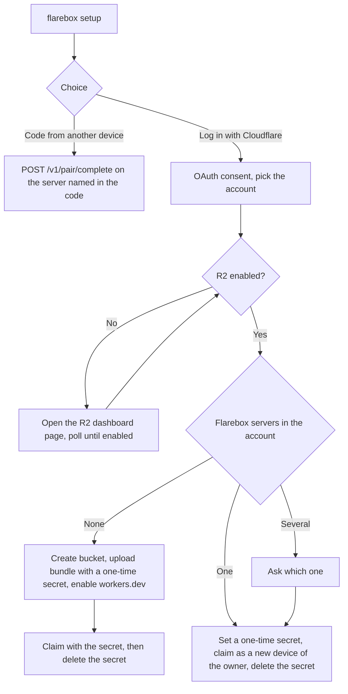

# CLI-first setup design

Status: draft for review. Scope: making `brew install flarebox` followed by `flarebox setup` the default way to install Flarebox on macOS and Linux, with the deploy button as a second path. It covers the Cloudflare login, the server deploy and claim, adding devices, upgrades, and how the CLI and the macOS app are distributed. Out of scope: implementing the commands, README and website text, and buying or verifying a domain. The server side builds on [deploy-and-upgrade.md](deploy-and-upgrade.md).

Every step below ran against the test account "Flarebox deploy test" on 2026-11-10 with a private OAuth client and a throwaway prototype: branch [`spike/cli-setup-oauth`](https://github.com/flarebox-dev/flarebox/tree/spike/cli-setup-oauth/spike/cli-setup) at commit a5d0a2370ec8377d4a0ef053b255d9663dabf3e9. "Measured" means a call in that run returned the value quoted. Anything else carries a source or is labelled *unverified*. Flarebox is not affiliated with Cloudflare, Inc.

## Summary

- One OAuth login (Authorization Code with PKCE, public client, no secret) is enough to deploy the server, claim it and upgrade it later. The CLI needs no Node, no Wrangler and no API token. The measured setup took 13 seconds from the first API call to a claimed server with the secret deleted again.
- The client needs four scopes: `account-settings.read`, `workers-scripts.admin`, `workers-r2.write` and `offline_access`. Workers Editor (`workers-scripts.edit`) is not enough, because script upload and asset upload return 403 under it. Workers Scripts Write (`workers-scripts.write`) exists but the dashboard cannot add it to a client.
- The loopback redirect works on `http://127.0.0.1` with any port. The device-code grant is not available to third-party clients, so a headless Linux machine joins with a pairing code from a device that has a browser, or pastes the redirect URL.
- The claim moves from the Worker log to a one-time Worker secret. The server needs one small change, so that a correct `FLAREBOX_RECOVERY_KEY` also claims a server that has no owner yet. Adding a device to an existing owner through the same secret already works on main.
- `flarebox setup` finds an existing server by a script tag (`flarebox-server`) and confirms it with `GET /v1/server`. With no server it deploys and claims one. With one it adds this device.
- Upgrades upload a newer bundle under the same names. Bindings, secrets and data survive, and storage migrations run when each Durable Object adopts the new code, which Cloudflare now defers for up to 300 seconds by default.
- Before Flarebox can ship this to everyone, the OAuth client must become public. That needs a verified domain on the client URL, a logo and a name, and promotion is permanent.

## 1. Commands

```
flarebox setup                  # asks: log in with Cloudflare, or enter a code from another device
flarebox setup <pairing code>   # joins the server named in the code
flarebox join <pairing code>    # the same, for scripts
flarebox server deploy          # Cloudflare login, then deploy and claim; fails if a server exists
flarebox server add-device      # Cloudflare login, then add this device to the existing server
flarebox server upgrade         # Cloudflare login, then upload this CLI's server bundle
flarebox server uninstall       # Cloudflare login, then delete the Worker, empty and delete the bucket
```

`flarebox setup` with no argument offers two choices. "Log in with Cloudflare" runs the OAuth flow (section 2), then looks for a Flarebox server in the chosen account (section 6):



The pairing code carries the server address, so a new device needs nothing else. Today `POST /v1/pair/start` returns an 8-character code such as `K7QM-2XPD` that is valid for 600 seconds (measured on the deployed server). The proposal is `<code>@<host>`, for example `K7QM-2XPD@flarebox.alice.workers.dev`. The CLI splits on the last `@` and prepends `https://`. The code alone still works with `--server`. The existing `flarebox pair --server --code --name` becomes `flarebox join`, and `pair` is removed in the same change.

The explicit subcommands never ask questions, so scripts can use them. Each one that needs Cloudflare runs the login itself (section 5).

## 2. Cloudflare login

The CLI uses the endpoints Cloudflare documents for OAuth clients ([Integrate](#ref-integrate)): `https://dash.cloudflare.com/oauth2/auth`, `/oauth2/token` and `/oauth2/revoke`. Third-party clients may use only the Authorization Code flow, and CLI apps must use PKCE with `S256` and the token method `none` ([Create an OAuth client](#ref-client)).

Login sequence, as the prototype ran it:

1. Generate a 32-byte verifier, its S256 challenge and a random `state`.
2. Listen on `127.0.0.1` on a free port and open the authorize URL in the browser with `response_type=code`, the client id, `redirect_uri=http://127.0.0.1:<port>/oauth/callback`, the scopes, the state and the challenge.
3. The user signs in, picks the account and selects Authorize. The callback carries `code`, `scope` and `state`.
4. Check the state, then exchange the code once at the token endpoint with the verifier.

Measured behaviour:

| Question | Result |
|---|---|
| Loopback redirect | `http://127.0.0.1:<any port>/oauth/callback` is accepted. A full login on port 49152, which is not registered, succeeded. `http://localhost` is accepted only on the exact registered port, and `http://[::1]` is refused unless registered. Other paths and hosts are refused with `invalid_request`. |
| Device-code grant | Discovery lists `/oauth2/device/auth`, but a request returns `invalid_grant`: "The requested OAuth 2.0 Client does not have the 'urn:ietf:params:oauth:grant-type:device_code' grant". The client API allows only `authorization_code` and `refresh_token` ([Create OAuth client API](#ref-client-api)). |
| Consent page | Shows an account picker, the requested permissions in groups ("Account & Billing 1, Developer Platform 2, OAuth scopes 1" for our four scopes), and for this client the warning "This application has not verified ownership of any domain". |
| Token response | `token_type: bearer`, `expires_in: 3600`, `scope` with the granted scopes, a refresh token, no ID token and no account id. |
| Which account | `GET /client/v4/accounts` returns only the account picked on the consent page. |
| Code replay | Exchanging the same code a second time returns `invalid_grant` and revokes every token issued from that code. The access token then gets `9109 Invalid access token` and the refresh token `invalid_grant`. RFC 6749 section 4.1.2 recommends this. |
| Refresh | Each refresh rotates the refresh token. Reusing the old refresh token right after a rotation still worked. Reusing one 5 minutes after its rotation returned "The refresh token was already used" and revoked the whole grant, including the newest access token. |
| Narrowing on refresh | A `scope` parameter on a refresh request is ignored. The new token keeps the full grant. |
| Revoke | `POST /oauth2/revoke` with the refresh token, then the access token: both return 200. The access token then gets 403 and the refresh token `invalid_grant`. |
| PKCE enforcement at the authorize step | Requests with `code_challenge_method=plain` and with no challenge both reached the login page. Whether the token endpoint then refuses them is *unverified*. The CLI always sends S256. |

Rules this gives the implementation:

- Exchange each code exactly once. After a timeout or a lost response, start a new login instead of resending the exchange, or the user loses the grant.
- Keep one writer for the refresh token. Write the new refresh token to storage (atomic rename) before using the new access token, and hold a lock across the refresh. Two processes refreshing from the same old token risk revoking the grant.
- Read the granted `scope` from the token response and stop with a clear message if a required scope is missing. Optional scopes can be declined on the consent page ([Authorizing an application](#ref-authorizing)).

**Headless Linux.** The device grant is not available, so a machine without a browser has three options:

1. Join with a pairing code from a device that has a browser. A server needs one Cloudflare login, not one per device. This is the recommended path.
2. `flarebox setup --no-browser` prints the authorize URL. The user opens it on any machine, and the final redirect to `127.0.0.1` fails to load there. The user copies that page's address and pastes it into the CLI, which checks the state and exchanges the code. *Unverified* end to end; it relies only on the code and state in the URL, which the prototype received.
3. SSH port forwarding (`ssh -L <port>:127.0.0.1:<port> host`) with `--port <port>`, so the laptop's browser reaches the CLI's listener.

A hosted HTTPS page that shows the code to copy would also work, but it needs a domain and a server, and it is not needed while option 2 exists.

## 3. Scopes

| Scope (dashboard name) | Needed for | Evidence |
|---|---|---|
| `account-settings.read` (Account Settings Read) | `GET /accounts` to learn which account was picked | 200 with this scope (measured). |
| `workers-scripts.admin` (Workers Admin) | Script upload, asset upload session, secrets, workers.dev route, settings, script delete, DO namespace list | Each returned 200 under this scope (measured). |
| `workers-r2.write` (Workers R2 Storage Write) | R2 check (bucket list), bucket create, object list and delete, bucket delete | Each returned 200 under this scope (measured). |
| `offline_access` | The refresh token | Cloudflare adds it to the client when `refresh_token` is a grant type ([Create OAuth client API](#ref-client-api)). Requested explicitly in every measured login. |

Not needed: User Details Read (`GET /user` returns 403 without it; only useful to show the user's email), Workers Observability Write (the upload's `observability` block applied without it), and Workers Routes (the workers.dev route goes through `POST .../scripts/<name>/subdomain`).

Workers Editor (`workers-scripts.edit`) was the first choice and failed: `POST .../assets-upload-session` and `PUT .../workers/scripts/<name>` returned 403 "No access to the specified resource." even for a five-line Worker with no bindings. The API reference lists only Workers Scripts Write for the asset session ([Assets upload](#ref-assets-api)). `GET /client/v4/oauth/scopes` lists `workers-scripts.write` as "Workers Scripts Write", but the dashboard's scope picker does not offer it, and the authorize endpoint refuses it with `invalid_scope` for a client created in the dashboard. Workers Admin is broader than Scripts Write. A client created through the API with `workers-scripts.write` might work with less access; *unverified* (open question 1).

## 4. Deploy and claim

### 4.1 R2

`GET /accounts/<id>/r2/buckets` returned 200 on the test account, where R2 is active. R2 cannot be enabled through the API: on an account where it was never enabled, creating a bucket fails with "Please enable R2 Subscription for your account. [code: 10042]" ([workers-sdk#15468](#ref-r2-cli)). The CLI treats error 10042 on the bucket list as "R2 is off", opens `https://dash.cloudflare.com/<account id>/r2/overview`, says that the checkout there includes free monthly usage and bills beyond it ([R2 get started](#ref-r2)), and polls the bucket list every 5 seconds until it succeeds. *Unverified*: that the bucket list (and not only bucket creation) returns 10042, and that this dashboard URL opens the R2 overview. The test account has R2 active, so the "off" branch could not be observed.

### 4.2 Release bundle

The release job builds the server once with `wrangler deploy --dry-run --outdir` and packs:

- `worker/worker.js`: the bundled Worker module, 418 KiB (97 KiB gzipped) on main.
- `assets/`: `server/web/dist`, the share-link viewer.
- `manifest.json`: the server version, main module, compatibility date, Durable Object classes, R2 binding name and default bucket name, the migration list, the assets binding and the observability settings, read from `server/wrangler.jsonc`. The prototype's [`make-manifest.mjs`](https://github.com/flarebox-dev/flarebox/blob/spike/cli-setup-oauth/spike/cli-setup/make-manifest.mjs) shows the shape.

The CLI embeds the bundle for its own version: CLI 0.3.0 deploys and upgrades to server 0.3.0. That keeps the deploy offline once the CLI is installed, and the bundle is covered by the same checksum as the CLI. A CI check compares the manifest with `wrangler.jsonc`, so the button path and the CLI path cannot drift.

### 4.3 Upload

All calls go to `https://api.cloudflare.com/client/v4/accounts/<id>` with `Authorization: Bearer <access token>`:

1. `POST /r2/buckets` with `{"name": <bucket>}`.
2. `POST /workers/scripts/<name>/assets-upload-session` with a manifest of path, hash and size. The upload JWT comes back with buckets of hashes to upload. Wrangler hashes with BLAKE3; the prototype used the first 32 hex digits of SHA-256 and the API accepted them. A second deploy of the same assets returned zero files to upload.
3. `POST /workers/assets/upload?base64=true` per bucket with the upload JWT, base64 file contents as multipart parts. The last call returns 201 and a completion JWT ([Direct uploads](#ref-direct-upload)).
4. `PUT /workers/scripts/<name>` with a multipart body that holds the module and this metadata (the secret's value elided):

```json
{
  "main_module": "worker.js",
  "compatibility_date": "2026-11-01",
  "bindings": [
    { "type": "durable_object_namespace", "name": "ACCOUNT", "class_name": "AccountDO" },
    { "type": "durable_object_namespace", "name": "SPACE", "class_name": "SpaceDO" },
    { "type": "r2_bucket", "name": "BUCKET", "bucket_name": "<bucket>" },
    { "type": "secret_text", "name": "FLAREBOX_RECOVERY_KEY", "text": "<one-time secret>" },
    { "type": "assets", "name": "ASSETS" }
  ],
  "tags": ["flarebox-server"],
  "keep_bindings": ["secret_text", "secret_key"],
  "migrations": { "new_tag": "v1", "steps": [{ "new_sqlite_classes": ["AccountDO", "SpaceDO"] }] },
  "observability": { "enabled": true, "redact_query_string": true },
  "assets": { "jwt": "<completion JWT>", "config": { "_headers": "<contents of _headers>" } }
}
```

5. `POST /workers/scripts/<name>/subdomain` with `{"enabled": true, "previews_enabled": false}`, then `GET /workers/subdomain` for the account's subdomain. The server URL is `https://<name>.<subdomain>.workers.dev`.
6. Poll `GET <url>/v1/server`. The first request returned 404, the next one, 3.6 seconds later, returned `ServerInfo`.

The upload response echoed `migration_tag: v1`, the tag, `has_assets: true` and the observability block. `GET .../settings` afterwards showed `logs.persist: true`, `invocation_logs: true` and `redact_query_string: true`, and `GET /viewer/` returned 200 `text/html` from the uploaded assets.

**Migrations.** The rule matches Wrangler's. With no tag on the script, send every step with `new_tag` set to the last tag. With a tag, send the steps after it with `old_tag`, or nothing when it is already the last tag. A deployed tag that the bundle does not know means the deployment is newer than the CLI, and the CLI stops.

### 4.4 Claim with a one-time secret

The secret travels in the same upload as the code, so the Worker never runs without it, and nobody who lacks the secret can claim the new server first. The CLI generates 32 random bytes and sends them base64url-encoded (43 characters, above the server's 32-character floor), then:

1. `POST <url>/v1/claim` with `{"code": <secret>, "userName": ..., "deviceName": ..., "platform": ...}`, the JSON form of `ClaimRequest`. The first attempt returned 200 with the owner's `userId` and the device's `deviceId` (measured).
2. `DELETE /workers/scripts/<name>/secrets/FLAREBOX_RECOVERY_KEY`, then `GET .../secrets` to confirm the list is empty.
3. Store the device credentials. A replay of the same secret afterwards returned 403 "this deployment already has an owner".

**Server change.** Main is not enough. On an unclaimed deployment, `redeemClaim` checks only claim codes from `/setup`, so the recovery key is ignored. On a Worker running main with the secret in its upload, 20 claims over 63 seconds were all refused with "no valid claim code; open /setup to issue one" (measured). The prototype's patch (12 lines in `server/src/account/claim.ts`) lets a correct, unused key claim an unclaimed deployment. It records the key as used, deletes any claim code, and creates the owner and the device in the same transaction. With it, the claim succeeded. The trust argument of deploy-and-upgrade.md section 2 carries over unchanged, because whoever can set the Worker's secrets can already replace its code. Spec section 15.2 needs one sentence for it. The `/setup` claim code stays for button deploys.

The change also needs the Durable Object to run the new code. On the Worker that went from main to the patched build, claims kept failing for 60 seconds after the upload while `/v1/server` already showed the new version. A claim about 100 seconds after the upload, following half a minute without requests, succeeded. Since 2026-10-30, an active Durable Object keeps its current code for up to 300 seconds after a deploy unless the upload sets `code_update_strategy` ([Code updates](#ref-do-updates)). Our retries every 3 seconds kept the Account DO active, so it kept the old claim logic. The secret itself was in place: `/v1/claim` runs in the Worker, which reads `env.FLAREBOX_RECOVERY_KEY` and passes it to the Durable Object. A fresh deploy is not affected, because the Account DO starts on the new code.

### 4.5 Existing server: add this device

When `flarebox setup` finds a claimed server, it sets a one-time secret with `PUT /workers/scripts/<name>/secrets` (`{"name": "FLAREBOX_RECOVERY_KEY", "text": ..., "type": "secret_text"}`), claims, and deletes the secret. On a claimed server this is today's recovery path, so main needs no change for it. In the measured run, after a second login, the first claim 0.2 seconds after setting the secret was refused, and the next one 3.4 seconds after returned a device with the same `userId` as the first device. That device listed the space the first device had created. The CLI retries the claim for up to 60 seconds.

Recovery adds a device; it does not revoke the others ([deploy-and-upgrade.md §2](deploy-and-upgrade.md)). This branch makes that path the normal way to add a device, so device revocation becomes more pressing (open question 8).

## 5. Upgrade and uninstall

`flarebox server upgrade`:

1. Log in, find the server (section 6), and read `GET .../scripts/<name>/settings` for the bucket name and the current bindings.
2. Upload the assets and the bundle under the same script name with the same bucket, `keep_bindings: ["secret_text", "secret_key"]`, and the migration diff from section 4.3.
3. Poll `/v1/server` until it reports the new version.

The measured upgrade from 0.0.1 to 0.0.2 kept the space created before it, and the device token still refreshed. A Worker first deployed from the release in #34 (no assets, no observability, the oldest Account DO schema) was upgraded to main, then to the patched build. Each upload added what the release adds (assets, observability) and kept the DO tag at v1. The claim on that storage succeeded with the patched build. That claim writes to `used_recovery_keys`, a table only the newer storage steps create, so the Account DO migrated the storage written by the #34 release. `keep_bindings` kept a secret's value across an upload that did not send it, since a claim with that secret succeeded after the upload.

Because of the deferred code update, an upgrade is complete for each Durable Object only after it adopts the new code, within 300 seconds by default. The CLI sets `code_update_strategy` explicitly (`{"mode": "deferred", "max_delay": 300}`), so the behaviour does not depend on Cloudflare's default, and it tells the user that open sync sessions move to the new release within 5 minutes. The API accepted `{"mode": "immediate"}` in a measured upload; it resets active objects at once and drops their WebSockets, so it is not the default.

`flarebox server uninstall` must empty the bucket first. `DELETE /r2/buckets/<bucket>` on a bucket the server had written to returned 409 with "10008 ... is not empty". Creating a space writes `spaces/<space id>/meta/<id>/space.json`. `GET /r2/buckets/<bucket>/objects` and `DELETE .../objects/<key>` worked under `workers-r2.write`. `DELETE /workers/scripts/<name>?force=true` also removed the Worker's two Durable Object namespaces, and the namespace list was empty afterwards. Uninstall asks for confirmation and names the bucket and the number of objects, because it deletes the owner's files.

## 6. Finding a Flarebox server in an account

An account may hold other Workers. The upload sets `tags: ["flarebox-server"]`, and `GET /workers/scripts` returns each script's `tags` (measured: `{"id": "flarebox-proto", "tags": ["flarebox-server"], "migration_tag": "v1", "has_assets": true}`). The CLI keeps the scripts with that tag, then calls `GET <workers.dev URL>/v1/server` on each and keeps those that answer with a valid `ServerInfo`. A tag alone is not proof, since anyone with the account can tag a script. A Worker deployed with the button has no tag; the CLI also probes a script named `flarebox` and adds the tag on its next upgrade. With several matches the CLI lists their names and URLs and asks. `--server <name>` picks one in scripts.

## 7. Credentials on the device

- The Cloudflare grant is needed for deploy, add-device, upgrade and uninstall, which are rare. The default is to revoke it at the end of each command and log in again next time, so no Workers Admin credential stays on disk (open question 2). With `--keep-login` the CLI keeps the refresh token in the macOS Keychain, or on Linux in the Secret Service when available and otherwise a 0600 file, under the single-writer rule of section 2.
- The refresh token's lifetime was not measured and Cloudflare does not document it; *unverified*. A third-party report measured the same one-hour access token ([Mailda](#ref-mailda)).
- Flarebox device credentials (`DeviceCredentials`) stay where the CLI and the app keep them today. The Cloudflare grant never reaches the Flarebox server.

## 8. Changes by directory

**`server/`**

- `account/claim.ts`: a correct, unused recovery key claims an unclaimed deployment (section 4.4). Tests next to the existing bootstrap tests cover a claim by key on an unclaimed server, refusal of a used key, refusal of a short key, and that the key path never counts as a wrong claim code.
- `wrangler.jsonc`: add `durable_objects.code_update_strategy` so button deploys and CLI deploys behave the same.
- `scripts/`: the manifest generator, and a CI check that the manifest matches `wrangler.jsonc`.
- Spec section 15.2: one sentence for the key claim. No proto change.

**`cli/` and `core/`**

- A new crate, `core/cloudflare`, with the OAuth client (PKCE, loopback listener, paste-URL fallback, token store with a lock), a small API client over `reqwest` (already a dependency of `core/net`), the bundle upload and the server discovery. It holds no Flarebox protocol logic, so the macOS app can call it through `core/ffi`.
- `cli/`: the commands of section 1, the embedded bundle, and `pair` renamed to `join` with the address-carrying code. The claim and pairing calls reuse `core/net`.

**`apps/macos/`**

The setup screen (`SetupModel`) gains "Log in with Cloudflare" next to "Enter a code from another device". Both call the same Rust code as the CLI through the FFI. The app opens the default browser and receives the callback on the loopback listener in Rust. A custom URL scheme callback (`flarebox://`), which `ASWebAuthenticationSession` would want, is refused by Cloudflare's client form according to a third-party report ([ubitools](#ref-ubitools)); *unverified*. The existing claim-code entry stays for servers deployed with the button.

## 9. Distribution

**Homebrew.** A tap, `flarebox-dev/homebrew-tap`, carries a `flarebox` formula that builds the CLI from the tagged source archive, with bottles for macOS arm64 and Linux x86_64 and arm64 built by the tap's GitHub Actions ([Taps](#ref-tap)). Users run `brew install flarebox-dev/tap/flarebox`. The short `brew install flarebox` needs the formula in homebrew/core, which requires a stable tagged release, a build from source on Homebrew's macOS and Linux CI, and a DFSG-compatible licence ([Acceptable formulae](#ref-core)); Apache-2.0 and AGPL-3.0-or-later both qualify. The name was free on 2026-11-10: `brew info flarebox` found no formula and no cask. Homebrew's notability thresholds for new formulae were not checked; *unverified*.

**macOS app.** The DMG from `release-macos.yml` goes into the tap as a cask. homebrew/core does not accept formulae whose main output is a `.app` ([Acceptable formulae](#ref-core)). Whether the cask can also be named `flarebox` next to the formula, or needs another name, is open question 7.

**Linux without Homebrew.** Each release also attaches static `x86_64` and `aarch64` musl binaries with SHA-256 checksums. `.deb`, `.rpm` and a systemd user unit for `flarebox daemon` can follow. Release work is out of scope here.

## 10. What a public client needs before launch

The prototype used a private client, which only members of the test account can authorize ([Create an OAuth client](#ref-client)). Before anyone else can use `flarebox setup`, the client must become public, which needs:

- A client name, a logo, a client URL and at least one scope.
- Domain verification of the client URL: a DNS `TXT` record `cloudflare_oauth_client_publisher=<value>`, which Cloudflare polls for up to two days. After verification the domain cannot change.
- Promotion to public, which cannot be undone.

Until then the consent page shows the amber "has not verified ownership of any domain" warning, as it did for every login in this run. The client belongs in an account the project controls long-term, not the test account. Account administrators can turn off public OAuth app access for their account ([Authorizing an application](#ref-authorizing)); for them the CLI needs a fallback that accepts an API token with the same permissions (`--api-token`, read from an environment variable).

## 11. Decisions for the project owner

1. Workers Admin is the only Workers scope the dashboard offers that works. Should we try a client created through the API with `workers-scripts.write` (narrower) before launch, or accept Workers Admin?
2. Revoke the Cloudflare grant after each command (the proposal), or keep it so `flarebox server upgrade` runs without a browser?
3. Pairing code format: `<code>@<host>` (the proposal), a URL, or a QR code in the app.
4. Headless Linux: is "join with a code from another device" enough as the default, with the paste-URL fallback behind `--no-browser`?
5. Embed the server bundle in the CLI (the proposal) or download it from the release by checksum?
6. Keep the name `FLAREBOX_RECOVERY_KEY` for the one-time claim secret, or rename it to something like `FLAREBOX_OWNER_KEY` now that it also claims new servers?
7. Homebrew names: the formula `flarebox` for the CLI, and the cask `flarebox` or `flarebox-app` for the macOS app. When to submit to homebrew/core?
8. Adding a device from a Cloudflare login does not revoke lost devices. Should device revocation land before or with this change?
9. Which domain and account will own the public OAuth client?

## References

- <a id="ref-client"></a>Cloudflare. "Create your OAuth client." [Link](https://developers.cloudflare.com/fundamentals/oauth/create-an-oauth-client/), last updated 2026-08-20, accessed 2026-11-10.
- <a id="ref-client-api"></a>Cloudflare API. "Create OAuth Client." [Link](https://developers.cloudflare.com/api/resources/iam/subresources/oauth_clients/methods/create/), accessed 2026-11-10.
- <a id="ref-integrate"></a>Cloudflare. "Integrate your OAuth client with Cloudflare." [Link](https://developers.cloudflare.com/fundamentals/oauth/integrate-with-cloudflare/), last updated 2026-06-03, accessed 2026-11-10.
- <a id="ref-authorizing"></a>Cloudflare. "Authorizing an application." [Link](https://developers.cloudflare.com/fundamentals/oauth/authorizing-an-application/), last updated 2026-08-20, accessed 2026-11-10.
- <a id="ref-assets-api"></a>Cloudflare API. "Create Assets Upload Session." [Link](https://developers.cloudflare.com/api/resources/workers/subresources/scripts/subresources/assets/subresources/upload/methods/create/), accessed 2026-11-10.
- <a id="ref-direct-upload"></a>Cloudflare. "Direct Uploads", Workers static assets. [Link](https://developers.cloudflare.com/workers/static-assets/direct-upload/), last updated 2026-08-10, accessed 2026-11-10.
- <a id="ref-do-updates"></a>Cloudflare. "Durable Objects code updates." [Link](https://developers.cloudflare.com/durable-objects/deployments/durable-objects-code-updates/), last updated 2026-10-30, accessed 2026-11-10.
- <a id="ref-r2"></a>Cloudflare. "Get started", Before you begin. R2 docs. [Link](https://developers.cloudflare.com/r2/get-started/#before-you-begin), accessed 2026-11-10.
- <a id="ref-r2-cli"></a>cloudflare/workers-sdk issue #15468, "R2: support an explicit first-time subscription enablement flow in Wrangler" (opened 2026-09-02, open). [Link](https://github.com/cloudflare/workers-sdk/issues/15468), accessed 2026-11-10.
- <a id="ref-tap"></a>Homebrew. "How to Create and Maintain a Tap." [Link](https://docs.brew.sh/How-to-Create-and-Maintain-a-Tap), accessed 2026-11-10.
- <a id="ref-core"></a>Homebrew. "Acceptable Formulae." [Link](https://docs.brew.sh/Acceptable-Formulae), accessed 2026-11-10.
- <a id="ref-mailda"></a>Mailda. "The scope vocabulary, and where it was finally read from" (third-party measurements, 2026-09-09). [Link](https://mailda.site/docs/receipts/cloudflare-oauth-scopes/), accessed 2026-11-10.
- <a id="ref-ubitools"></a>Tao. "Practical Notes on Integrating a Cloudflare OAuth Client" (third-party, 2026-08-23). [Link](https://www.ubitools.com/cloudflare-oauth-client), accessed 2026-11-10.
