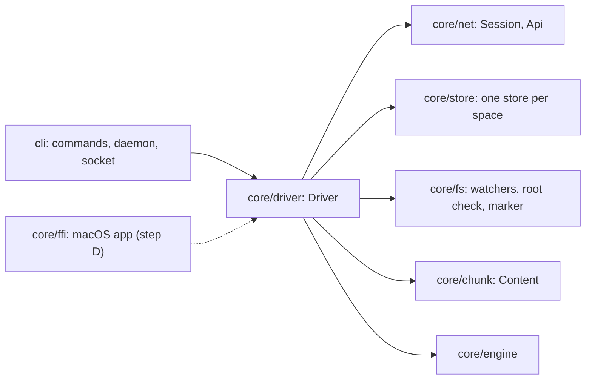

# Sync driver and Linux daemon

Status: step C (plans/macos-0.1.0.md), part 1 and the first step of part 2. The driver links folders, keeps a session with each space, observes the disk, and serves the CLI. Part 2 runs the sync engine in each folder's task. Its first step is in: a new file or folder moves between two devices in both directions, and so does an edit, a rename or a delete of either. [The loop](#the-loop) describes how. Conflicts go through the same loop and are not proved end to end yet. [What part 2 wires](#what-part-2-wires) lists the whole of part 2.

## Crates and boundaries



- **`core/driver`** (`flarebox-driver`) is everything a client runs on one device around the engine. It is a library with an async API, so the daemon calls it from its Tokio runtime and the macOS app can call it in-process through `core/ffi`, holding a runtime of its own. It never prints and never exits; it logs through `tracing`.
- **`cli`** is the `flarebox` command. Each command is a request that runs against a `Driver`: the daemon's, through its socket, when the daemon runs, or one the command opens itself when it does not. `flarebox daemon` opens the driver, starts it, serves the socket, and stops on SIGTERM or SIGINT.
- The driver depends on `core/net`, `core/store`, `core/fs`, `core/chunk` and `core/engine`.

## Profile layout

A profile is one device credential and the stores it writes. The CLI uses the XDG base directories; the app passes its own container (`Paths::under`).

| Path | Contents |
|---|---|
| `$XDG_CONFIG_HOME/flarebox/config.toml` | The device-local configuration. Edited by the person; no secrets, no state, never synced |
| `$XDG_STATE_HOME/flarebox/` (mode 0700) | Machine-bound state, never copied |
| `…/credential.json` (mode 0600) | The device credential: server, user and device ids, the user name on the device that claimed the server, device name, refresh credential. On macOS it is excluded from Time Machine (see below). Its modification time is when the refresh credential last changed |
| `…/credential.next` (mode 0600) | Only while a rotation's outcome is unknown: the refresh credential the device proposed and its deadline (RFC 0011 §2, docs/design/credential-rotation.md). Excluded from Time Machine like `credential.json` |
| `…/lock` | The profile lock (`flock`), held by the one process that writes the profile |
| `…/spaces/<space_id>/store.sqlite` | One `core/store` per linked space: R, S, L, the cursor, the link and the questions |
| `$XDG_RUNTIME_DIR/flarebox/daemon.sock` (mode 0600) | The daemon's socket; in the state directory when `XDG_RUNTIME_DIR` is unset |
| `<folder>/.flarebox/` | Inside each linked folder: the root marker `space.json`, the owner record `device.json` and, from part 2, staging, quarantine, parked entries and the local trash |

**One credential, one writer (H6 of reports/BOX-71).** Same-device changes never count as unseen on the server, and `device_seq` is strict, so two writers sharing a credential would overwrite each other silently or refuse each other's commits. The driver keeps the rule in five places:

1. `pair` and `claim` refuse to replace a credential: a profile is paired once, until `sign_out`. The macOS app and the CLI on the same machine are separate profiles and pair separately.
2. Opening a driver takes the profile lock, so a second daemon, or a command while the daemon is not answering, is refused.
3. Each store records the device and server that linked it (`Link` in `core/store`). A store whose device is not the profile's halts with a problem instead of syncing.
4. `link` refuses a folder that holds, or sits inside, the state, runtime or configuration directory or another linked folder, so the credential and the stores are never synced. Each folder task checks this again before it observes the folder or connects, because a profile can be moved into a folder after linking it. Folders are compared by path and by the identity of each folder and its ancestors, so a symbolic link, a bind mount or a macOS firmlink does not hide an overlap.
5. A folder's claim follows the physical folder whatever path reaches it. `.flarebox/device.json` names the device that linked it: another profile's `link` refuses the folder, and its task halts instead of syncing it, until the folder is unlinked there. A running folder holds an `flock` on the folder itself until its task and its observer have stopped, so two processes never sync one folder at once, and deleting or replacing `.flarebox/` (design §6.2) cannot split the lock; `link` holds it while it checks and writes the folder. Between events, at most every 2 seconds, the task checks that the folder's path still names the folder it locked, and halts if the folder was moved, replaced or removed. The check waits while an event is handled, so a long bootstrap delays it. It keeps a task from syncing a folder it no longer holds; it is not a barrier for writes, which part 2 binds to the locked folder instead.

**Backups on macOS.** Writing the credential excludes it from Time Machine with the attribute `tmutil addexclusion` sets, before any of the credential is written. `pair` and `claim` create and exclude that file before they ask the server for a credential, so a profile that cannot keep it out of backups fails without using up the code. Opening the driver sets the attribute again if a write dropped it, and refuses to open the profile if the attribute can be neither read nor set. A Mac restored from a backup therefore has its stores and linked folders but no credential. Those folders halt with "this device is signed out". `pair`, `claim` and `save_credential` (a credential from `flarebox setup`) unlink them first, removing their stores and owner records and keeping their files, so the new device links them again. The rest of the profile is backed up as before.

A profile copied whole to another machine (credential and stores together) passes these checks. RFC 0002 section 6 detects it through `device_seq` once the engine compares the counter in part 2.

## Configuration and selective sync

```toml
[sync]
include = ["Projects/"]   # when not empty, only these paths are synced
exclude = ["*.iso"]       # .fbignore patterns

[trash]
max_size_mb = 2048        # the default
```

The rules apply to every folder of the profile (H13). `Config::load` checks them with `SyncRules::lines`, and `ignore::local_rules` turns them into the matcher's device-local list (`flarebox_ignore::LocalRules`): with an include list, only the listed paths, what is under them and the folders leading to them are synced, and the exclude patterns narrow that further. A path is excluded when the built-in exclusions, this list or the folder's own `.fbignore` files exclude it, so the device can always narrow what it syncs and no `.fbignore` pattern widens it. Like `.fbignore`, the rules only save bandwidth and disk: the server still sends every name in the space, and the credential can read everything.

The matcher is the engine's (`flarebox_engine::ignore`, over `flarebox-ignore`). `ignore::matcher` builds the part every folder shares, the built-in exclusions and the device list, and `ignore::scan_rules` gives each watcher of `core/fs` the rules it scans with, which also read the folder's `.fbignore` files (design §5.10). The scans leave excluded paths out, so the observer reports none; it passes the rules of each changed `.fbignore` file on in `Observation::rules`, and its first batch follows the scan of the whole tree and lists them all.

`[trash]` caps the local trash of each folder (sync-engine.md §5.2), which holds what sync effects displaced. A running folder reclaims it when it starts and then once a day. Entries older than seven days go first, then the oldest entries while the trash holds more than `max_size_mb` megabytes. A file written after it entered the trash comes back at the root as a recovered file instead.

## The driver API

`Driver::open(paths)` takes the lock and reads the configuration, the credential and the stores. Then:

| Call | What it does |
|---|---|
| `pair(server, code, name)` | `POST /v1/pair/complete` with a code from a paired device, then writes the credential. Headless: no browser |
| `claim(server, code, user_name, device_name)` | `POST /v1/claim` with the one-time code from the server's log, for the first device of a new server; writes the credential with the user name |
| `sign_out(confirm_last_device)` | Stops the driver and revokes the device on the server, then unlinks every folder (the files stay) and deletes the credential, so the profile can pair or claim again (RFC 0009 §5). Unless `confirm_last_device` is set, it keeps the credential and folders and syncs again if it was, and returns `LastDevice` for any HTTP 409 or `NotRevoked` when the server cannot be reached or does not answer. With it, a failed revocation, a 409 included, is logged and the sign-out finishes on the device. A folder that cannot be unlinked stops it with that error and leaves the device signed in, so signing out again finishes it |
| `link(folder, space)` | Resolves the space by id, then by unique name (`GET /v1/spaces`); checks the folder (exists, no overlap with the profile or another linked folder, a no-replace rename (design §5.2), no other process syncing it, no record of another device, no marker of another space); writes the root marker if missing and the owner record; creates the store with its `Link`. Starts the folder if the driver runs |
| `unlink(folder)` | Stops the folder, removes the folder's owner record and then deletes its store. The files and the rest of the folder's `.flarebox/` stay, because the local trash may hold displaced files. The folder stays listed until both are gone, so a stop, unlink or sign-out that comes later, also after this call was cancelled, finds it and finishes it. No task starts for the folder until the unlink finishes or fails. If this call is cancelled first, the folder shows as halted until another unlink or a sign-out finishes it. If either removal fails, the folder stays linked and halted with the error |
| `status()` | The account and, per folder, state, cursor, head, remote node count, local entry count, unanswered questions and the current problem |
| `questions()`, `answer(id, answer)` | Lists unanswered questions from the stores and records an answer, refusing one the question does not offer |
| `restore(space, request)`, `restores(space)` | Records a restore a person asked for, from the trash or of an earlier version, in the folder's store and returns its ID; lists the restores of a space, those that ended with their outcome and those that wait as pending. A pending restore whose node is a problem says so (`waits_for: node_problem`), because it is sent only after the problem is cleared. A pending restore without a reason waits for the folder to sync, and that can wait for another node's problem, so a surface shows the folder's problems next to it and does not promise that it goes through by itself. Recording refuses an ID that is not a UUIDv7 and a space no folder links. A running folder's task takes a request when it is recorded, and a stopped one when it next opens the folder; the engine then sends it in its next commit (sync-engine.md §6.3) |
| `start()`, `stop()` | Starts one task per folder on the current runtime; stops them and waits until every task has ended, also those another caller stopped first |
| `watch()` | A `tokio::sync::watch` receiver marked changed whenever `status()`, `questions()` or `restores()` may have changed: pairing, claiming, linking, unlinking (a failed one included), answering, recording a restore, starting, stopping, signing out and every status update of a folder task. A mark may come without a visible difference |

`pair`, `claim`, `sign_out`, `link` and `unlink` run one at a time, each to its end, network requests included. A sign-out that starts while a claim or a link waits for the server waits for it and then undoes it, a `start` during a sign-out is undone with it, and a pair that starts during a claim fails as already paired without contacting the server, so another operation never loses a credential the server issued. If storing that credential fails, `pair` or `claim` returns the error.

How `core/ffi`'s `Core` trait maps onto it in step D:

| `Core` | Driver |
|---|---|
| `state` | `status` and `questions`, read again after each `watch` mark, so the app gets `SessionEvent`s instead of polling. `Account.user_name` is set on the device that claimed the server |
| `start`, `stop`, `pair`, `claim`, `sign_out`, `link_folder`, `unlink_folder`, `answer` | the calls of the same name (`unlink_folder` takes a space id; the app finds the path in the status) |
| `connect`, `start_pairing`, `spaces`, `create_space` | not in the driver yet; each is one `core/net` `Api` call |
| `pause`, `resume`, `dismiss_notice`, `devices` | not in the driver yet; notices and the pause need state the engine produces, and no server lists devices |

## A folder's task

1. **Root check** (design §6.2): the folder exists, is readable, is on the device recorded at link time and holds a marker for its space. A folder that fails is halted with the reason and checked again every 30 seconds; nothing else runs for it meanwhile.
2. **Placement and claim**: the folder must not overlap the profile's directories or its other folders (H6 rule 4), no other process may hold its lock, and its owner record must name this device; a folder linked before the record existed gets one. Any failure halts the folder before it is observed or connected.
3. **Observation** runs on a thread of its own (below) and reports how many entries the folder holds. The task waits for the thread to end before it stops, so the folder's lock is free once `stop` returns. The last holder of this lock, and of the profile lock, unlocks it and does not only close its descriptor. A child process holds a copy of the descriptor from its fork to its exec, and a close alone would leave the lock with that copy.
4. **Session**: `core/net`'s `Session`, which reconnects with backoff on its own. It uses the profile's one `Auth`, which every folder task, `link` and the sign-out revocation share, so a rotation of the refresh credential reaches all of them. Events are handled in order:

| Event | What the task does |
|---|---|
| `Connected(Welcome)` | With a cursor of another history: halt; that is a recovery (§6.4). Otherwise the engine compares the server's count of this device's commits with the store (§2.8), and a commit that was in flight when the task started is sent again unchanged if the count allows it. A store that never synced (no cursor, no commit in flight and none acknowledged) first takes the server's count, at its first `Welcome` only: the device synced the space with a store that is gone, as after `unlink` and a second `link`, and it continues `device_seq` from the value the server reported (design §6.4, step 2). With no cursor in the store, or a cursor that records a server behind it (below): bootstrap. With any other cursor: subscribe from `last_seq`, once per session (the session resumes by itself after a reconnect) |
| `Changes` | Applied to R in one store transaction, in seq order, skipping records the store holds: each `NodeState` is a post-image, `NodePurged` removes the node, `SpaceUpdated` and `MemberUpdated` change nothing yet. A gap resubscribes from the cursor. A change of an unknown kind halts before its record (spec v0 §9.1: fail closed) |
| `CaughtUp` | The server's head is known. The state is `up_to_date` once R holds that head, the folder was scanned and nothing is left to move |
| `ResyncRequired` | `LOG_TRUNCATED` and `AHEAD_OF_SERVER`: bootstrap again. For `AHEAD_OF_SERVER` the cursor first records that the server is behind it, in the store, until a bootstrap replaces R. That bootstrap makes the engine forget the S entries of what the server may have lost (`Trees::forget_lost`, sync-engine §4.4), also when the server's head caught up before the listing or the task restarted in between. `HISTORY_CHANGED` and unknown reasons: halt |
| `Disconnected` | State `offline` with the reason; the session retries |
| `Stopped` | Halt with the reason (credentials refused, device revoked, space not found or forbidden, unsupported version) |
| `Committed` | The result of this device's commit, which the commit call also returns. Whichever arrives first is applied to R and kept by the engine, and the other changes nothing |

**Bootstrap** (spec v0 §7.5, design §4.4) pages through `ListTree` 5,000 nodes at a time into a tree in memory and subscribes from the first page's `head_seq`. When the cursor records that the server is behind it, the bootstrap also pages through `ListTrash` after the last tree page, and a trashed node replaces a listed one only when it is newer (RFC 0002 §6). The log is replayed onto that tree, where a node state replaces a listed node only when it is newer. The tree replaces R in one transaction once the replay has reached the highest `head_seq` of any page and the head of a `CaughtUp`. Until then the store keeps the R it had, so R is a valid tree at every commit of the store. A folder that was never synced also waits for its first scan, and halts when the folder and the space hold an entry of the same `name_key` directly under their roots, because matching the two (design §2.8 and §6.4) is not built. Two trees that share no such name sync as they are: the space's nodes are downloaded and the folder's entries are committed as new. This rule stands until the engine holds a first link's unmatched entries for the user (GUN-324).

### The loop

`Folder` (in `folder.rs`) is the folder while it syncs. It owns the engine, the store and the disk and is their only writer. Each of its methods takes one input: a session event, an observation batch, or the result of work it asked for. The method changes the engine, ends with `Engine::checkpoint` in the same store transaction, and returns the work to start. No transaction contains an await. The task around it runs one `select!` that hands each input to the folder and runs the returned work as futures: the tree listing, the staging of one effect, the upload of one commit's chunks, the commit call and a wait.

`Engine::checkpoint` settles the trees and writes the L row and the S row of every node that was dirty, the engine state and the ID generator. A store loaded after any step gives the engine the task holds.

After every input the folder decides what runs next, in the order of the engine's reference loop (`core/sim/tests/engine_sync.rs`):

1. Nothing is planned before the first scan, or while R does not follow the log. Nothing is planned either after an effect that wrote, moved or removed a `.fbignore` file, or that moved a folder, until a batch that answers the reset the effect requested has passed its rules (`Disk::awaits_rules`, design §5.10). The trees hold each rules file by the path of its folder, so until that batch a rules file that was just downloaded excludes nothing yet, and the rules file of a moved folder does not apply at the new path. Every effect asks the observer to reset its paths, and each request is counted. The observer's thread takes the pending resets with the count, scans right after a reset without waiting for a change, and sends the count with the first batch after which every reset it was given is settled (`Batch::answered`), also when that batch found nothing. A batch that only began after the effect does not end the wait: the thread may have taken its resets before the effect ended, and the batch may have scanned other paths.
2. An effect comes first, one at a time. Its download is staged outside the store, and `Disk::apply` runs in the step that takes the staged file. A download that fails for now stages the same effect again after a wait. The engine plans an effect for L as it is, and a batch can change L before the effect applies. `Disk::apply` touches the folder only when L still takes the effect's outcome (`EffectRecord::applies`, the checks the planner makes before it plans an effect): no other node holds the name, every folder on the way is still a folder in L and not inside the node, a folder the effect removes holds no entry in L, and L does not hold a node the effect creates. `Effects::done` refuses such an outcome too. Otherwise it writes the marker and nothing else, fails the effect and unblocks it, and the engine plans it again once a batch has changed L. A start that recovers an effect as done applies the same rule before it records the outcome, and takes the outcome only when L confirms that the entry recovery found is the effect's (`Effects::confirms`): no other node holds it, and the node a removal removes is still where the effect removes it. Otherwise the effect fails as if it had met that entry. An effect the disk refuses blocks its node, and the engine does not plan the same effect for it again (`Effects::failed`). The folder unblocks every blocked node after a wait that starts near a second and doubles with each failure of a node in a row, up to ten minutes, and once at each start, so a cause the observer never reports, such as a name taken for a moment, does not keep a node from syncing.
3. No effect is planned while a commit is in flight, unless committing has stopped, and no commit is built while an effect is in flight.
4. A commit is built when no effect is planned and R holds the server's head. Its new content is uploaded from the files L names, then the commit is sent with the upload's receipts. A file that changed during the upload abandons the commit, which the server holds nothing of, and the observer reads the file again.
5. A refused commit goes to the engine (`Commits::failed`), which says whether the same commit is sent again, its changes are planned again, or committing stops. A refusal that needs recovery halts the folder. `AHEAD_OF_SERVER` (`Failure::Resync`) bootstraps again, as the `ResyncRequired` row describes. A commit too large for one message (`CallError::TooLarge`) is split as the server's `LIMIT_EXCEEDED` would split it. A node the server refused an op for stays out of commits until the first whole scan of the next start, which clears it (`Commits::clear_problem`, sync-engine §2.7).

**Refusals (H1).** `policy::after_refusal` decides what follows a refused call, and `ListTree` goes through it today:

| Code | Disposition |
|---|---|
| `RETRY_LATER` | retry after `retry_after_ms`, or after backoff when it is 0 (the session already retries it a few times) |
| `QUOTA_EXCEEDED` | retry after `retry_after_ms` only when it is above 0; halt otherwise |
| `INTERNAL` | retry after backoff |
| any other known code | halt and report |
| `UNSPECIFIED` or a code this build does not know | halt and report with the raw number; never resent |

`core/net` is getting the same rule (BOX-52). When it lands, the driver keeps `policy` only for what `core/net` does not decide.

## Observation

`FsObserver` implements the `Observer` trait over `core/fs`'s `NativeWatcher` (inotify on Linux, FSEvents on macOS), falling back to a full rescan every 30 seconds when the platform watcher cannot cover the tree. Each batch is an `Observation`, the input the engine's `Observed(changes, root_check)` needs (design §1, §9):

- `Observed::Created`, `Modified`, `Renamed` and `Removed`, with paths relative to the root and the file identity of every entry. Each created, modified or renamed file also says whether another path links it. Hard links sync as independent files (design §5.6), so the mapper never takes the node of another path for such a file;
- the `Content` of every created or modified file, chunked with `core/chunk`'s V0 profile. The file is opened one folder at a time without following links, must still be the entry the scan saw, and must not change while it is read; otherwise the change carries no content and the path is listed in `busy` (design §5.8). The observer keeps such a file and reads it again after 250 ms, doubling the wait after each failure up to 30 seconds, until a read succeeds, which it reports as a `Modified` with the content, or a later change to the path replaces it. The watcher's snapshot has already moved past the change, so nothing else would report the file again;
- renames across the exclusion boundary (design §5.10), the one exception to the rule below. A rename into an excluded path is reported, without reading the file, so the engine can freeze the node at its synced position instead of seeing it disappear. A rename out of one is followed by the content of the file, or by a `Created` with content for every included entry under the folder, because nothing was observed there while it was excluded;
- the root check made after the batch's scans, and the folders the scans could not read.

Changes whose path the matcher excludes are dropped. The observer starts from a snapshot rebuilt from L: every placed node at its path, each file with the size, modification time and executable bit of its content. Files whose content L never received are left out, so the observer reports them again. The first scan therefore reports what changed while nothing observed the folder, removals included, and reads only the files that differ. A file whose identity, size and modification time match L is trusted across a restart. A start that recovers an effect asks the observer to reset that effect's paths to L, so a file placed just before a crash is read once.

## The daemon

`flarebox daemon` runs in the foreground: it opens the driver (taking the profile lock), binds the socket, starts every folder, and serves requests until SIGTERM or SIGINT. Then it stops accepting requests, removes the socket, stops the folders (closing their sessions) and exits 0. `cli/systemd/flarebox.service` runs it as a systemd user service (`Type=exec`, `Restart=on-failure`).

**Socket.** One JSON line each way per connection: a request tagged `request` (`status`, `pair`, `link`, `unlink`, `questions`, `answer`) and a response tagged `response`. The socket is 0600 in a 0700 directory, and the daemon also refuses a peer whose uid is not its own.

**Logs** go to stderr, as key-value text or, with `--log-format json`, one JSON object per line; `FLAREBOX_LOG` sets the filter. They carry space ids, paths, seqs and counts. They never carry the refresh credential, an access token or a pairing code: `Credential`, like `core/net`'s `Credentials`, leaves the secret out of its `Debug` output, and requests are never logged. The integration test checks the daemon's log for both secrets.

## What part 2 wires

Part 2 puts the engine between the inputs and outputs part 1 already produces and consumes, per folder. Items 1 to 5 are wired as [The loop](#the-loop) describes, and item 8 passes for new files, edits, renames and deletes (`core/driver/tests/sync.rs`). Still open in them: recovery (§6.4) in item 2, where the task halts, and the `.fbignore` rules in item 3.

1. **Engine state.** Build the engine from the store (R with the cursor, S, L with identities, the commit in flight, the ID generator, the accepted device counter and the effect counter) and run its `handle(now_ms, input)` loop in the folder task. After each input, write the engine's row changes in one store transaction, then execute its outputs (design §1).
2. **Server log.** Replace `folder::apply_changes` and `folder::replace_tree` with the engine inputs `Changes`, `TreePage`, `CaughtUp` and `ResyncRequired`, and the engine's `Resume` and `ListTree` outputs. `Connected(Welcome)` goes to the engine, which compares `history_id` and `device_seq` with the store (design §2.8, RFC 0002 §2); the halts on another history and `HISTORY_CHANGED` become recovery (§6.4).
3. **Observations.** Feed each `Observation` to the engine as `Observed`, with its root check. Start the observer from a snapshot rebuilt from L instead of an empty one, leaving out files whose content the engine never received (their reads were still pending when the last observer stopped) so the new observer reports them again, after recovering the effect in flight and checking the marker's effect counter against the store (§2.8, §5.3). `Folder::open` gives the trees the device list (`Trees::set_local_rules` with `ignore::local_rules`) once the engine is loaded. `Disk::observed` gives them the `Observation::rules` of each batch before its changes (`Engine::rules`), also when it drops the changes. After a restore the engine plans nothing until the first batch has passed its rules. `Engine::observe` takes a `Renamed` whose target the trees ignore (`Trees::ignores`) as a move into an excluded path: the node takes that name when its folder is a node of L, and is recorded with `Trees::ignore_local` otherwise. Those records are made before any change of the batch applies. When an observation places a recorded folder again, its children are recorded in its place until an observation places them too, because the user may have moved them elsewhere while the folder was out. A folder whose removal the batch reports keeps such a node in L, and so do the folders on the way to it, which are recorded too, so that the server keeps them (sync-engine §5.10). A new folder created later at the name of such a recorded folder, while R holds that folder live, is that folder placed again: it keeps the folder's node, and what is recorded under it stays recorded, instead of being removed from L with the folder it displaced. Once R no longer holds the folder live, as after another device deleted it, the new folder is a new node, so it does not revive the deleted one. The store keeps what `ignore_local` recorded (sync-engine §2.8). The snapshot rebuilt from L leaves a recorded node out with what L holds under it, and so do the resets of a rescan: the disk does not hold the node there, and a scan cannot always find it in the ignored folder again, because it does not look below an ignored name for a file whose path another file took. A scan therefore reports an entry it finds at a recorded node's path as created. An entry with the node's identity is the node placed again. Any other entry has taken the name, whether it is a file or a folder, new or moved there, except the new folder above. The recorded node then leaves L with what L holds under it, and each stays recorded with its identity (`Trees::displace_local`), so it stays excluded and the server keeps it, with its content. The server still holds the recorded node at that name, so it gives the arriving entry a conflict name, which the disk then takes. A displaced node is placed again when an entry with its identity arrives at a synced path, and its record ends when R no longer holds it live. The scan that first finds a move into an ignored folder also looks for every entry a removed folder held, so it reports that `Renamed` even when the folder is gone. After an effect that can have changed which rules apply where, nothing is planned until a batch that answers the effect's reset has passed its rules (rule 1 of [The loop](#the-loop)).
4. **Effects.** Execute `ApplyEffect` through `core/fs`'s `Space::apply` with the quarantine protocol, writing the marker counter first, and report `EffectDone` or `EffectFailed`. The executor is bound to the descriptor of the locked folder and resolves every path relative to it (`openat`), and observations are consumed under the same guard, because the path check of H6 rule 5 is not a barrier for writes. File contents come from `GetDownloadTargets` and `Transfer::download` into staging, through the chunk cache in the store.
5. **Commits.** Execute `SendCommit`: `PrepareUpload` and `Transfer::upload` for the chunks it references, then `Session::commit`. Report `CommitResult` or `CommitFailed` with the refusal disposition of `policy`.
6. **Questions and problems.** Store each `AskUser` as a question row whose body is a `Question`; give recorded answers to the engine as `UserDecision` and delete the rows it has consumed. Show `Problem` outputs in the folder's status. The mass-delete guard's question is wired this way: the step that holds deletions stores its row, `Driver::answer` wakes the folder, and the folder hands the answer to `Commits::decide`. The driver counts nothing itself.
7. **App surface.** Extend what `status()` and `questions()` report for the macOS app (step D): per-folder progress (files and bytes left to upload and to download), typed problems instead of strings, and on each question the kind and detail of every item, the mass-delete limit that was crossed and the cause of a recovery.
8. **Pass condition:** two Linux profiles linked to one space sync files both ways, as an integration test against the Worker under `wrangler dev`.

## Spec notes

These belong to the spec owner (RFC 0006, #44); the driver follows them already:

- H1: a client treats an unknown `Error.Code` as a refusal that halts the operation, and retries `QUOTA_EXCEEDED` only when `retry_after_ms` is above 0.
- H6: two processes that write must never share a `device_id`; a second client on the same machine pairs on its own.

And one the driver needs:

- No response carries the user's name to a paired device: `DeviceCredentials` has only ids, and no endpoint reads the user. Adding `user_name` to `DeviceCredentials` (or a read of the signed-in user) would let `Account.user_name` be set after `pair` too.
