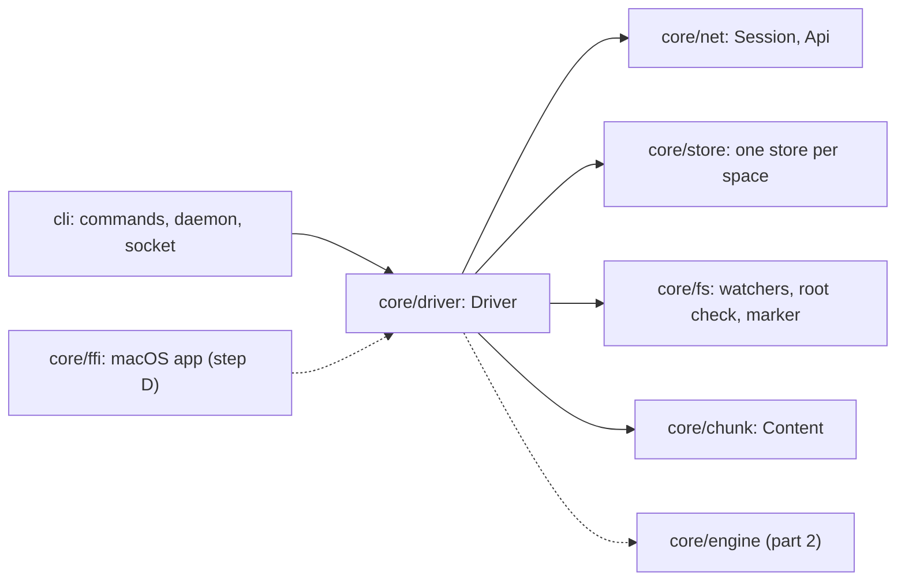

# Sync driver and Linux daemon

Status: part 1 of step C (plans/macos-0.1.0.md). The driver links folders, keeps a session with each space and applies the server's log to the store's remote tree, observes the disk, and serves the CLI. It does not run the sync engine yet: nothing is uploaded and nothing is written to a linked folder except its root marker. Part 2 wires the engine once its commit layer (#28) is merged; [What part 2 wires](#what-part-2-wires) lists exactly what that adds.

## Crates and boundaries



- **`core/driver`** (`flarebox-driver`) is everything a client runs on one device around the engine. It is a library with an async API, so the daemon calls it from its Tokio runtime and the macOS app can call it in-process through `core/ffi`, holding a runtime of its own. It never prints and never exits; it logs through `tracing`.
- **`cli`** is the `flarebox` command. Each command is a request that runs against a `Driver`: the daemon's, through its socket, when the daemon runs, or one the command opens itself when it does not. `flarebox daemon` opens the driver, starts it, serves the socket, and stops on SIGTERM or SIGINT.
- The driver depends on `core/net`, `core/store`, `core/fs` and `core/chunk`, and not on `core/engine`. Part 2 adds that dependency.

## Profile layout

A profile is one device credential and the stores it writes. The CLI uses the XDG base directories; the app passes its own container (`Paths::under`).

| Path | Contents |
|---|---|
| `$XDG_CONFIG_HOME/flarebox/config.toml` | The device-local configuration. Edited by the person; no secrets, no state, never synced |
| `$XDG_STATE_HOME/flarebox/` (mode 0700) | Machine-bound state, never copied |
| `…/credential.json` (mode 0600) | The device credential: server, user and device ids, the user name on the device that claimed the server, device name, refresh credential |
| `…/lock` | The profile lock (`flock`), held by the one process that writes the profile |
| `…/spaces/<space_id>/store.sqlite` | One `core/store` per linked space: R, S, L, the cursor, the link and the questions |
| `$XDG_RUNTIME_DIR/flarebox/daemon.sock` (mode 0600) | The daemon's socket; in the state directory when `XDG_RUNTIME_DIR` is unset |
| `<folder>/.flarebox/` | Inside each linked folder: the root marker `space.json`, the owner record `device.json` and, from part 2, staging, quarantine, parked entries and the local trash |

**One credential, one writer (H6 of reports/BOX-71).** Same-device changes never count as unseen on the server, and `device_seq` is strict, so two writers sharing a credential would overwrite each other silently or refuse each other's commits. The driver keeps the rule in five places:

1. `pair` and `claim` refuse to replace a credential: a profile is paired once, until `sign_out`. The macOS app and the CLI on the same machine are separate profiles and pair separately.
2. Opening a driver takes the profile lock, so a second daemon, or a command while the daemon is not answering, is refused.
3. Each store records the device and server that linked it (`Link` in `core/store`). A store whose device is not the profile's halts with a problem instead of syncing.
4. `link` refuses a folder that holds, or sits inside, the state, runtime or configuration directory or another linked folder, so the credential and the stores are never synced. Each folder task checks this again before it observes the folder or connects, because a profile can be moved into a folder after linking it. Folders are compared by path and by the identity of each folder and its ancestors, so a symbolic link, a bind mount or a macOS firmlink does not hide an overlap.
5. A folder's claim follows the physical folder whatever path reaches it. `.flarebox/device.json` names the device that linked it: another profile's `link` refuses the folder, and its task halts instead of syncing it, until the folder is unlinked there. A running folder holds an `flock` on the folder itself until its task and its observer have stopped, so two processes never sync one folder at once, and deleting or replacing `.flarebox/` (design §6.2) cannot split the lock; `link` holds it while it checks and writes the folder. Between events, at most every 2 seconds, the task checks that the folder's path still names the folder it locked, and halts if the folder was moved, replaced or removed. The check waits while an event is handled, so a long bootstrap delays it. It keeps a task from syncing a folder it no longer holds; it is not a barrier for writes, which part 2 binds to the locked folder instead.

A profile copied whole to another machine (credential and stores together) passes these checks. RFC 0002 section 6 detects it through `device_seq` once the engine compares the counter in part 2.

## Configuration and selective sync

```toml
[sync]
include = ["Projects/"]   # when not empty, only these paths are synced
exclude = ["*.iso"]       # .fbignore patterns
```

The rules apply to every folder of the profile (H13). `SyncRules::lines` turns them into the lines of one root `.fbignore` file: `/*`, then negations that re-include each listed path and the folders leading to it (a path cannot be re-included once a parent is excluded), then the exclude patterns. That file goes into the matcher input, `ignore::IgnoreInput`, as a `RuleSource::Device` file after the folder's own `.fbignore` files, so the device can always narrow what it syncs. Like `.fbignore`, the rules only save bandwidth and disk: the server still sends every name in the space, and the credential can read everything.

The matcher is GUN-270's. Until it lands, `ignore::matcher` returns `Unfiltered`, which excludes nothing, and the driver logs a warning when the configuration has rules. Replacing that function body is the whole integration; the observer already filters every change through `Matcher::is_excluded`.

## The driver API

`Driver::open(paths)` takes the lock and reads the configuration, the credential and the stores. Then:

| Call | What it does |
|---|---|
| `pair(server, code, name)` | `POST /v1/pair/complete` with a code from a paired device, then writes the credential. Headless: no browser |
| `claim(server, code, user_name, device_name)` | `POST /v1/claim` with the one-time code from the server's log, for the first device of a new server; writes the credential with the user name |
| `sign_out(confirm_last_device)` | Stops the driver and revokes the device on the server, then unlinks every folder (the files stay) and deletes the credential, so the profile can pair or claim again (RFC 0009 §5). Unless `confirm_last_device` is set, it keeps the credential and folders and syncs again if it was, and returns `LastDevice` for any HTTP 409 or `NotRevoked` when the server cannot be reached or does not answer. With it, a failed revocation, a 409 included, is logged and the sign-out finishes on the device. A folder that cannot be unlinked stops it with that error and leaves the device signed in, so signing out again finishes it |
| `link(folder, space)` | Resolves the space by id, then by unique name (`GET /v1/spaces`); checks the folder (exists, no overlap with the profile or another linked folder, a no-replace rename (design §5.2), no other process syncing it, no record of another device, no marker of another space); writes the root marker if missing and the owner record; creates the store with its `Link`. Starts the folder if the driver runs |
| `unlink(folder)` | Stops the folder, removes the folder's owner record and then deletes its store. The files and the rest of the folder's `.flarebox/` stay, because the local trash may hold displaced files. The folder stays listed until both are gone, so a stop, unlink or sign-out that comes later, also after this call was cancelled, finds it and finishes it. No task starts for the folder until the unlink finishes or fails. If this call is cancelled first, the folder shows as halted until another unlink or a sign-out finishes it. If either removal fails, the folder stays linked and halted with the error |
| `status()` | The account and, per folder, state, cursor, head, remote node count, local entry count, unanswered questions and the current problem |
| `questions()`, `answer(id, answer)` | Lists unanswered questions from the stores and records an answer, refusing one the question does not offer |
| `restore(space, request)`, `restores(space)` | Records a restore a person asked for, from the trash or of an earlier version, in the folder's store and returns its ID; lists the restores of a space, those that ended with their outcome and those that wait as pending. A pending restore whose node is a problem says so (`waits_for: node_problem`), because it is sent only after the problem is cleared. Recording refuses an ID that is not a UUIDv7 and a space no folder links. Until the folder task takes requests from the store (the step after it runs the engine's commits), a request stays pending (sync-engine.md §6.3) |
| `start()`, `stop()` | Starts one task per folder on the current runtime; stops them and waits until every task has ended, also those another caller stopped first |
| `watch()` | A `tokio::sync::watch` receiver marked changed whenever `status()`, `questions()` or `restores()` may have changed: pairing, claiming, linking, unlinking (a failed one included), answering, recording a restore, starting, stopping, signing out and every status update of a folder task. A mark may come without a visible difference |

`pair`, `claim`, `sign_out`, `link` and `unlink` run one at a time, each to its end, network requests included. A sign-out that starts while a claim or a link waits for the server waits for it and then undoes it, a `start` during a sign-out is undone with it, and a pair that starts during a claim fails as already paired without contacting the server, so another operation never loses a credential the server issued. If storing that credential fails, `pair` or `claim` returns the error.

How `core/ffi`'s `Core` trait maps onto it in step D:

| `Core` | Driver |
|---|---|
| `state` | `status` and `questions`, read again after each `watch` mark, so the app gets `SessionEvent`s instead of polling. `Account.user_name` is set on the device that claimed the server |
| `start`, `stop`, `pair`, `claim`, `sign_out`, `link_folder`, `unlink_folder`, `answer` | the calls of the same name (`unlink_folder` takes a space id; the app finds the path in the status) |
| `connect`, `start_pairing`, `spaces`, `create_space` | not in the driver yet; each is one `core/net` `Api` call |
| `pause`, `resume`, `dismiss_notice`, `devices` | not in the driver yet; notices and the pause need state the engine produces, and no server lists devices |

## A folder's task

1. **Root check** (design §6.2): the folder exists, is readable, is on the device recorded at link time and holds a marker for its space. A folder that fails is halted with the reason and checked again every 30 seconds; nothing else runs for it meanwhile.
2. **Placement and claim**: the folder must not overlap the profile's directories or its other folders (H6 rule 4), no other process may hold its lock, and its owner record must name this device; a folder linked before the record existed gets one. Any failure halts the folder before it is observed or connected.
3. **Observation** runs on a thread of its own (below) and reports how many entries the folder holds. The task waits for the thread to end before it stops, so the folder's lock is free once `stop` returns.
4. **Session**: `core/net`'s `Session` with one `Auth` built from the credential, which reconnects with backoff on its own. Events are handled in order:

| Event | Part 1 |
|---|---|
| `Connected(Welcome)` | With no cursor in the store: bootstrap (below), then subscribe from the first page's `head_seq`. With a cursor of the same history: subscribe from `last_seq`, once per session (the session resumes by itself after a reconnect). With a cursor of another history: halt; that is a recovery (§6.4) |
| `Changes` | Applied to R in one store transaction, in seq order, skipping records the store holds: each `NodeState` is a post-image, `NodePurged` removes the node, `SpaceUpdated` and `MemberUpdated` change nothing yet. A gap resubscribes from the cursor. A change of an unknown kind halts before its record (spec v0 §9.1: fail closed) |
| `CaughtUp` | State `up_to_date` |
| `ResyncRequired` | `LOG_TRUNCATED`: bootstrap again. `HISTORY_CHANGED`, `AHEAD_OF_SERVER` and unknown reasons: halt |
| `Disconnected` | State `offline` with the reason; the session retries |
| `Stopped` | Halt with the reason (credentials refused, device revoked, space not found or forbidden, unsupported version) |
| `Committed` | Logged; part 1 sends no commits |

**Bootstrap** (spec v0 §7.5) pages through `ListTree` 5,000 nodes at a time and replaces R in one transaction, with the cursor at the first page's `head_seq`. Replaying the log from there fixes up nodes that changed between pages.

**Refusals (H1).** `policy::after_refusal` decides what follows a refused call, and `ListTree` goes through it today:

| Code | Disposition |
|---|---|
| `RETRY_LATER` | retry after `retry_after_ms`, or after backoff when it is 0 (the session already retries it a few times) |
| `QUOTA_EXCEEDED` | retry after `retry_after_ms` only when it is above 0; halt otherwise |
| `INTERNAL` | retry after backoff |
| any other known code | halt and report |
| `UNSPECIFIED` or a code this build does not know | halt and report with the raw number; never resent |

`core/net` is getting the same rule (BOX-52). When it lands, the driver keeps `policy` only for what `core/net` does not decide.

## Observation

`FsObserver` implements the `Observer` trait over `core/fs`'s `NativeWatcher` (inotify on Linux, FSEvents on macOS), falling back to a full rescan every 30 seconds when the platform watcher cannot cover the tree. Each batch is an `Observation`, the input the engine's `Observed(changes, root_check)` needs (design §1, §9):

- `Observed::Created`, `Modified`, `Renamed` and `Removed`, with paths relative to the root and the file identity of every entry;
- the `Content` of every created or modified file, chunked with `core/chunk`'s V0 profile. The file is opened one folder at a time without following links, must still be the entry the scan saw, and must not change while it is read; otherwise the change carries no content and the path is listed in `busy` (design §5.8). The observer keeps such a file and reads it again after 250 ms, doubling the wait after each failure up to 30 seconds, until a read succeeds, which it reports as a `Modified` with the content, or a later change to the path replaces it. The watcher's snapshot has already moved past the change, so nothing else would report the file again;
- renames across the exclusion boundary (design §5.10), the one exception to the rule below. A rename into an excluded path is reported, without reading the file, so the engine can freeze the node at its synced position instead of seeing it disappear. A rename out of one is followed by the content of the file, or by a `Created` with content for every included entry under the folder, because nothing was observed there while it was excluded;
- the root check made after the batch's scans, and the folders the scans could not read.

Changes whose path the matcher excludes are dropped. In part 1 the driver starts each observer from an empty snapshot, so its first batch lists the whole folder, and it only counts the entries.

## The daemon

`flarebox daemon` runs in the foreground: it opens the driver (taking the profile lock), binds the socket, starts every folder, and serves requests until SIGTERM or SIGINT. Then it stops accepting requests, removes the socket, stops the folders (closing their sessions) and exits 0. `cli/systemd/flarebox.service` runs it as a systemd user service (`Type=exec`, `Restart=on-failure`).

**Socket.** One JSON line each way per connection: a request tagged `request` (`status`, `pair`, `link`, `unlink`, `questions`, `answer`) and a response tagged `response`. The socket is 0600 in a 0700 directory, and the daemon also refuses a peer whose uid is not its own.

**Logs** go to stderr, as key-value text or, with `--log-format json`, one JSON object per line; `FLAREBOX_LOG` sets the filter. They carry space ids, paths, seqs and counts. They never carry the refresh credential, an access token or a pairing code: `Credential`, like `core/net`'s `Credentials`, leaves the secret out of its `Debug` output, and requests are never logged. The integration test checks the daemon's log for both secrets.

## What part 2 wires

Once #28 is merged, part 2 puts the engine between the inputs and outputs part 1 already produces and consumes, per folder:

1. **Engine state.** Build the engine from the store (R with the cursor, S, L with identities, the commit in flight, the ID generator, the accepted device counter and the effect counter) and run its `handle(now_ms, input)` loop in the folder task. After each input, write the engine's row changes in one store transaction, then execute its outputs (design §1).
2. **Server log.** Replace `folder::apply_changes` and `folder::replace_tree` with the engine inputs `Changes`, `TreePage`, `CaughtUp` and `ResyncRequired`, and the engine's `Resume` and `ListTree` outputs. `Connected(Welcome)` goes to the engine, which compares `history_id` and `device_seq` with the store (design §2.8, RFC 0002 §2); the halts on another history, `HISTORY_CHANGED` and `AHEAD_OF_SERVER` become recovery (§6.4).
3. **Observations.** Feed each `Observation` to the engine as `Observed`, with its root check. Start the observer from a snapshot rebuilt from L instead of an empty one, leaving out files whose content the engine never received (their reads were still pending when the last observer stopped) so the new observer reports them again, after recovering the effect in flight and checking the marker's effect counter against the store (§2.8, §5.3). Read `.fbignore` files into `IgnoreInput` with the device rules.
4. **Effects.** Execute `ApplyEffect` through `core/fs`'s `Space::apply` with the quarantine protocol, writing the marker counter first, and report `EffectDone` or `EffectFailed`. The executor is bound to the descriptor of the locked folder and resolves every path relative to it (`openat`), and observations are consumed under the same guard, because the path check of H6 rule 5 is not a barrier for writes. File contents come from `GetDownloadTargets` and `Transfer::download` into staging, through the chunk cache in the store.
5. **Commits.** Execute `SendCommit`: `PrepareUpload` and `Transfer::upload` for the chunks it references, then `Session::commit`. Report `CommitResult` or `CommitFailed` with the refusal disposition of `policy`.
6. **Questions and problems.** Store each `AskUser` as a question row whose body is a `Question`; give recorded answers to the engine as `UserDecision` and delete the rows it has consumed. Show `Problem` outputs in the folder's status.
7. **App surface.** Extend what `status()` and `questions()` report for the macOS app (step D): per-folder progress (files and bytes left to upload and to download), typed problems instead of strings, and on each question the kind and detail of every item, the mass-delete limit that was crossed and the cause of a recovery.
8. **Pass condition:** two Linux profiles linked to one space sync files both ways, as an integration test against the Worker under `wrangler dev`.

## Spec notes

These belong to the spec owner (RFC 0006, #44); the driver follows them already:

- H1: a client treats an unknown `Error.Code` as a refusal that halts the operation, and retries `QUOTA_EXCEEDED` only when `retry_after_ms` is above 0.
- H6: two processes that write must never share a `device_id`; a second client on the same machine pairs on its own.

And one the driver needs:

- No response carries the user's name to a paired device: `DeviceCredentials` has only ids, and no endpoint reads the user. Adding `user_name` to `DeviceCredentials` (or a read of the signed-in user) would let `Account.user_name` be set after `pair` too.
