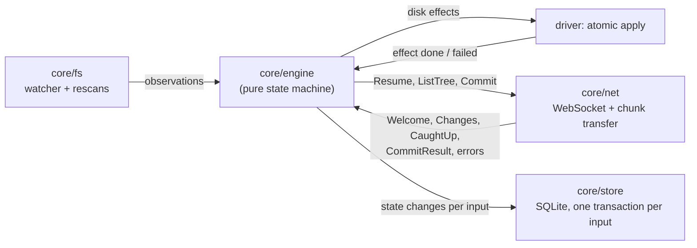

# Sync engine design

Status: draft for review. Scope: `core/engine` (the sync state machine), `core/sim` (the simulation harness and reference server) and the parts of `core/chunk` the engine relies on. Protocol references such as "spec §6.2 R3" point to the v0 protocol draft that `spec/proto` implements.

## Summary

- The engine keeps three trees keyed by `node_id`: the remote tree **R** (the server state this device has applied), the local tree **L** (the disk as last observed) and the synced tree **S** (the per-node merge base). A planner derives disk changes and commit ops from their differences, as in Dropbox's Nucleus ([Jayakar 2020](#ref-nucleus), [Goldberg 2020](#ref-trinity)). The only persisted intent is the one commit in flight.
- The engine is a pure function of its inputs. It does no I/O, reads no clock and draws no randomness of its own; the file system, the network and the store are drivers around it.
- Correctness is stated in the vocabulary of Balasubramaniam and Pierce ([1998](#ref-bp)) and Pierce and Vouillon ([2004](#ref-unison)): the engine never overwrites a change it has not propagated, it only propagates user changes, and when activity stops every replica converges. Unlike Unison it does not stop at conflicts, because no person is watching; it keeps both sides instead, so the no-data-loss property is stated over file contents.
- The Space DO's commit order is the only order. Clients resolve conflicts they have already seen (a "rebase" of their local changes onto the newer remote tree) and the server resolves the ones they have not (spec §6.2). With a total order, moves need no CRDT: the server checks for cycles and the later move loses, which is the state-machine case of Kleppmann et al. ([2021](#ref-move), §5.2).
- Disk changes are atomic and conditional: write to a staging file, verify, then swap into place only if the target still matches what the engine believes is there. Removed or replaced files go to a local trash first.
- A mass-delete guard and a sync-root marker stop the two common ways a sync client destroys data at scale: a bug or a user mistake that deletes many files, and a missing or unmounted root that looks like "everything was deleted".
- Testing is a reference model plus deterministic simulation in the style of Trinity and FoundationDB ([Goldberg 2020](#ref-trinity), [Apple](#ref-fdb)): seeded, reproducible runs with crashes, network faults and concurrent users, checked by an oracle for convergence, content loss and resurrection.
- A small TLA+ model is worth writing for the commit and GC protocol (server side), not for the planner.

## 1. Context

The engine owns sync decisions for one space on one device. Its interface is a single entry point, `handle(now_ms, input)`, which updates the engine state and queues outputs. After each call the driver persists the state changes in one store transaction and only then executes the queued outputs, so every output is backed by durable state (write-ahead).

Inputs:

| Input | From | Meaning |
|---|---|---|
| `Observed(changes)` | fs driver | What the disk looks like now at some paths: created, modified (with chunked `Content`), renamed, removed. Produced by `core/fs` rescans, so it describes state rather than raw watcher events |
| `Rescanned(entries)` | fs driver | A full or subtree listing after startup, an event overflow or a crash |
| `EffectDone(id)`, `EffectFailed(id, observed)` | fs driver | Result of a disk effect, with fresh observations on failure |
| `Connected(Welcome)`, `Disconnected` | net | Session state |
| `Changes(records)`, `CaughtUp(head_seq)`, `ResyncRequired(reason)`, `TreePage(page)` | net | Server log and bootstrap |
| `CommitResult(result)`, `CommitFailed(commit_id, error)` | net | Outcome of the commit in flight |
| `UserOps(ops)`, `UserDecision(decision)` | app | Restores requested in the UI; answers to the mass-delete prompt |

Outputs: `Resume`, `ListTree`, `SendCommit(commit)`, `ApplyEffect(effect)`, `Problem(problem)` (something only a person can fix) and `AskUser(question)`.

The engine never sees file bytes. Files are described by their `Content` (size, mtime, executable bit, chunk list, manifest digest; spec §5.1), which the driver computes with `core/chunk`. Two contents are equal for sync purposes when size, manifest digest and executable bit are equal; mtime alone is not a change.

## 2. State model

### 2.1 Options

| Approach | How it works | Why not (or why) |
|---|---|---|
| Intent queue (Sync Engine Classic) | Persist "work to do": upload this, download that. Replay the queue after a restart | The queue drifts from reality when events are lost, a crash interrupts a step, or the disk changes while work waits. Dropbox's account of Classic names this as the root problem: it "persists the outstanding work", and a move became a delete plus an add, which loses the file everywhere when only the delete goes through ([Jayakar 2020](#ref-nucleus); [Goldberg 2020](#ref-trinity)) |
| Archive-based state sync (Unison) | Keep the last synchronized state as an archive; compare each replica with it per path to find changes ([Pierce and Vouillon 2004](#ref-unison), §5) | The right core idea (the archive is a merge base), but Unison is path-keyed, two-replica, batch, and stops at conflicts for a person to decide. Flarebox has N devices, stable IDs and an unattended daemon |
| Peer-to-peer tree CRDT | Replicate an op log with timestamps; undo, apply and redo to reach the same tree on every replica ([Kleppmann et al. 2021](#ref-move)) | Unneeded: a Space DO already orders every commit. A CRDT also merges by a fixed rule such as last writer wins, which drops one side of a concurrent edit; Flarebox keeps both (spec §6.2 R3) |
| **Three trees (Nucleus)** | Persist observations: remote tree, local tree and synced tree per node. A planner derives what to do from their differences and stops when all three are equal ([Goldberg 2020](#ref-trinity)) | **Chosen.** The direction of every change is unambiguous, a restart only needs a rescan, the stop condition is checkable, and the trees give strong invariants to test against |

### 2.2 The trees

All three trees are keyed by `node_id` (spec §2) and share the root node (`node_id = space_id`). Each is a valid tree on its own: every non-root node has a parent that is a directory in the same tree, there are no cycles, and in R and S no two live children of a directory share a `name_key` (spec §6.1).

- **R, remote tree**: the `NodeState` records (spec §5.2) this device has applied, including trashed nodes and their revs, plus `history_id` and `last_seq`, the highest seq up to which every record has been applied. A trashed node counts as absent when trees are compared.
- **L, local tree**: the disk as last observed. Each node has parent, exact on-disk name, kind, `Content` for files, and the file identity from `core/fs` (`dev`, `ino`, birth time) that lets the engine tell a rename from a delete and create. A node may be **parked** (§2.5): temporarily moved into `.flarebox/parked/` to break a dependency cycle; a parked node keeps its S position for comparison.
- **S, synced tree**: per node, the shape (parent, name, kind, content) on which L and R last agreed. S is the merge base: L ≠ S means a local change, R ≠ S means a remote change.

Names are compared after NFC normalization; whether a name is taken is decided by `name_key = casefold(NFC(name))` (spec §6.1), on every platform, so the engine never relies on the local file system's case rules.

Besides the trees the engine persists the **commit in flight** (at most one, spec §8): `commit_id`, `base_seq`, the ops, and for each op the shape it sent. Nodes the in-flight commit touches are **frozen**: the planner neither changes them on disk nor rebases them until the result arrives.

### 2.3 Classifying a node

The planner looks only at **dirty** nodes, those whose L, S or R entry changed since they were last found in sync. Planning cost is proportional to the amount of unsynced work, not to the tree size.

| L vs S | R vs S | Meaning | Action |
|---|---|---|---|
| equal | equal | in sync | none; the node leaves the dirty set |
| equal | differs | remote change | apply R to disk (§2.5) |
| differs | equal | local change | upload as ops (§2.6) |
| differs | differs, L = R | both sides made the same change | S := R |
| differs | differs, L ≠ R | concurrent change | rebase on the client (§2.4) |

These rules are the B&P reconciler requirement in ID form ([Balasubramaniam and Pierce 1998](#ref-bp), Definition 4.1.2): a node that is not dirty on one side takes the other side's value, and a node dirty on both sides is never overwritten by the synchronizer.

### 2.4 Concurrent changes the client resolves

The client commits with `base_seq = last_seq`, which tells the server "I have seen everything up to here". A local change, though, was made against S, which may be older than R. If the client sent it unchanged, the server would treat the newer remote change as seen and apply the local change on top, losing the remote one. So before building a commit, the client rebases each concurrent change onto R with the same outcome the server would choose if it had not been seen (spec §6.2):

| Local (L vs S) | Remote (R vs S) | Client action | Matches |
|---|---|---|---|
| content edit | content edit | Fork: the local file becomes a new node Y with the local content (CreateFile under the original name). The server renames Y with a conflict name because the original holds the name; the original node is downloaded again with the remote content | R3, R1 |
| content edit | rename or move | Send the edit; both apply | R4 |
| delete | any change (content, move, rename, or a new child) | Keep: drop the delete for that node and every ancestor that is still needed, set S := ⊥ for them so they are downloaded again. Delete only the nodes that did not change remotely | R7 |
| content edit or move | delete (trashed) | Send the op; the server revives the node and the ancestor chain it needs | R8 |
| move | move | Send the move; the later commit wins | R5 |
| move that would create a cycle against R | any | Revert locally: S := L's position, so R ≠ S and the planner moves the node back to its R position | R6 |
| create | create of the same name | Send the create; the server renames a file (R1) or merges a directory (R2) | R1, R2 |

Conflicts the client has not seen yet, because they were committed after `base_seq`, are resolved by the server with the same rules. Between the two, every concurrent pair is resolved exactly once.

### 2.5 Applying remote changes to disk

For a node with a remote change and no local change, the planner emits one **effect**:

| Remote change | Effect | Precondition checked by the driver just before applying |
|---|---|---|
| new directory | `CreateDir(path)` | parent exists; no entry whose `name_key` equals the name |
| new file | `WriteFile(path, content)` | as above; the content is fully downloaded and verified |
| content change | `WriteFile(path, content, replaces)` | the file still has identity and content `replaces` (S's content) |
| move or rename | `Move(from, to)` | source still has the recorded identity (and content, for a file); target free |
| trashed file | `RemoveFile(path)` into local trash | file still has S's content |
| trashed directory | `RemoveDir(path)` into local trash | directory is empty; children are removed first, bottom up |

Paths are computed from L at the time the effect is emitted. A precondition failure means the user changed something; the driver reports `EffectFailed` with fresh observations, the engine updates L, and the next plan sees a local or concurrent change instead. The engine never retries an effect blindly, and it never applies an effect to a node with a local change, so a disk mutation never destroys data that has not been uploaded. In v0 at most one effect is outstanding at a time; batches of independent effects (siblings, different subtrees), as Nucleus runs them ([Goldberg 2020](#ref-trinity)), are a later optimization.

Some remote states cannot be reached one move at a time: two files swap names, or a directory moves under its former child. When no remote move is applicable but some are pending, the planner **parks** one blocking node: it moves it into `.flarebox/parked/<node_id>`, which is always possible, and moves it to its final place later. Parked nodes are excluded from local-change detection, and the rescan after a crash finds them there and puts them back into L instead of treating them as deleted.

### 2.6 Building a commit

When the device is connected, caught up (§4.4) and has no commit in flight, the planner turns local changes into ops:

- New nodes become `CreateDir` or `CreateFile`, parents first.
- Position changes become `Move`.
- Content changes become `UpdateContent`.
- Deleted subtrees become one `Delete` per topmost deleted node, after the keep rule of §2.4.

The planner orders ops by simulating them on a scratch copy of R: it repeatedly emits an op that is valid there (parent present, name free, no cycle; a delete only when no surviving child remains under it) and applies it. Ops that never become valid, such as a name swap, are sent anyway at the end, and the server resolves them (R1 renames one side). A create whose parent is not on the server and not in this commit waits for a later commit. A commit holds at most 1,000 ops (spec §13); the cut respects parent-before-child order.

The commit is persisted as in flight, with a fresh `commit_id`, before `SendCommit` is emitted.

### 2.7 After a commit result

The result's change records update R like any other record (§4.4). S is updated from what was sent, not from what the server returned, so any difference between the two shows up as a remote change and the disk follows the server:

| Op | Result | S | L |
|---|---|---|---|
| CreateDir, CreateFile n | APPLIED, APPLIED_RENAMED | S(n) := sent shape | unchanged; a conflict rename arrives as a remote rename |
| CreateDir A | MERGED_INTO B | S(B) := sent shape | re-key A as B (children follow). If B is already in L elsewhere, that old local folder gets a fresh local ID and is uploaded as a new folder |
| UpdateContent n | APPLIED | S(n).content := sent content | unchanged |
| UpdateContent n | CONFLICT_COPY Y | S(Y) := sent shape and content; S(n) := ⊥ | re-key the local file as Y; n is downloaded again |
| Move n | APPLIED, APPLIED_RENAMED | S(n) position := sent position | unchanged |
| Move n | REJECTED (CYCLE) | S(n) position := sent position | unchanged; R ≠ S moves the node back |
| Delete | APPLIED, SUPERSEDED | S := ⊥ for every node the client planned to delete | unchanged; nodes the server kept are live in R and absent in L and S, so they are downloaded again |
| any | other REJECTED | unchanged | node marked as a problem and excluded from planning until the next rescan or a user action |

### 2.8 Persistence and crash recovery

The store persists, per `handle` call and in one transaction: R with `history_id` and `last_seq`, S, L with file identities, the commit in flight, parked and problem nodes, and the engine's ID generator state. Connection state, outstanding effects and queued outputs are not persisted.

After a crash the engine restarts from that state and the fs driver rescans the whole root. The interesting window is between a disk effect and its acknowledgement: the disk changed, L did not. The rescan reports the effect's result as an unknown entry, and the engine **adopts** it instead of uploading it as new when R has a node expected at that path with the same kind and content that L does not have there. A move that completed before the crash is adopted the same way. Everything else on disk that L does not know is a new local node. The commit in flight is resent unchanged after reconnecting; `commit_id` makes the server return the stored result if it was already applied (spec §8 step 4).

## 3. Correctness properties

### 3.1 Vocabulary

Pierce and Vouillon describe a synchronizer run as a tuple `(o, a, b, a', b')`: the archive `o` (the last synchronized state), the two replicas `a` and `b` before the run, and the replicas after it. A path has changed in `a` if the root sort of `a@p` differs from `o@p` ([2004](#ref-unison), §5). Balasubramaniam and Pierce split a synchronizer into update detection, which computes a predicate `dirty` that may over-report but must never miss an update (`¬dirty(p) ⟹ o(p) = a(p)`), and reconciliation ([1998](#ref-bp), Definition 3.1.1).

The mapping to Flarebox is per node rather than per path, and one replica is the server:

| Unison / B&P | Flarebox |
|---|---|
| archive `o` | S |
| replica `a` | L (and the disk it observes) |
| replica `b` | R (the server state this device knows; the server merges all devices) |
| `dirty_a(p)` | L(n) ≠ S(n). Update detection is the fs rescans; it must be safe in the B&P sense, so a lossy watcher triggers a rescan rather than a guess (§5.1) |
| run | one planner step: an effect, a commit, or a tree update |

### 3.2 Safety

The engine satisfies Unison's two change-propagation conditions at every step, not only at the end of a run, because a crash can end a run anywhere ([Pierce and Vouillon 2004](#ref-unison), §10):

- **Preserve user changes**: if L(n) ≠ S(n), no effect changes n on disk. The only disk operation on a locally changed node is the one the user's own change implies after the server answers: renaming a fork to its conflict name (§2.7), which keeps its content.
- **Propagate only user changes**: every effect makes L(n) equal to R(n), and every op makes R(n) equal to L(n). Nothing is made up, with two deliberate exceptions: conflict names, which the server chooses (spec §6.1), and parked locations (§2.5), which are not visible in the synced folder and never uploaded.

Unison's third condition, **stop at conflicts**, is replaced on purpose. Unison asks a person; its authors note that systems with many replicas, such as the Windows 2000 file service, overwrite instead, because there may be nobody to ask ([Pierce and Vouillon 2004](#ref-unison), footnote 3). Flarebox runs unattended on N devices, so it resolves every conflict deterministically and keeps both sides (spec §1 principle 4). The no-data-loss property below is what replaces "stop at conflicts".

### 3.3 No data loss

A **content** is a byte string, identified by its manifest digest. A replica (a device's disk or the server's live tree) **holds** a content if a live file there has it. A user action on a device **kills** a content when it removes it from that device's disk: overwriting a file that had it, or deleting the file or a directory containing it. Sync effects never kill.

**Property (no data loss).** Every content that some replica held at some point, and that no user action killed, is held by every replica once the system is quiescent (§3.4).

This holds through all the conflict rules: concurrent edits keep both contents (R3), an edit concurrent with a delete keeps the edit (R7, R8), and a fork keeps the local content in a new node. A content that was killed is still recoverable from the server for the retention period, as a previous version or in the trash (spec §12.2); that is a separate property of the server.

### 3.4 Convergence and termination

**Quiescence**: no user actions, every device online and connected, the network delivers every message, and no faults are injected.

**Property (convergence).** From any reachable state, after quiescence starts, every device reaches L = S = R for all nodes within a bounded number of steps, every device's disk equals the server's live tree (paths, kinds, contents), and no parked node remains.

This is the analogue of Unison's maximality (a maximal run propagates every non-conflicting change, [Pierce and Vouillon 2004](#ref-unison), §5): with conflicts resolved instead of left alone, nothing remains unpropagated. Termination matters as much as the final state. CanopyCheck checks it with a cutoff on planning iterations ([Goldberg 2020](#ref-trinity)); the simulation does the same with a step budget after quiescence starts.

### 3.5 No resurrection

**Property (no resurrection).** A node trashed by a delete whose author had seen its latest state stays trashed unless a later op revives it, and every op a device sends is caused by a user action on that device (an edit, move, rename, create or delete it observed on disk) or by a user restore request.

The two rules that keep a node alive, R7 and R8, both need a change the deleter had not seen. The engine cannot fabricate one: it sends ops only for L ≠ S, L changes only through observations, and S only moves toward what was sent or what R says. Two engine paths could break this and are guarded: a crash that makes a known file look new (handled by adoption, §2.8), and a lost store that makes the whole folder look new (handled like a first link: local files are matched against R by path and content before anything is uploaded).

### 3.6 Moves

Kleppmann et al. show that concurrent moves either duplicate subtrees (Dropbox at the time) or must pick one winner, and that a move which creates a cycle in combination with another must be ignored ([2021](#ref-move), §2). Their CRDT orders moves by timestamp and undoes and redoes to apply them in that order. Flarebox has the simpler setting they describe as state machine replication: one leader orders every operation, so a move "still needs to check for cycles, but it never needs to undo or redo" ([2021](#ref-move), §5.2). The properties:

- **No duplication**: a node is in exactly one place in every tree at every step (Nucleus has the same invariant, "any moved folder is visible in exactly one location", [Goldberg 2020](#ref-trinity)). A move is one op and one `rename` on disk.
- **No cycles**: R, S and L are trees at every step. The server rejects a cycle-creating move (R6), the client reverts it locally, and parking (§2.5) avoids transient cycles on disk.
- **Last commit wins** between concurrent moves of one node (R5), which is last writer wins with the commit seq as the timestamp.

## 4. The server's total order

### 4.1 Commit

1. The planner builds a commit (§2.6) and the engine persists it as in flight.
2. The net driver uploads the chunks the commit references (`PrepareUpload`, then `PUT` for each `UPLOAD`; spec §8 steps 1–2) and sends `Commit`.
3. The result updates R and S (§2.7) and the frozen nodes are released.

`base_seq` is `last_seq` at the moment the commit is built and is not changed on resend: the ops were built against that state, and keeping it lets the server detect every change committed after it (spec §6, "unseen change"). Only one commit is in flight (spec §8, last paragraph).

### 4.2 Errors and retries

| Outcome | Applied on the server? | Engine action |
|---|---|---|
| transport error, disconnect, timeout | unknown | Resend the same commit, same `commit_id`, after reconnecting and catching up |
| `MISSING_CHUNKS` | no (checked before any op, spec §8 step 4) | Upload again, resend the same commit. If the bytes are gone (the file changed since it was chunked), abandon the commit and re-plan from L with a new `commit_id` |
| `RETRY_LATER`, `QUOTA_EXCEEDED` | no | Back off for `retry_after_ms` and resend |
| `READ_ONLY` (format too new, spec §9.2) | no | Abandon, stop committing, report a problem; downloads continue |
| `INVALID_ARGUMENT`, `LIMIT_EXCEEDED` | no | Abandon and report; this is an engine bug, and the simulation treats it as a failure |
| `base_seq > head_seq` | no | Resync (§4.4), then re-plan |

A commit is abandoned only after an error that proves it was not applied. Abandoning means forgetting the in-flight record; S was not changed for it, so the same local changes are planned again from the trees.

### 4.3 Rebase

"Rebase" here means what §2.4 describes: local changes are kept as tree differences rather than queued ops, so after new remote changes arrive the next commit is simply built from the new R, with concurrent changes resolved first. There is no op log to rewrite. The two places where a sent op does need to be rewritten are handled by the result codes: `MERGED_INTO` (the client re-keys the folder) and `CONFLICT_COPY` (the client re-keys the file). Both happen once per commit and touch only the nodes named in the result.

### 4.4 Receiving changes

- After `Connected`, the engine sends `Resume{history_id, since_seq: last_seq}`, unless `history_id` changed, `last_seq` is above `head_seq`, or `last_seq` is below `log_floor_seq`; then it bootstraps with `ListTree` (spec §7.3–7.5).
- Records are applied in seq order, each `NodeState` only if its rev is above the stored one (spec §5.2), so duplicates and overlaps are harmless. A gap (a record with seq above `last_seq + 1`) triggers a new `Resume` and the rest of the batch is dropped.
- The device's own commit results arrive in `CommitResult`, not as pushes (spec §7.3 step 2). They are applied at once (rev gating makes this safe) and their seq is remembered, so `last_seq` advances past them when the records before them arrive.
- The engine is **caught up** once `last_seq` reaches the `head_seq` of the last `CaughtUp`. It builds commits only when caught up, so local changes are rebased onto everything the server had when the session began.
- An unknown change record type means the client cannot keep the tree correct: the engine stops applying, stops committing, and asks for an upgrade (spec §9.1, fail closed).
- Bootstrap after `LOG_TRUNCATED` or `AHEAD_OF_SERVER`: R is replaced by the listing, S and L are kept, and the normal classification decides what moves in which direction. `HISTORY_CHANGED` (a point-in-time restore) is different and is covered in §6.3.

### 4.5 What is not a CRDT

The Space DO is a sequencer and validator, and clients are replicas of its state machine. Clients never merge each other's ops, keep no vector clocks, and do not need to converge without the server. The conflict rules are not commutative: which side keeps the name depends on which commit came first (R1, R3), which is why the client must not resolve unseen conflicts itself. Offline devices keep working: their changes accumulate as differences between L and S, and they are rebased and committed when the device reconnects.

## 5. Local file system edge cases

### 5.1 Lossy watcher events and rescans

Watcher events are hints about where to look, never facts about what changed. `inotify` is not recursive, needs a watch per directory, is limited by `max_user_watches`, and drops events with `IN_Q_OVERFLOW` when its queue fills ([inotify(7)](#ref-inotify)). FSEvents coalesces events and asks the client to rescan a subtree (`kFSEventStreamEventFlagMustScanSubDirs`), and reports dropped events with `KernelDropped` or `UserDropped` ([Apple FSEvents guide](#ref-fsevents)). So, as `core/fs` already does, watchers only choose which subtrees to rescan, and a rescan compares the disk with the last snapshot and reports created, modified, renamed and removed entries with their file identities. A lost event becomes a wider rescan; it never becomes an assumption. This is what B&P call a safe update detector: it may report more than changed, never less.

Patterns the fs layer turns into the right observation:

- **Rename over an existing file** (an editor's atomic save: write a temporary file, then rename it over the original): reported as a modification of the original file, so the node keeps its ID and version history.
- **Delete and re-create at the same path** within the debounce window: also a modification when the kind is the same.
- **Ignored names** (`.flarebox/`, and platform files such as `.DS_Store` or `Thumbs.db` per a fixed list): invisible to the engine, but they still occupy names on disk, so an effect that needs that name fails its precondition and is reported as a problem.

### 5.2 Atomic apply

Every effect is applied so that a crash or a concurrent user change leaves either the old state or the new one at the target path, never a partial file and never a lost user write:

1. Download chunks into the content-addressed chunk cache and verify each chunk's SHA-256 (spec §10). Assemble the file in `.flarebox/tmp/` on the same file system as the sync root, verify the manifest digest, set the executable bit, and `fsync` the file.
2. Check the precondition (§2.5) against the target: file identity, size and mtime, and for a replacement the content hash.
3. Move into place:
   - Create: `renameat2(RENAME_NOREPLACE)` on Linux ([rename(2)](#ref-rename)) or `renamex_np(RENAME_EXCL)` on macOS ([renamex_np(2)](#ref-renamex)), so an entry created in the meantime is never overwritten.
   - Replace: atomically exchange the new file and the target with `RENAME_EXCHANGE` or `RENAME_SWAP`, then compare the swapped-out file with the precondition again. If it no longer matches, the user wrote in between: swap back and report the failure. If it matches, move it into the local trash.
   - Where these flags are unsupported (some network and FUSE file systems), fall back to check-then-`rename`. This leaves a short window in which a concurrent write can be replaced; Unison accepts the same window ([Pierce and Vouillon 2004](#ref-unison), §8). The replaced file goes to the local trash rather than being unlinked, so its content survives.
4. `fsync` the parent directory. Crash-consistent updates need the file synced before the rename and the directory after it ([Pillai et al. 2014](#ref-pillai)).

The **local trash** (`.flarebox/trash/`) holds every file the engine removes or replaces, for a configurable period (proposed default 7 days) or until a size cap. It is a client-side safety net for bugs and for remote deletions; the server's trash and version history remain the primary recovery path.

### 5.3 Partial downloads and uploads

A partial download exists only in `.flarebox/tmp/` and the chunk cache, never at the final path. At startup, `tmp/` is emptied; verified chunks stay in the cache, so the download resumes. Uploads resume through `PrepareUpload`: chunks the server already has come back as `PRESENT` (spec §8 step 1).

### 5.4 Case sensitivity

The default macOS APFS volume is case-insensitive and preserves case; case-sensitive variants exist ([Apple APFS FAQ](#ref-apfs)). Linux file systems are case-sensitive by default; ext4 can fold case per directory since Linux 5.2 ([Collabora 2020](#ref-casefold)). The server enforces a unique `name_key` per directory on every platform (spec §6.1). Consequences:

- On Linux, `Report.txt` and `report.txt` in one folder cannot both sync. The second one committed gets a conflict name (R1), and the Linux device renames its local file to match. This is spec open question 3; the engine handles either answer.
- The engine decides whether a name is taken by `name_key`, never by asking the file system, so it behaves the same on both kinds of volume.
- A case-only rename (`a` to `A`) must reach the engine as a rename, not as a delete and a create; the fs layer recognizes it by file identity.

### 5.5 Unicode normalization

APFS preserves the normalization of names and, since macOS High Sierra, compares them normalization-insensitively ([Apple APFS FAQ](#ref-apfs)). HFS+ stores names decomposed (NFD). Linux stores bytes. The server stores NFC (spec §6.1). The engine keeps the exact on-disk name in L, so paths resolve, and compares names after NFC normalization, so an NFD name from HFS+ does not cause an endless rename. On Linux, two names that differ only in normalization collide in `name_key`, like a case collision.

### 5.6 Symbolic links, special files and hard links

Symbolic links, sockets, devices and FIFOs are not synced in v0 (spec §5.1) and are skipped by `core/fs`. The engine never follows a link, so nothing outside the root is read or written through one. A remote file whose name is taken locally by a skipped entry cannot be applied; it is reported as a problem. Hard links are synced as independent files.

### 5.7 Permissions and the executable bit

Only the executable bit is synced (spec §5.1), as part of `Content`. Owners, groups, ACLs, extended attributes and macOS resource forks are not. A file the engine cannot read is not a deletion: it is reported as a problem and left out of planning until it becomes readable. A file the engine cannot write fails its effect and is reported.

### 5.8 Files that change while being chunked or uploaded

The fs driver records identity, size and mtime before reading a file and checks them again after chunking; if they changed, it discards the result and rescans after the file has been quiet for the debounce interval. Chunk bytes are read again when uploaded and must match their hash, which the server also checks (R2's `sha256` on relay uploads, spec §8 step 2). If the file changed after chunking, the upload fails, the commit gets `MISSING_CHUNKS`, and §4.2 abandons it and re-plans from the newer observation. A file that never stays still (a log or a database being written) is retried with backoff and reported as busy after a limit.

### 5.9 Very large directories and trees

The trees are indexed by `(parent, name)` and `(parent, name_key)`, so lookups do not scan siblings. Planning visits only dirty nodes. Commits are cut at 1,000 ops in dependency order; bootstrap reads `ListTree` page by page (spec §7.5). The initial scan streams entries to the engine in batches. v0 holds the trees in memory and persists changes row by row; a tree larger than memory would need the store to page, which is not planned for 1.0.

## 6. Mass-deletion safety

### 6.1 Mass-delete guard

Other sync tools ask before propagating large deletions: Unison's `confirmbigdel` asks for confirmation when a whole replica appears deleted ([Unison manual](#ref-unison-manual)), rclone's `--max-delete` stops a sync after N deletions ([rclone docs](#ref-rclone)), and OneDrive users report a "delete these items?" prompt for large deletions (user reports on [Microsoft Q&A](#ref-onedrive), not official documentation).

Flarebox's guard: when the deletions in one planned commit, or in a rolling 10-minute window, would trash more than a threshold of files, the engine holds those `Delete` ops and emits `AskUser`. Everything else keeps syncing, including other local changes and downloads. The user can confirm (the deletes are committed) or restore (the engine sets S := ⊥ for the held nodes, so they are downloaded again from the server). Proposed defaults, to be decided: more than 1,000 files, or more than 50% of the space's files when the space has at least 20. The same check applies to remote deletions about to be applied locally; those are applied (the server is authoritative) but go to the local trash and trigger a notification.

### 6.2 Missing-root detection

A sync root that disappears or empties is treated as an error, never as "the user deleted everything". Syncthing does this with a `.stfolder` marker and stops syncing a folder whose marker is missing ([Syncthing FAQ](#ref-syncthing)); Unison's `mountpoint` preference aborts when a given path is missing ([Unison manual](#ref-unison-manual)). Before every full rescan, and whenever the fs layer reports the root or its marker removed, the driver checks:

- the root exists, is a directory and is readable;
- `.flarebox/space.json` exists and names this space;
- the root is on the same file system as recorded (`st_dev`), so a different volume mounted at the same path is noticed;
- the scan did not fail anywhere: an unreadable subtree is "unknown", not "absent".

If any check fails, the engine pauses that space and reports a problem; no op is built from that scan. A root that is present and marked but suddenly has no files while S has many is a mass delete and goes through §6.1, which then always requires an explicit confirmation.

### 6.3 Restoring after a bad mass delete

| Tool | What the user does | What the client must do |
|---|---|---|
| Trash groups (spec §4.1, R9) | Restore the deletion from the app: it lists the trash (`ListTrash`), groups entries by `trash_group` and offers "undo deletion of N files from device D at time T". The app sends `Restore` ops through the engine (`UserOps`), 1,000 per commit | Nothing special: restores come back as remote changes and every device downloads them. The device that deleted must not delete again: if the cause was a missing root, §6.2 keeps it paused; if it was a user action, the guard prompt has been answered |
| Version restore (R10) | Restore previous versions of files that were overwritten | Same as above; a restore is an `UpdateContent` that the server orders |
| Point-in-time recovery | The owner restores the Space DO to a time before the incident. The Account DO directs it with the DO PITR API (`getBookmarkForTime`, `onNextSessionRestoreBookmark`; [Cloudflare docs](#ref-pitr)), available for the past 30 days, and the Space DO records a new `history_id` (spec §7.4) | Every client sees `HISTORY_CHANGED` and does a **union resync** instead of a normal bootstrap: S := ∅, then local and remote nodes are matched by path and content as on a first link. Matching nodes are adopted, remote-only nodes are downloaded, local-only nodes are uploaded as new, and differing contents at one path are both kept. Nothing is deleted on either side during the resync. The deleted files come back everywhere, and anything created after the restore point that still exists on some disk is uploaded again. This goes further than spec §7.3 step 4, which only says local changes are committed again, and needs an RFC |
| R2 export (spec §11) | When the incident is older than 30 days or the Durable Object is lost, `flarebox export` rebuilds the tree from a snapshot and the log segments up to a chosen seq, and imports it as a new space | Devices are re-linked to the new space and reconcile with the same union resync, by path and content. Chunks unreferenced for longer than the GC grace period (spec §12, 30 days) may be gone, so old versions may not be recoverable this way |

## 7. Testing

### 7.1 Reference model

`core/sim` contains an in-memory Space DO written from spec §6 and §8: commit idempotency, `base_seq` checks, chunk presence, rules R1–R11 with the "unseen change" definition, trash groups, revs and post-image change records. It is the server for every engine test, and its rule tests double as executable examples of the spec. The plan's equivalence test with the TypeScript server (same op sequences, same resulting tree) will use the scenario files of spec §14 once they exist.

### 7.2 Property tests

With `proptest`:

- Chunking (`core/chunk`): chunks concatenate to the input, sizes stay within the configured bounds (only the last chunk may be smaller than the minimum), boundaries are deterministic, files below the small-file threshold are one chunk and empty files none, and the manifest digest matches spec §5.1.
- Remote application: applying any permutation of a set of commit records, with duplicates, gives the same R (spec §5.2).
- Names: `name_key` is idempotent; conflict names follow spec §6.1, never collide with an existing name, and stay within 255 bytes.
- Planner (CanopyCheck style, [Goldberg 2020](#ref-trinity)): generate S, derive L and R by random perturbation, then repeatedly let the planner emit work, apply effects as if they succeeded and commits through the reference server in shuffled order, and check that the trees converge within a bound and that every content that was only local or only remote ends up in all three trees.

### 7.3 Deterministic simulation

Like Trinity and FoundationDB's simulator, the harness runs whole devices against the reference server in one thread, with every source of nondeterminism under the control of one seed ([Goldberg 2020](#ref-trinity); [Apple](#ref-fdb)).

- **Actors**: 2 to 5 devices, each with an engine, an in-memory file system (case-sensitive or case-insensitive, chosen per device), an fs driver that turns user actions into observations and applies effects with their preconditions, and a net driver. Devices may join late with an empty disk.
- **Scheduler**: at each step a seeded PRNG picks one enabled action: a user action, delivery of one in-flight message, an effect, or a fault. Delivering any in-flight message, not only the oldest, produces reordering.
- **User actions**: create, overwrite (whole or in part, so chunks are shared), rename, move and delete files and directories, on online and offline devices, with names from a small pool that includes case variants and casefold collisions (`ß` and `ss`) so R1 and R2 fire often. Every write produces a fresh content.
- **Faults**: message drops (each drop also breaks the connection, since a WebSocket fails as a whole), disconnects and reconnects, server restarts (all connections drop; state survives, as in a DO), log truncation that forces a `ListTree` resync, device crashes (engine memory lost, persisted state and disk kept) including crashes between a disk effect and its acknowledgement, user actions while a device is down, lost chunk uploads (`MISSING_CHUNKS`) and failed downloads.
- **Oracle**, checked after the run and a quiescence phase:
  - convergence (§3.4): every disk equals the server's live tree, every engine reports L = S = R, nothing parked, nothing in flight, within a step budget;
  - no data loss (§3.3): the harness records every content each user wrote and every kill, and checks that every unkilled content is held everywhere;
  - no resurrection (§3.5): the harness records which nodes each device's user touched, and checks that every op the server received targets a node the sending device's user touched (or a fork or merge of one);
  - invariants after every step: the three trees of every engine are valid trees, at most one commit is in flight per device, the server's tree has unique `name_key`s and no cycles, revs never decrease;
  - determinism: running the same seed twice produces the same trace hash.
- **Reproduction**: a failing run prints its seed and the command that reruns it (`FLAREBOX_SIM_SEED=<seed> cargo test -p flarebox-sim`), and can dump its trace. The PRNG is a small generator implemented in the crate rather than a dependency, so seeds stay valid across dependency upgrades. Independent streams for user actions, scheduling and faults keep a seed's behavior from shifting completely when one part changes, a problem the Trinity authors describe ([Goldberg 2020](#ref-trinity)).
- **CI**: `cargo test --workspace` runs a bounded set of seeds and steps on every pull request. A manually triggered workflow runs longer campaigns with a chosen seed count and start seed. One test plants a known bug (an fs driver that skips preconditions), finds a seed that fails, and checks that rerunning it fails the same way, to show that the oracle catches real losses and that seeds reproduce.
- **Limitations**: the in-memory file system does not cover native behavior (permissions, real rename semantics, fsync); a later mode can run the same scenarios against a temporary directory, as Trinity Native does. The TypeScript server is covered by the equivalence tests, not by the simulation.

## 8. Is a TLA+ model worth it?

Yes, for the commit and GC protocol, and not for the planner.

The planner's state is large but local: the simulation and the planner property tests explore it well, and a model of it would duplicate the code. The commit and GC protocol is the opposite: small, timing-dependent, spread over clients, the Space DO, R2 and alarms, and invisible to the client simulation. Its failure modes are rare interleavings that lose data, such as a chunk deleted while a commit that references it is being validated, or an upload whose result was unknown landing after its row was deleted (spec §12.5). This is the kind of design TLA+ is used for at AWS, where model checking found subtle bugs in designs that had passed review ([Newcombe et al. 2015](#ref-aws)).

A model of about 200–300 lines, checked with TLC for 2 clients, 2–3 chunks, 3 commits and discrete time, would cover `PrepareUpload` holds, pending and live chunks, refcounts, retention, the two-phase delete and the alarm, with these invariants:

- **No dangling reference**: every chunk of every retained version is in R2.
- **Upload safety**: no chunk row is deleted while an upload target for it is still valid (`hold TTL ≥ target lifetime + upload time`, spec §12.5), even when PUTs complete at arbitrary later times.
- **Commit idempotency**: a `commit_id` is applied at most once; a retry returns the stored result.
- **Gapless log**: seqs increase by one per commit within a history, and no client's `last_seq` exceeds `head_seq`.
- **Liveness** (under fairness): an unreferenced, unheld chunk is eventually deleted; a valid commit is eventually applied or definitively rejected.

It belongs next to the spec (`spec/tla/`) and to the server track, which owns GC, once Phase 1's GC lands. Stateright, a model checker embedded in Rust ([Stateright](#ref-stateright)), could reuse the reference server, but the reference server is not the TypeScript implementation, and a language-neutral model fits the spec better.

## 9. Interfaces with other tracks

- **`core/fs`**: its `Snapshot` and typed `Change`s are the observation source. The engine needs, per changed file, the `Content` computed with `core/chunk`, and the file identity for every entry. Effects need the precondition checks and the atomic apply of §5.2, the `.flarebox/` directory (`tmp`, `parked`, `trash`, `space.json`) excluded from scans, and the root checks of §6.2.
- **`core/store`**: the current schema stores the remote tree and a queue of pending ops. This design needs S and L (with file identities) as tables next to R, the commit in flight (ops plus sent shapes) instead of a pending-op queue, and parked and problem nodes. The engine reports row-level changes after each input so the store can write them in the same transaction.
- **`core/net`**: maps inputs and outputs to WebSocket messages, runs `PrepareUpload` and chunk transfer for `SendCommit`, and backs off on `RETRY_LATER` and `QUOTA_EXCEEDED`.
- **`core/chunk`**: FastCDC 2020 with 1 MiB minimum, 4 MiB average and 16 MiB maximum chunks for files of 4 MiB or more, one chunk below that, none for an empty file; SHA-256 chunk hashes (spec §10, following the phase 0 proposal to use SHA-256 instead of BLAKE3).
- **`server/`**: the reference model in `core/sim` and the TypeScript Space DO must agree on spec §6; questions found while writing the model are in §10.

## 10. Spec questions found while designing

1. `UpdateContent` on a directory has no reject reason in spec §8; the reference model uses `NOT_FOUND` until one is chosen.
2. `CreateDir` where a live file has the same `name_key`: R2 covers directory against directory only. The reference model applies R1 (the new directory gets a conflict name).
3. Conflict names longer than 255 bytes: no truncation rule. The reference model shortens the stem and keeps the suffix and extension.
4. `Delete` whose target is kept only because a descendant has an unseen change: the reference model returns `SUPERSEDED` for the target.
5. `Move` to the node's current position: whether `meta_rev` changes. The reference model leaves it unchanged, so a no-op move does not make other devices' deletes keep the node.
6. Behavior after `HISTORY_CHANGED`: union resync as in §6.3 instead of spec §7.3 step 4.
7. Reserving `.flarebox` at the space root, so a node with that name never reaches a client that cannot materialize it.
8. Mass-delete thresholds (§6.1): a product decision.

## References

- S. Balasubramaniam and B. C. Pierce. "What is a file synchronizer?" MobiCom 1998. [doi:10.1145/288235.288261](https://doi.org/10.1145/288235.288261); full version: Indiana University TR 507, [PostScript](https://www.cis.upenn.edu/~bcpierce/papers/snc-mobicom.ps).
- B. C. Pierce and J. Vouillon. "What's in Unison? A Formal Specification and Reference Implementation of a File Synchronizer." Technical Report MS-CIS-03-36, University of Pennsylvania, 2004. [PDF](https://www.cis.upenn.edu/~bcpierce/papers/unisonspec.pdf).
- M. Kleppmann, D. P. Mulligan, V. B. F. Gomes and A. R. Beresford. "A highly-available move operation for replicated trees." IEEE Transactions on Parallel and Distributed Systems, 2021. [doi:10.1109/TPDS.2021.3118603](https://doi.org/10.1109/TPDS.2021.3118603); [PDF](https://martin.kleppmann.com/papers/move-op.pdf).
- S. Jayakar. "Rewriting the heart of our sync engine." Dropbox Tech Blog, 2020-03-09. [Link](https://dropbox.tech/infrastructure/rewriting-the-heart-of-our-sync-engine).
- I. Goldberg. "Testing sync at Dropbox." Dropbox Tech Blog, 2020-04-20. [Link](https://dropbox.tech/infrastructure/-testing-our-new-sync-engine).
- Apple. "Simulation and Testing." FoundationDB documentation. [Link](https://apple.github.io/foundationdb/testing.html), accessed 2026-11-09.
- C. Newcombe, T. Rath, F. Zhang, B. Munteanu, M. Brooker and M. Deardeuff. "How Amazon Web Services Uses Formal Methods." Communications of the ACM 58(4), 2015. [Link](https://cacm.acm.org/research/how-amazon-web-services-uses-formal-methods/).
- Stateright, an actor library with an embedded model checker for Rust. [GitHub](https://github.com/stateright/stateright), accessed 2026-11-09.
- T. S. Pillai et al. "All File Systems Are Not Created Equal: On the Complexity of Crafting Crash-Consistent Applications." OSDI 2014. [Link](https://www.usenix.org/conference/osdi14/technical-sessions/presentation/pillai).
- inotify(7), Linux manual page. [man7.org](https://man7.org/linux/man-pages/man7/inotify.7.html), accessed 2026-11-09.
- Apple. "Using the File System Events API." File System Events Programming Guide. [Link](https://developer.apple.com/library/archive/documentation/Darwin/Conceptual/FSEvents_ProgGuide/UsingtheFSEventsFramework/UsingtheFSEventsFramework.html), accessed 2026-11-09.
- rename(2), Linux manual page (`renameat2`, `RENAME_NOREPLACE`, `RENAME_EXCHANGE`). [man7.org](https://man7.org/linux/man-pages/man2/rename.2.html), accessed 2026-11-09.
- renamex_np(2), macOS manual page (`RENAME_EXCL`, `RENAME_SWAP`), as mirrored by a third party; no current copy on Apple's site was found. [unix.com mirror](https://www.unix.com/man_page/mojave/2/renamex_np/), accessed 2026-11-09.
- Apple. "Frequently Asked Questions." Apple File System Guide. [Link](https://developer.apple.com/library/archive/documentation/FileManagement/Conceptual/APFS_Guide/FAQ/FAQ.html), accessed 2026-11-09.
- Collabora. "Using the Linux kernel's Case-insensitive feature in Ext4." 2020-08-27. [Link](https://www.collabora.com/news-and-blog/blog/2020/08/27/using-the-linux-kernel-case-insensitive-feature-in-ext4/).
- Unison File Synchronizer User Manual and Reference Guide (`confirmbigdel`, `mountpoint`). [PDF](https://raw.githubusercontent.com/bcpierce00/unison/documentation/unison-manual.pdf), accessed 2026-11-09.
- rclone documentation, `--max-delete`. [Link](https://rclone.org/docs/#max-delete-int), accessed 2026-11-09.
- Microsoft Q&A, user reports of OneDrive's prompt before deleting many items, for example [question 5691884](https://learn.microsoft.com/en-us/answers/questions/5691884/why-does-onedrive-ask-to-delete-13888-items-and-wh), accessed 2026-11-09.
- Syncthing FAQ, "I am seeing the error message folder marker missing". [Link](https://docs.syncthing.net/users/faq.html#i-am-seeing-the-error-message-folder-marker-missing-what-do-i-do), accessed 2026-11-09.
- Cloudflare. "SQLite-backed Durable Object Storage", point-in-time recovery API. [Link](https://developers.cloudflare.com/durable-objects/api/sqlite-storage-api/), accessed 2026-11-09.
