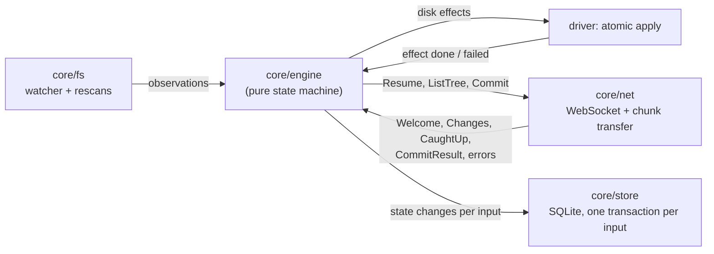

# Sync engine design

Status: revision 5, after the review of d37ee0d and its delta reviews. The core design (the three trees, commits, disk application and the mass-delete guard) is final. The recovery of §6.4 and the recovery parts of §10 are a **draft, to be verified by simulation**: the named scenarios of §7.5 must pass before 0.1.0. Paragraphs marked **[changed]** differ from the design approved at that commit; the list is in [Changes from the approved draft](#changes-from-the-approved-draft). Scope: `core/engine` (the sync state machine), `core/sim` (the simulation harness and reference server) and the parts of `core/chunk` the engine relies on. Protocol references such as "spec §6.2 R3" point to the v0 protocol draft that `spec/proto` implements.

## Summary

- The engine keeps three trees keyed by `node_id`: the remote tree **R** (the server state this device has applied), the local tree **L** (the disk as last observed) and the synced tree **S** (the per-node merge base). A planner derives disk changes and commit ops from their differences, as in Dropbox's Nucleus ([Jayakar 2020](#ref-nucleus), [Goldberg 2020](#ref-trinity)). The only persisted intents are the one commit in flight and the one disk effect in flight, each recorded before it starts and bound to the server history it was planned against.
- The engine is a pure function of its inputs. It does no I/O, reads no clock and draws no randomness of its own; the file system, the network and the store are drivers around it.
- Correctness is stated in the vocabulary of Balasubramaniam and Pierce ([1998](#ref-bp)) and Pierce and Vouillon ([2004](#ref-unison)): the engine never overwrites a change it has not propagated, it only propagates user changes, and when activity stops every replica converges. Unlike Unison it does not stop at conflicts, because no person is watching; it keeps both sides instead, so the no-data-loss property is stated over file contents.
- The Space DO's commit order is the only order. Clients resolve conflicts they have already seen (a "rebase" of their local changes onto the newer remote tree) and the server resolves the ones they have not (spec §6.2). With a total order, moves need no CRDT: the server checks for cycles and the later move loses, which is the state-machine case of Kleppmann et al. ([2021](#ref-move), §5.2).
- Disk changes never destroy bytes a user wrote, for regular file editing: programs that save by rename or open, write and close. The guarantee does not cover live databases or other long-lived writers that keep a descriptor open across a sync change (§5.2). A file the engine replaces or removes is first renamed into a quarantine directory, verified against what the engine expected, and only then moved to a local trash; a mismatch puts it back. A durable effect record names every path involved, so a crash at any point is recovered without deleting anything that might be a user's file.
- A mass-delete guard and a sync-root marker stop the two common ways a sync client destroys data at scale: a bug or a user mistake that deletes many files, and a missing or unmounted root that looks like "everything was deleted".
- After a rewind of the space on the server (`HISTORY_CHANGED`), or when this device's store turns out to be older than its history on the server, the engine runs a recovery (§6.4): it reconciles by node ID against the pre-reset trees, applies only what the device had not changed, and holds stale, local-only and changed files for the user's approval. This section is a draft: the simulation scenarios of §7.5 must verify it before 0.1.0, and that verification has not been done yet.
- Testing is a reference model plus deterministic simulation in the style of Trinity and FoundationDB ([Goldberg 2020](#ref-trinity), [Apple](#ref-fdb)): seeded, reproducible runs with crashes inside disk effects and store transactions, network faults, history resets and concurrent users, checked by an oracle that tracks the provenance of every write and every op. Native contract tests on real file systems cover what the simulation cannot.
- A small TLA+ model is worth writing for the commit and GC protocol (server side), not for the planner.

## Changes from the approved draft

Each change answers a blocking finding of the review of d37ee0d (B1–B7), of the delta reviews of fa2e1f3 (D1–D5), 6025930 (R3-1–R3-3) and d3966cb (R4-1–R4-4), or a decision the project owner made after the first review.

| Change | Sections | Finding |
|---|---|---|
| Disk effects use a quarantine protocol with a durable effect record instead of exchange-and-swap-back; staging never holds user bytes, quarantine is never swept; the check-then-rename fallback is removed and unsupported file systems are refused; paths resolve from a root descriptor without following links; durability for both directories of a rename and for power loss is stated separately | §2.5, §2.8, §5.2, §5.3, §7.4 | B1, B2 |
| The commit in flight records its `history_id` and a per-device `device_seq`; it is never resent into another history. An uncertain outcome is resolved only by the stored result, never by re-planning from the current tree: the server keeps each device's latest result until its next commit and the highest `device_seq` it accepted, so a retry is answered with its result, applied as new, or refused as coming from a rolled-back store, which starts recovery; a fixed check order is proposed (spec change). The earlier `BASE_TOO_OLD` rule is withdrawn | §2.2, §2.8, §4.2, §10 | B3, D1, R3-1 |
| `HISTORY_CHANGED` no longer triggers a union resync. Recovery (decided for 0.1.0) keeps the pre-reset trees as evidence, reconciles by node ID, applies only what the device had not changed, and holds stale, local-only and changed files for approval; it also covers a rolled-back local store, including one rolled back across remote changes only, which an effect counter in the root marker detects | §4.4, §6.3, §6.4, §10 | B4, R3-1, owner decision |
| The mass-delete guard persists its ledger, held set and approvals, counts affected files rather than ops, binds an approval to a node and revision set, and requires a root check for every observation that removes files | §2.8, §6.1, §6.2 | B5 |
| The oracle tracks the provenance of every write and op (intents bound to the commit that carries them, so retries are not new mutations; unpublished writes retired by their own user, so cancelled creates expect no op), counts identical bytes from separate writes separately, supersedes a write only by an action on that write, separates conservation from materialization on excluded nodes, checks resurrection from the server log, states liveness only under explicit conditions, and is itself mutation-tested; crash points move inside effects and store transactions | §3.3–§3.5, §7.3 | B6, D5 |
| Mass-delete counting: a removed folder counts as one deletion; the 50% limit still counts the files it held | §6.1 | owner decision |
| `.fbignore` with `.gitignore` syntax; becoming ignored never deletes anything, except a missed move into an ignored path until the guard of §6.1 exists | §5.10 | owner decision (GUN-270) |
| Change records are applied as whole commits in seq order; applying a result to R and acknowledging the commit are separate steps, so a result that arrives across a gap is buffered and one whose records were already replayed is acknowledged at once; a bootstrap tree is published only once consistent; the permutation property is narrowed (spec clarification) | §2.7, §4.4, §7.2, §10 | B7, D2 |
| The no-lost-bytes guarantee is scoped to a stated writer contract, not live databases or long-lived descriptor writers: writes through a descriptor held open across an effect survive only as long as the local trash keeps the displaced file; the trash keeps its own index and reclamation is native-tested | §5.2, §7.4 | D3 |
| Ignore transitions never delete or trash: an unexplained disappearance is first searched for in ignored subtrees by identity, a miss while any ignored entry exists is held for the user rather than deleted, and a remote move into a path ignored here leaves the local copy in place | §5.10 | D4, R3-2 |
| The device counter has an explicit lifecycle: the store keeps the accepted counter, an uncertain commit keeps its slot, a refused commit's slot is reused, and only a counter the store cannot account for starts recovery | §2.8, §10 | R4-1 |
| A changed `history_id` on connect starts recovery before any bootstrap; unanswered questions are asked again after a restart; deleting a folder that holds excluded nodes is split so they stay on the server; a user move out of an ignored path propagates; `.flarebox/` does not make a disappearance ambiguous; a recovery answer is committed only if the server has not changed since its simulation | §2.8, §4.4, §5.10, §6.1, §6.4, §7.5, §10 | review of #7 (CodeRabbit) |
| Recovery is a draft verified by simulation: holds are released only by a certain row, explicit intents such as a version restore are kept as evidence, and an answer is checked against the whole server transition, so R8 cannot revive nodes outside it; every counterexample of the four reviews is a named scenario | §6.4, §7.5, §10 | R4-2, R4-3, R4-4, owner decision |
| `EffectDone` carries the new entry's identity; S updates wait until S stays valid; a delete waits for a forced folder create that may merge into it, and a folder created where a moving folder still is takes a pending name; local positions the server will not take (cycles, renames, merges into a folder held elsewhere) are reverted on disk instead of through S, keep and upload their local edits, and are parked when they block each other; commits are sized to fit the 1 MiB message limit and `LIMIT_EXCEEDED` splits a commit instead of abandoning it | §1, §2.6, §2.7, §2.8, §4.2, §9 | engine implementation (effects and commit layers); message limit decided by the project |
| Restores are explicit intents the engine queues and persists: a `Restore` op goes into the next commit after the ops of its own node, its result changes neither S nor L and comes back as a remote change, and its outcome is kept with the last 1,000; a request reaches the engine through an inbox table of the store | §2.2, §2.6, §2.7, §2.8, §4.2, §6.3 | owner decision (GUN-323) |
| A refused commit is handled as RFC 0006 §1 says: `FORBIDDEN`, `INVALID_ARGUMENT`, `NOT_FOUND`, `CONFIRMATION_REQUIRED`, `QUOTA_EXCEEDED` without a retry time, `UNSPECIFIED` and unknown codes are a policy halt that keeps the commit, resends nothing whatever the `Welcome` says, and is stored | §4.2 | owner decision (GUN-281), RFC 0006 |

## 1. Context

The engine owns sync decisions for one space on one device. Its interface is a single entry point, `handle(now_ms, input)`, which updates the engine state and queues outputs. After each call the driver persists the state changes in one store transaction and only then executes the queued outputs, so every output is backed by durable state (write-ahead).

Inputs:

| Input | From | Meaning |
|---|---|---|
| `Observed(changes, root_check)` | fs driver | What the disk looks like now at some paths: created, modified (with chunked `Content`), renamed, removed. Produced by `core/fs` rescans, so it describes state rather than raw watcher events. `root_check` is the result of the root checks of §6.2 made for this batch; removals in a batch without a passing check are not trusted (§6.1) |
| `Rescanned(entries)` | fs driver | A full or subtree listing after startup, an event overflow or a crash |
| `EffectDone(id, identity)`, `EffectFailed(id, observed)` | fs driver | Result of a disk effect, with fresh observations on failure. **[changed]** For an effect that creates or writes an entry, `EffectDone` carries the file identity of the new entry, so L tracks the entry the effect made rather than the one it replaced. After a restart, the driver first recovers the effect record (§5.3) and reports its outcome the same way |
| `Connected(Welcome)`, `Disconnected` | net | Session state |
| `Changes(records)`, `CaughtUp(head_seq)`, `ResyncRequired(reason)`, `TreePage(page)` | net | Server log and bootstrap |
| `CommitResult(result)`, `CommitFailed(commit_id, error)` | net | Outcome of the commit in flight |
| `UserOps(ops)`, `UserDecision(decision)` | app | Restores requested in the UI; answers to the mass-delete prompt |

Outputs: `Resume`, `ListTree`, `SendCommit(commit)`, `ApplyEffect(effect)`, `Problem(problem)` (something only a person can fix) and `AskUser(question)`.

The engine never sees file bytes. Files are described by their `Content` (size, mtime, executable bit, chunk list, manifest digest; spec §5.1), which the driver computes with `core/chunk`. Two contents are equal for sync purposes when size, manifest digest and executable bit are equal; mtime alone is not a change.

## 2. State model

### 2.1 Options

| Approach | How it works | Why not (or why) |
|---|---|---|
| Intent queue (Sync Engine Classic) | Persist "work to do": upload this, download that. Replay the queue after a restart | The queue drifts from reality when events are lost, a crash interrupts a step, or the disk changes while work waits. Dropbox's account of Classic names this as the root problem: it "persists the outstanding work", and a move became a delete plus an add, which loses the file everywhere when only the delete goes through ([Jayakar 2020](#ref-nucleus); [Goldberg 2020](#ref-trinity)) |
| Archive-based state sync (Unison) | Keep the last synchronized state as an archive; compare each replica with it per path to find changes ([Pierce and Vouillon 2004](#ref-unison), §5) | The right core idea (the archive is a merge base), but Unison is path-keyed, two-replica, batch, and stops at conflicts for a person to decide. Flarebox has N devices, stable IDs and an unattended daemon |
| Peer-to-peer tree CRDT | Replicate an op log with timestamps; undo, apply and redo to reach the same tree on every replica ([Kleppmann et al. 2021](#ref-move)) | Unneeded: a Space DO already orders every commit, so a replicated move operation buys nothing here. Content handling is not the reason: a CRDT can keep concurrent contents (a multi-value register does), as Flarebox does with conflict copies (spec §6.2 R3) |
| **Three trees (Nucleus)** | Persist observations: remote tree, local tree and synced tree per node. A planner derives what to do from their differences and stops when all three are equal ([Goldberg 2020](#ref-trinity)) | **Chosen.** The direction of every change is unambiguous, a restart only needs a rescan, the stop condition is checkable, and the trees give strong invariants to test against |

### 2.2 The trees

All three trees are keyed by `node_id` (spec §2) and share the root node (`node_id = space_id`). Each is a valid tree on its own: every non-root node has a parent that is a directory in the same tree, there are no cycles, and in R and S no two live children of a directory share a `name_key` (spec §6.1).

- **R, remote tree**: the `NodeState` records (spec §5.2) this device has applied, including trashed nodes and their revs, plus `history_id` and `last_seq`, the highest seq up to which every record has been applied. A trashed node counts as absent when trees are compared.
- **L, local tree**: the disk as last observed. Each node has parent, exact on-disk name, kind, `Content` for files, and the file identity from `core/fs` (`dev`, `ino`, birth time) that lets the engine tell a rename from a delete and create. A node may be **parked** (§2.5): temporarily moved into `.flarebox/parked/` to break a dependency cycle; a parked node keeps its S position for comparison.
- **S, synced tree**: per node, the shape (parent, name, kind, content) on which L and R last agreed. S is the merge base: L ≠ S means a local change, R ≠ S means a remote change.

Names are compared after NFC normalization; whether a name is taken is decided by `name_key = NFD(casefold(NFD(name)))`, canonical caseless matching, so canonically equivalent names that differ only by case collide (spec §6.1, as the server implements it), on every platform, so the engine never relies on the local file system's case rules.

Besides the trees the engine persists:

- the **commit in flight** (at most one, spec §8): `commit_id`, its `device_seq` (§2.8), the `history_id` and `base_seq` it was built against, the ops, for each op the shape it sent, and, once received, a result that cannot be applied yet (§4.4). **[changed]** The `history_id` was not recorded before;
- the **effect in flight** (at most one in v0): the effect record of §5.2. **[changed]** Effects were not persisted before;
- the **mass-delete state** of §6.1: the deletion ledger, the held nodes and the pending question. **[changed]**
- the **restores** a person asked for (§2.6, §6.3): each one that has no outcome yet, under the ID of its request, and the outcomes of the last 1,000 that ended. **[changed]**

Nodes the in-flight commit touches are **frozen**: the planner neither changes them on disk nor rebases them until the result is applied.

### 2.3 Classifying a node

The planner looks only at **dirty** nodes, those whose L, S or R entry changed since they were last found in sync. Planning cost is proportional to the amount of unsynced work, not to the tree size.

| L vs S | R vs S | Meaning | Action |
|---|---|---|---|
| equal | equal | in sync | none; the node leaves the dirty set |
| equal | differs | remote change | apply R to disk (§2.5) |
| differs | equal | local change | upload as ops (§2.6) |
| differs | differs, L = R | both sides made the same change | S := R |
| differs | differs, L ≠ R | concurrent change | rebase on the client (§2.4) |

These rules are the B&P reconciler requirement in ID form ([Balasubramaniam and Pierce 1998](#ref-bp), Definition 4.1.2): a node that is not dirty on one side takes the other side's value, and a node dirty on both sides is never overwritten by the synchronizer.

**[changed]** S := R for a node both sides changed the same way can wait, because S stays a valid tree (§2.7): its new name may still be held in S. S then takes R's content at once and the position once it fits, so the next edit on either side is compared with the content both sides already hold and is not taken for a concurrent one. A node whose acknowledged update waits keeps that update instead.

### 2.4 Concurrent changes the client resolves

The client commits with `base_seq = last_seq`, which tells the server "I have seen everything up to here". A local change, though, was made against S, which may be older than R. If the client sent it unchanged, the server would treat the newer remote change as seen and apply the local change on top, losing the remote one. So before building a commit, the client rebases each concurrent change onto R with the same outcome the server would choose if it had not been seen (spec §6.2):

| Local (L vs S) | Remote (R vs S) | Client action | Matches |
|---|---|---|---|
| content edit | content edit | Fork: the local file becomes a new node Y with the local content (CreateFile under the original name). The server renames Y with a conflict name because the original holds the name; the original node is downloaded again with the remote content | R3, R1 |
| content edit | rename or move | Send the edit; both apply | R4 |
| delete | any change (content, move, rename, or a new child) | Keep: drop the delete for that node and every ancestor that is still needed, set S := ⊥ for them so they are downloaded again. Delete only the nodes that did not change remotely | R7 |
| content edit or move | delete (trashed) | Send the op; the server revives the node and the ancestor chain it needs | R8 |
| move | move | Send the move; the later commit wins | R5 |
| move that would create a cycle against R | any | Revert locally **[changed]**: the node is reverted (§2.6), S is unchanged, and the effects move it back to its R position | R6 |
| create | create of the same name | Send the create; the server renames a file (R1) or merges a directory (R2) | R1, R2 |

Conflicts the client has not seen yet, because they were committed after `base_seq`, are resolved by the server with the same rules. Between the two, every concurrent pair is resolved exactly once.

### 2.5 Applying remote changes to disk

For a node with a remote change and no local change, the planner emits one **effect**:

| Remote change | Effect | Expected state the driver verifies (§5.2) |
|---|---|---|
| new directory | `CreateDir(path)` | parent has the recorded identity; the name is free (no-replace create) |
| new file | `WriteFile(path, content)` | as above; the content is fully downloaded and verified in staging |
| content change | `WriteFile(path, content, replaces)` | the displaced file, once quarantined, has the identity and content `replaces` (S's content) |
| move or rename | `Move(from, to)` | source has the recorded identity; the target name is free (no-replace rename) |
| trashed file | `RemoveFile(path)` | the quarantined file has S's content |
| trashed directory | `RemoveDir(path)` | the quarantined directory is empty, or holds only platform files (§5.2); children are removed first, bottom up |

**[changed]** Before d37ee0d's review the driver checked a precondition and then replaced or removed the target, which leaves a window in which a user write is lost (review B1, B2). Now every effect that displaces something goes through the quarantine protocol of §5.2: the displaced entry is first renamed into `.flarebox/quarantine/`, then compared with the expected state, and only an entry that matches goes to the local trash. Paths are computed from L at the time the effect is emitted, and the effect record is persisted before the effect is handed to the driver. A mismatch means the user changed something: the driver puts the entry back, reports `EffectFailed` with fresh observations, the engine updates L, and the next plan sees a local or concurrent change instead. The engine never retries an effect blindly and never emits an effect for a node with a local change. In v0 at most one effect is outstanding at a time; batches of independent effects (siblings, different subtrees), as Nucleus runs them ([Goldberg 2020](#ref-trinity)), are a later optimization.

Some remote states cannot be reached one move at a time: two files swap names, or a directory moves under its former child. When no remote move is applicable but some are pending, the planner **parks** one blocking node: it moves it into `.flarebox/parked/<node_id>`, which is always possible, and moves it to its final place later. Parked nodes are excluded from local-change detection, and the rescan after a crash finds them there and puts them back into L instead of treating them as deleted. **[changed]** A reverted node (§2.6) that blocks another placement is parked like a node whose only change is remote, so two reverted nodes that hold each other's names are placed one after the other; parking moves an entry whole and never changes its content. A parked reverted node that R no longer has and that holds no unuploaded edit is removed from the parked directory; one that holds such an edit is moved back to its local position, so the edit is uploaded as a new node. A parked file re-keyed this way keeps its entry's name in the parked directory, the ID it was parked under, until it leaves the parked directory; effects address it by that name. A folder L deletes while a node under it is parked is reverted, so it is created again and the node is moved out into it. A node whose S update waits (§2.7) is not planned, so when it blocks a placement it is parked too, and the effects then place it at its R position; a local rename it held onto a name another node needs is not kept.

### 2.6 Building a commit

When the device is connected, caught up (§4.4) and has no commit in flight, the planner turns local changes into ops:

- New nodes become `CreateDir` or `CreateFile`, parents first.
- Position changes become `Move`.
- Content changes become `UpdateContent`.
- Deleted subtrees become one `Delete` per topmost deleted node, after the keep rule of §2.4 and the guard of §6.1.

The planner orders ops by simulating them on a scratch copy of R: it repeatedly emits an op that is valid there (parent present, name free, no cycle; a delete only when no surviving child remains under it) and applies it. **[changed]** When no op is valid, the planner looks for a **name cycle**: moves that each wait only for a name held by a node whose own move is in the cycle, as in a swap or a rotation through a third name. It moves one node of the cycle to a free pending name under its target folder (`<name> (pending)`, chosen as for a `CreateDir` below), which frees its old name, and the simulation goes on: the other moves become valid, and the node moves from the pending name to its target last. The ops apply in order and the change records hold each node's final state, so other devices never see the pending name, and every node keeps its identity and exact name. A cycle is sent only when the commit has room for all of its moves; a cycle longer than a commit can hold is split, and the moved-aside node keeps its pending name until a later commit, as a pending folder does. A move that waits for a name held by a node that does not move away is a real conflict and is still sent at the end for the server to resolve (R1 renames one side). **[changed]** A `CreateDir` sent this way may be merged into the folder that holds its name, so a delete of that folder or of a folder holding it waits for the next commit; otherwise the delete would remove what the merged folder brings. When the folder holding the name is itself moving away, the new folder is created under a free pending name instead (`<name> (pending)`, or `<name> (pending 2)` and so on when that is taken, with the name cut at a character boundary so that its NFC form fits in 255 bytes) and renamed in a later commit, so it is not merged into a folder that leaves. A move that would close a cycle against R is not sent: the node is **reverted**.

**[changed]** A reverted node is one whose local position the server will not take: a move that closes a cycle (or that the server rejects with `CYCLE`), a create or move the server renamed (§2.7), and a folder merged into one that L holds elsewhere with the nodes created in it (§2.7). The planner sends no create or move for it but still sends its content edits and a delete the user makes, and the effects of §2.5 make its position on disk equal to R as for a remote change, but never replace its content. When R no longer has it, the effects remove it only if it holds no unuploaded edit; a file that holds one becomes a new node, and the edit is uploaded as a create, because an edit beats a delete. A folder L deleted on the way from a reverted or parked node to the root is reverted too, so it is created again, and so is a folder the keep rule cannot clear from S yet because S still has children under it. A node stops being reverted once L has it at its R position. A create whose parent is not on the server and not in this commit waits for a later commit. A commit holds at most 1,000 ops (spec §13); the cut respects parent-before-child order. **[changed]** Its change records and its result must each fit in one 1 MiB message (spec §7.2), so the planner also stops at an estimate of 512 KiB of change records, counting a record for every node an op changes with its name and content, and a delete whose subtree exceeds that estimate is planned as deletes of the folder's contents first, deepest first, with the folder itself deleted in a later commit. The estimate is rough; `LIMIT_EXCEEDED` (§4.2) splits further.

**[changed]** A restore a person asked for (§6.3) leaves no difference between L and S: a trashed node is on no disk, and an earlier version is in no tree. So the engine keeps each request as an explicit intent, queued under the request's ID, and the planner adds a `Restore` op for it:

- The queued restores come first, in request order, so the first commit with room carries them and local changes of other nodes do not hold them back.
- A restore follows every op the commit has for its own node. An unsent edit of a file is therefore sent before the restore of an earlier version and becomes a version itself instead of a conflict copy, and a node deleted here is deleted before it is restored. While such an op is left for a later commit, the restore waits with it. It also waits while the planner leaves its node out: a problem node (§2.7), a node whose S update waits, or a parked one. The changes of such a node are unsent, and a restore sent ahead of them would be replaced by an edit the person made before asking for it. And it waits while L and R agree on its node but S has not taken that yet (class Same, §2.3), which happens when the S update depends on another node's effect. Sent then, the restore would change R while L still differs from S, and the engine would upload what the disk holds over the restored version as if the person had written it.
- A restore from the trash of a node R holds as trashed places the node in the scratch copy, at the position the request names or at the one it was trashed at. A folder is then not deleted in the same commit, because the delete would trash the restored node again; the keep rule of §2.4 brings the folder back after the commit.
- The estimate counts a record for every node R holds in the node's trash group, or one record when R does not hold the node as trashed.
- The engine does not judge a restore against R. R may lag the listing the person chose from, and after a bootstrap it does not hold the trash, so the server answers every case (§2.7).

A commit may hold only restores. A queued restore stays queued while committing is halted for recovery or by a policy halt; on a read-only device it ends as rejected, because nothing would ever send it.

The commit is persisted as in flight, with a fresh `commit_id` and the current `history_id`, before `SendCommit` is emitted.

### 2.7 After a commit result

The result's change records update R like any other record, and like any other record they are applied only in seq order (§4.4). **[changed]** Applying a result's records to R and **acknowledging** the commit are separate steps (review B7, D2). Acknowledging means making the S and L updates below, including any re-keying, and clearing the in-flight record, in one store transaction. A result whose seq is `last_seq + 1` is applied to R and acknowledged at once. A result further ahead is stored with the commit in flight; its nodes stay frozen, and it is applied and acknowledged once the commits before it have been applied. A result whose seq is at or below `last_seq` is not an error: R already holds its records, because the log replay after a reconnect or a bootstrap included the commit before the result arrived. Its records are skipped and the commit is acknowledged at once. S is updated from what was sent, not from what the server returned, so any difference between the two shows up as a remote change and the disk follows the server:

| Op | Result | S | L |
|---|---|---|---|
| CreateDir, CreateFile n | APPLIED | S(n) := sent shape | unchanged |
| CreateDir, CreateFile n | APPLIED_RENAMED **[changed]** | S(n) := sent shape with the server's name | n is reverted (§2.6): the disk takes the server's name |
| CreateDir A | MERGED_INTO B | S(B) := sent shape | re-key A as B (children follow). **[changed]** If B is already in L elsewhere, A keeps its ID and S(A) stays ⊥; A and the nodes created in it are reverted, so on disk they move into B and A is removed once empty. Later creates and moves into A are sent into B and reverted the same way, and so is a node in A that B already holds |
| UpdateContent n | APPLIED | S(n).content := sent content, unless S(n)'s content changed since the commit was built, even back to what it was then: S(n) then keeps what it holds, since the server applies the op only when no other device changed n's content after `base_seq`, so that change came after the commit. The store keeps, for each node the commit updates, whether S's content changed since it was built **[changed]** | unchanged |
| UpdateContent n | CONFLICT_COPY Y | S(Y) := sent shape and content; S(n) := ⊥ | re-key the local file as Y; n is downloaded again |
| Move n | APPLIED | S(n) position := sent position | unchanged |
| Move n | APPLIED_RENAMED **[changed]** | S(n) position := sent parent with the server's name | n is reverted: the disk takes the server's name |
| Move n | REJECTED (CYCLE) **[changed]** | unchanged | n is reverted: the disk moves it back to its R position |
| Delete | APPLIED, SUPERSEDED | S := ⊥ for every node the client planned to delete | unchanged; nodes the server kept are live in R and absent in L and S, so they are downloaded again. **[changed]** Each node R holds trashed by this commit is recorded as trashed here, for §4.4 |
| any but Restore | other REJECTED | unchanged | node marked as a problem and excluded from planning until the next rescan or a user action |
| Restore **[changed]** | any | unchanged | unchanged. The restore leaves the queue with its outcome: APPLIED is restored (also for a node that was already live), APPLIED_RENAMED is restored under the server's name, CONFLICT_COPY Y means the version came back as the new file Y, REJECTED carries the reason (`NOT_FOUND` for a node, version or target folder that was purged or expired), and any other code is a rejection that names the code. The node is never marked as a problem, reverted or re-keyed |

**[changed]** A `Restore` op is the one op whose result sets nothing from what was sent. What it sent is an instruction, and only the server knows which nodes the trash group holds and what the version's content is. So everything it brought back is a remote change: R holds it once the result's records are applied, and the effects of §2.5 create the folders, download the files, or replace the file whose version was restored. The outcome is saved by the transaction that clears the commit in flight, so a restore is neither lost nor sent a second time.

**[changed]** S stays a valid tree. An S update above that would orphan a node, take a sibling's name key or close a cycle waits and is made together with the updates it depends on, including the updates of §2.4 that both sides agree on; a node with a waiting update is not planned until it is made. Until then the waiting shape stands in for S when the engine asks whether L holds an unuploaded edit, so when R drops such a node the effects remove it if it holds none, and the commit layer makes it a new node if it does, as for a reverted node (§2.6). For the same reason the effects compare L and R with the waiting shape, not with S. A node whose L matches S but not the waiting shape is not changed only remotely, so its content is never replaced, also when the node is moved because it is reverted or parked. A node whose L still holds the waiting shape while R differs from it is changed only remotely, and the effects give it R's shape. That ends an update that could never fit while L held its shape, such as a conflict copy whose sent name a new folder of the same name key took in S. A failed effect on a waiting node blocks it until the effect planned for it changes, as for any other node. A waiting update is dropped once anything else sets S for the node, such as settling a change both sides made alike or the keep rule of §2.4 bringing back a node L deleted, and once neither L nor R holds the node. A waiting removal is also dropped, even while R holds the node again, once something S holds under the node will not leave it with L's commits, such as a reverted node that R holds there: the removal could never be made, and the keep rule brings the folder back for that node. The keep rule also compares R with the waiting shape, so a node R holds as the update left it has no remote change to keep. Its position is stale once R no longer has the node there and L has left it too: it then falls back to the position S holds, so both sides' positions are compared with the S they came from, while its content stays the base for a later edit. Waiting updates that fit are made even while committing is halted, since downloads go on. Otherwise a stale update could hide a later local edit or hold the node out of planning for good.

### 2.8 Persistence and crash recovery

The store persists, per `handle` call and in one transaction: R with `history_id`, `last_seq` and whether the server reported that it is behind `last_seq` (§4.4), S, L with file identities, the commit in flight (with its `history_id`, its `device_seq` and any buffered result), the accepted device counter, the effect in flight, the mass-delete state, the waiting S updates, the nodes recorded as trashed here and the seqs of the last acknowledged commits by slot (§4.4) **[changed]**, parked nodes with the name of their parked entry, held and problem nodes, the queued restores with the outcomes of those that ended **[changed]**, and the engine's ID generator state. Connection state and queued outputs other than the in-flight commit and effect are not persisted. **[changed]** The effect in flight, the commit's `history_id`, the buffered result and the mass-delete state are new, and so are the commit layer's reverted nodes, waiting S updates, merged folders (A → B above), folders whose delete is split (§4.2) and the reduced op count after `LIMIT_EXCEEDED`. `flarebox_engine::state` holds the engine's part of this besides the nodes of R, L and S and the ID generator's state (`IdGen::state`), and restoring refuses a state that breaks an invariant. The engine does not implement the guard of §6.1 yet, so it holds no mass-delete state. Every question (the guard's, an ambiguous disappearance of §5.10, recovery's) is persisted with what it holds, so after a restart the engine emits `AskUser` again for each unanswered one; the driver shows a question ID once, so a repeat after a crash is harmless.

After a crash the engine restarts from that state. The fs driver first recovers the effect in flight from its record (§5.3), which leaves the disk in a state the record explains, and reports the outcome; only then does it rescan the whole root. Recovery makes adoption by guessing unnecessary for the engine's own effects. Adoption remains for one case: a device with no store at all (a first link, or a store that was lost), where the disk holds results of effects nobody remembers. The engine then **adopts** an unknown entry instead of uploading it as new when R has a node expected at that path with the same kind and content. Everything else on disk that L does not know is a new local node.

**[changed]** A store restored from an older backup, or copied to a second machine, is worse than a lost one, because it looks valid (review R3-1). It is detected through a per-device commit counter, `device_seq`. **[changed]** Its lifecycle (review R4-1):

- The store keeps the **accepted counter** *a*: the `device_seq` of the last commit whose result this device applied. A new commit takes slot *a* + 1, which is persisted with the commit before it is sent.
- A commit whose outcome is uncertain keeps its slot and its `commit_id` on every retry.
- A commit the server refused as a whole (a call-level error such as `MISSING_CHUNKS` or `UNSUPPORTED_VERSION`, so nothing was applied) does not use up its slot: the server advances its counter only when it accepts a commit. The re-planned commit gets a new `commit_id` and the same slot *a* + 1.
- Applying a commit's result sets *a* to its slot, in the same transaction that clears the commit in flight.

The server keeps, per device, the highest `device_seq` it accepted and that commit's result, updated atomically with accepting the commit, and reports the counter in `Welcome` as *w*. On reconnect:

| *w* against the store | Meaning | Action |
|---|---|---|
| *w* = *a* | the commit in flight, if any, was not accepted | resend it unchanged (table below) |
| *w* = *a* + 1, and the commit in flight has slot *a* + 1 | the commit was accepted and its response was lost | resend it unchanged: the server returns its stored result, which is applied as usual. Only if the server does not know that `commit_id` (`STALE_DEVICE_STATE`) is this a rollback |
| *w* = *a* + 1 with no commit in flight, or *w* > *a* + 1 | the store is behind the server: it was restored from a backup or copied | nothing is planned from this store; the space enters recovery (§6.4) with the store as evidence |
| **[changed]** *w* < *a* | the server lost commits of this device that it had accepted: its counter only grows and the store learns a slot only from its result | *a* := *w*; the commit in flight is dropped and its restores stay queued; R is recorded as ahead of the server and bootstrapped as for `AHEAD_OF_SERVER` (§4.4), which sends again what was lost |

A healthy store never shows the third row, because the commit is persisted before it is sent and *a* moves in the same transaction that clears it. **[changed]** The other recovery triggers are checked first: the root marker's counter (below) when the task starts, and the history before the counter. The driver takes a `Welcome` before the result of any commit the session answered after it, so *w* is never older than a commit the store acknowledged. A new connection also drops the results the session held behind a gap on the old one, so no event after a `Welcome` comes from an earlier connection, and a bootstrap after *w* < *a* takes nothing the server lost. A listing still out when such a `Welcome` arrives may have read the server before it, so its pages are dropped and the tree is listed again.

**[changed]** The counter covers only this device's own commits. A store restored to a point before it applied a remote change, with no commit of its own since, still shows *w* = *a*, yet the disk holds effects the store does not remember: a remote rename of n from /a to /b that reached the disk would rescan as a local delete of /a and a new file at /b (review of #7, CodeRabbit). So the store also keeps an **effect counter** *e*, the number of disk effects it has acknowledged, and the driver keeps a copy, *m*, in the root marker `.flarebox/space.json` (§6.2). The effect is recorded in the store first (§5.2); before it touches the disk, the driver writes *e* + 1 to the marker and flushes it; the store transaction that clears the effect in flight, whether it is reported done or failed, sets *e* to that value. A healthy device therefore has *m* = *e*, or *m* = *e* + 1 while an effect is in flight. On startup, after recovering the effect in flight (§5.3) and before any rescan is planned from, the driver reports *m*:

- *m* above *e* plus the effect in flight (one if an effect is recorded, zero otherwise): the store is older than the disk. Nothing is planned from it and the space enters recovery (§6.4) with the store as evidence;
- *m* below *e*: the disk, or at least its marker, was restored from an older state. The space pauses with a problem (§6.2) instead of reading the older files as local edits.

The counter is local, so it needs no protocol change. Like the other store-rollback triggers, it is part of the draft of §6.4 and is verified by simulation.

The commit in flight is handled by the history and the device counter it was built with. **[changed]**

| Situation after reconnecting | Action |
|---|---|
| `Welcome.history_id` equals the commit's `history_id` | Resend unchanged; `commit_id` makes the server return the stored result if it was already applied (spec §8 step 4). With the history fence of §10, the server also refuses it if the history changed in between |
| the server does not know the commit, and its `device_seq` is the next one the server expects from this device (proposed in §10) | The commit was never applied, so the server applies it now like any new commit. Its `base_seq` may be old, which only makes more changes count as unseen (spec §6); nothing is re-planned |
| the server reports `STALE_DEVICE_STATE`: the commit's `device_seq` is at or below the last one it accepted from this device (proposed in §10) | This store is older than the device's history on the server: it was restored from a backup or cloned. The outcome of the commit cannot be known, so it is never resent or re-planned; the space enters recovery (§6.4) |
| the history changed | Never resend and never re-plan it automatically. Its ops are kept as recovery evidence and the space enters recovery (§6.4) |

The crash cuts around a result: before the result's store transaction, the commit is still in flight and is resent, and the server returns the stored result, including any `MERGED_INTO` or `CONFLICT_COPY` re-keying, which is then applied once; after it, nothing is in flight. The simulation crashes devices at both cuts (§7.3).

**[changed]** A restore follows the same cuts, because a `Restore` op exists on the wire only inside the commit in flight. A request is durable once its own transaction commits, in an inbox table of the store that the driver's API writes and the task running the engine takes from. Taking it, queuing it in the engine and saving the engine state are one transaction. From there the restore stays queued through the build, the send and any resend, and it leaves the queue in the transaction that clears the commit and advances *a*. A commit that is abandoned because the server proved it was not applied only forgets the in-flight record, so its restores are sent again in the next commit, like its other changes. When the space enters recovery, the commit in flight and every queued restore are kept as they are, never resent and never planned again: they are the intents I₀ of §6.4.

## 3. Correctness properties

### 3.1 Vocabulary

Pierce and Vouillon describe a synchronizer run as a tuple `(o, a, b, a', b')`: the archive `o` (the last synchronized state), the two replicas `a` and `b` before the run, and the replicas after it. A path has changed in `a` if the root sort of `a@p` differs from `o@p` ([2004](#ref-unison), §5). Balasubramaniam and Pierce split a synchronizer into update detection, which computes a predicate `dirty` that may over-report but must never miss an update (`¬dirty(p) ⟹ o(p) = a(p)`), and reconciliation ([1998](#ref-bp), Definition 3.1.2).

The mapping to Flarebox is per node rather than per path, and one replica is the server:

| Unison / B&P | Flarebox |
|---|---|
| archive `o` | S |
| replica `a` | L (and the disk it observes) |
| replica `b` | R (the server state this device knows; the server merges all devices) |
| `dirty_a(p)` | L(n) ≠ S(n). Update detection is the fs rescans; it must be safe in the B&P sense, so a lossy watcher triggers a rescan rather than a guess (§5.1) |
| run | one planner step: an effect, a commit, or a tree update |

This is an adaptation: B&P and Unison prove their properties for path-keyed replicas, and nothing here inherits those proofs. The properties below are claims about this design, checked by the tests of §7.

### 3.2 Safety

The engine satisfies Unison's two change-propagation conditions at every step, not only at the end of a run, because a crash can end a run anywhere ([Pierce and Vouillon 2004](#ref-unison), §10):

- **Preserve user changes**: if L(n) ≠ S(n), no effect changes n on disk. The only disk operation on a locally changed node is the one the user's own change implies after the server answers: renaming a fork to its conflict name (§2.7) or giving a recovered file a free name (§5.2), both of which keep its content.
- **Propagate only user changes**: every effect makes L(n) equal to R(n), and every op makes R(n) equal to L(n). Nothing is made up, with two deliberate exceptions: conflict names, which the server chooses (spec §6.1), and parked locations (§2.5), which are not visible in the synced folder and never uploaded.

Unison's third condition, **stop at conflicts**, is replaced on purpose. Unison asks a person; its authors note that systems with many replicas, such as the Windows 2000 file service, overwrite instead, because there may be nobody to ask ([Pierce and Vouillon 2004](#ref-unison), footnote 3). Flarebox runs unattended on N devices, so it resolves every conflict deterministically and keeps both sides (spec §1 principle 4). The no-data-loss property below is what replaces "stop at conflicts".

### 3.3 No data loss

**[changed]** The property is stated per write, not per content digest, so that two files with identical bytes count separately (review B6).

A **write** is one user action that leaves a file with some bytes: a create or an overwrite on some device. Two writes are different writes even when their bytes are identical. Each write has a **home**: the node it was written to, or the node the server put it in instead (a conflict copy for `CONFLICT_COPY`, the surviving directory's child for `MERGED_INTO`). A replica (a device's disk or the server's live tree) **holds** a write if the live file at its home has the write's bytes.

A write w is **superseded** only by a user action on w itself, and how depends on whether w was ever published, that is, reached the server in an applied commit:

- an **unpublished** write is superseded when the user of the device that wrote it overwrites or deletes the file holding it before it is published. An offline create followed by a delete, or a temporary file that lives between two rescans, leaves nothing to publish, and the engine correctly sends nothing (review R3-3);
- a **published** write is superseded when, on some device whose disk showed w at its home, the user overwrote or deleted that file and the server accepted the change (an overwrite applied rather than turned into a conflict copy, a delete applied rather than superseded under R7).
- **[changed]** a rewind of the space by its owner (GUN-268) retires, on the server, every write published only after the restore point. The obligation for those bytes moves to the devices that still hold them: a copy held by recovery (§6.4) must be conserved until it is answered, published again if the answer is Publish or Keep, and found in the local trash if it is Discard. A retired write is not superseded: the property below exempts it until it is published again, when it becomes an ordinary published write, and until then it is checked against this obligation instead.

**[changed]** An action on another node never supersedes w, including the other side of the same conflict: overwriting n does not supersede a write that lives on in n's conflict copy (review D5), and one device's action never supersedes another device's unpublished write. Sync effects never supersede.

**Property (no data loss).** For writers within the contract of §5.2, once the system is quiescent (§3.4), every write that was neither superseded nor retired by a rewind is held by the server and by every device on which its home is eligible. On a device where its home is excluded (§5.10), the obligation is conservation, not materialization: if that device held the write when the home became excluded, it still holds it there.

This holds through all the conflict rules: concurrent edits keep both contents (R3), an edit concurrent with a delete keeps the edit (R7, R8), and a fork keeps the local write in a new node. A write that was superseded is still recoverable from the server for the retention period, as a previous version or in the trash (spec §12.2); that is a separate property of the server.

### 3.4 Convergence and termination

**Quiescence**: no user actions, every device online and connected, the network delivers every message, no faults are injected, every question the engine asks (§6.1) is answered, the scheduler is fair (every enabled action runs eventually) and every effect the driver starts completes.

**[changed]** The property is conditional (review B6). Some states legitimately persist under quiescence: a node reported as a problem (unreadable, a name the local file system cannot hold, an ignored file occupying the name), a node held for a decision nobody gives, or a space in recovery (§6.4) or paused after a failed root check. A node is **eligible** when none of these applies to it or to an ancestor.

**Property (convergence).** From any reachable state, after quiescence starts, every device eventually reaches L = S = R for every eligible node, every eligible node on every disk matches the server's live tree (path, kind, content), no parked node remains, and nothing is in flight. Ineligible nodes stay unchanged on disk and are reported.

This is the analogue of Unison's maximality (a maximal run propagates every non-conflicting change, [Pierce and Vouillon 2004](#ref-unison), §5): with conflicts resolved instead of left alone, nothing eligible remains unpropagated. The property promises eventual convergence, not a proven bound. CanopyCheck checks termination with a cutoff on planning iterations ([Goldberg 2020](#ref-trinity)); the simulation does the same with a step budget after quiescence starts, which is a test heuristic: exceeding it is reported as a likely livelock, to be confirmed from the trace.

### 3.5 No resurrection

**Property (no resurrection).** A node trashed by a delete whose author had seen its latest state stays trashed unless a later op revives it, and every op a device sends derives from one specific user action on that device that has not been propagated yet (an edit, move, rename, create or delete it observed on disk) or from a user restore request. **[changed]** "Specific and not yet propagated" is new: it rules out an op that re-sends an old, already propagated edit of a node the user once touched (review B6).

The two rules that keep a node alive, R7 and R8, both need a change the deleter had not seen. The engine cannot fabricate one: it sends ops only for L ≠ S, L changes only through observations, and S only moves toward what was sent or what R says. Two engine paths could break this and are guarded: a crash that makes a known file look new (handled by adoption, §2.8), and a lost store that makes the whole folder look new (handled like a first link: local files are matched against R by path and content before anything is uploaded).

### 3.6 Moves

Kleppmann et al. show that concurrent moves either duplicate subtrees (Dropbox at the time) or must pick one winner, and that a move which creates a cycle in combination with another must be ignored ([2021](#ref-move), §2). Their CRDT orders moves by timestamp and undoes and redoes to apply them in that order. Flarebox has the simpler setting they describe as state machine replication: one leader orders every operation, so a move "still needs to check for cycles, but it never needs to undo or redo" ([2021](#ref-move), §5.2). The properties:

- **No duplication**: a node is in exactly one place in every tree at every step (Nucleus has the same invariant, "any moved folder is visible in exactly one location", [Goldberg 2020](#ref-trinity)). A move is one op and one `rename` on disk.
- **No cycles**: R, S and L are trees at every step. The server rejects a cycle-creating move (R6), the client reverts it locally, and parking (§2.5) avoids transient cycles on disk.
- **Last commit wins** between concurrent moves of one node (R5), which is last writer wins with the commit seq as the timestamp.

## 4. The server's total order

### 4.1 Commit

1. The planner builds a commit (§2.6) and the engine persists it as in flight.
2. The net driver uploads the chunks the commit references (`PrepareUpload`, then `PUT` for each `UPLOAD`; spec §8 steps 1–2) and sends `Commit`.
3. The result updates R and S (§2.7) and the frozen nodes are released.

`base_seq` is `last_seq` at the moment the commit is built and is not changed on resend: the ops were built against that state, and keeping it lets the server detect every change committed after it (spec §6, "unseen change"). Only one commit is in flight (spec §8, last paragraph).

### 4.2 Errors and retries

| Outcome | Applied on the server? | Engine action |
|---|---|---|
| transport error, disconnect, timeout | unknown | Resend the same commit, same `commit_id`, after reconnecting and catching up |
| `MISSING_CHUNKS` | no (checked before any op, spec §8 step 4) | Upload again, resend the same commit. If the bytes are gone (the file changed since it was chunked), abandon the commit and re-plan from L with a new `commit_id` |
| `RETRY_LATER` | no | Back off for `retry_after_ms` and resend |
| `QUOTA_EXCEEDED` **[changed]** | no | With `retry_after_ms` above 0, back off for it and resend; without one, a policy halt |
| `READ_ONLY` (format too new, spec §9.2) | no | Abandon, stop committing, report a problem; downloads continue; a `Welcome` that allows writes ends it. **[changed]** Queued restores end as rejected (§2.6) |
| `FORBIDDEN`, `NOT_FOUND`, `CONFIRMATION_REQUIRED`, `UNSPECIFIED`, unknown code **[changed]** | no, or unknown | Policy halt (below) |
| `INVALID_ARGUMENT` **[changed]** | no | Policy halt, keeping the commit as evidence; this is an engine bug or a reused `commit_id`, and the simulation treats it as a failure |
| `UNSUPPORTED_VERSION`, `HEAD_MOVED` | no | Abandon and re-plan with a new `commit_id` |
| `LIMIT_EXCEEDED` **[changed]** | no | The commit's change records or its result do not fit in one 1 MiB message (spec §7.2). Abandon and re-plan in commits of half as many ops; a commit of one `Delete` is re-planned as deletes of the folder's contents first, a commit of one `Restore` ends that restore as not fitting, since the nodes it brings back are too many or too deep for one commit, and any other single op marks its node as a problem. Each acknowledged commit doubles the op count back towards 1,000 |
| `base_seq > head_seq` | no | Resync (§4.4), then re-plan |
| history mismatch (proposed fence, §10) **[changed]** | no | Stop committing; the space enters recovery as for `HISTORY_CHANGED` (§6.4) and the commit is kept as evidence |
| `STALE_DEVICE_STATE` (proposed, §10) **[changed]** | unknown | Stop committing; recovery (§6.4) |

**[changed]** A **policy halt** (RFC 0006 §1) keeps the refused commit with its `commit_id` and slot and records the code. The engine sends nothing more to the space, neither that commit nor a new one, and downloads continue. The refusal is reported to the user with the code and the error's message. The halt is stored, so it outlasts a reconnect and a restart, and no `Welcome` lifts it, so it overrides the resend of §2.8. Only a user action or a client update that knows the code ends it; RFC 0006 leaves those actions to a later RFC. It differs from read-only, which follows from the device's format or role and ends with a `Welcome` that allows writes.

A commit is abandoned only after an error that proves it was not applied. **[changed]** An earlier revision also abandoned a commit whose outcome was unknown and re-planned it from the trees. That is unsafe (review D1): if the commit wrote B and another device that had seen B then deleted the node, re-planning finds a local edit against a remote delete and revives the node. An outcome that is unknown is resolved by the stored result, never by inference from the current tree; when it cannot be resolved (another history, or a store older than the device's history), the space enters recovery (§6.4). Abandoning means forgetting the in-flight record; S was not changed for it, so the same local changes are planned again from the trees.

### 4.3 Rebase

"Rebase" here means what §2.4 describes: local changes are kept as tree differences rather than queued ops, so after new remote changes arrive the next commit is simply built from the new R, with concurrent changes resolved first. There is no op log to rewrite. The two places where a sent op does need to be rewritten are handled by the result codes: `MERGED_INTO` (the client re-keys the folder) and `CONFLICT_COPY` (the client re-keys the file). Both happen once per commit and touch only the nodes named in the result.

### 4.4 Receiving changes

- After `Connected`, the engine first compares `Welcome.history_id` with R's. **[changed]** If they differ, the space enters recovery (§6.4) before any bootstrap or planning, so R, S and L are kept as evidence instead of being replaced. Otherwise it sends `Resume{history_id, since_seq: last_seq}`, unless `last_seq` is above `head_seq` or below `log_floor_seq`; then it bootstraps with `ListTree` (spec §7.3–7.5).
- **[changed]** Records are applied as whole commits in contiguous seq order: commit `last_seq + 1`, then the next. A commit at or below `last_seq` is a duplicate and is skipped. A gap (a commit above `last_seq + 1`) triggers a new `Resume` and the rest of the batch is dropped. Within an applied commit, each `NodeState` overwrites the stored node only if its rev is above the stored one (spec §5.2), which makes the overlap between a bootstrap listing and the log replayed after it harmless. Rev gating is not a licence to apply commits out of order (review B7): `NodePurged` has no rev, so a purge followed by an older `NodeState` would recreate the node, and a post-image can name a parent created by an earlier commit that has not been applied yet.
- **[changed]** The device's own commit results arrive in `CommitResult`, not as pushes (spec §7.3 step 2), but a log replay after a reconnect includes the device's own earlier commits like any other. A result is acknowledged as §2.7 describes: at once when its seq is `last_seq + 1` or already covered by R, after the gap is filled when it is further ahead. So R never gains a node whose parent is missing, and an own commit is never left in flight because its records arrived first.
- The engine is **caught up** once `last_seq` reaches the `head_seq` of the last `CaughtUp`. It builds commits only when caught up, so local changes are rebased onto everything the server had when the session began.
- An unknown change record type means the client cannot keep the tree correct: the engine stops applying, stops committing, and asks for an upgrade (spec §9.1, fail closed).
- Bootstrap after `LOG_TRUNCATED` or `AHEAD_OF_SERVER`: the listing (spec §7.5) is collected into a staging tree while the old R stays in use. Pages are read at different `head_seq`s, so a page can hold a node whose parent was trashed or moved by the time another page was read. **[changed]** The staging tree replaces R only after the log has been replayed up to the highest `head_seq` of any page and the result is a valid tree; until then the planner does not run. Then S and L are kept, and the normal classification decides what moves in which direction. **[changed]** When the server reports `AHEAD_OF_SERVER`, in `ResyncRequired` or by refusing a commit, or `Welcome` reports *w* < *a* (§2.8), it lost commits this device applied. The store records this with `last_seq` until the bootstrap replaces R, because the listing cannot show it: another device may commit before the listing begins, so the server's head is no longer below `last_seq`, and the device may restart in between and see no `AHEAD_OF_SERVER` at all. S then forgets each node that the new R lacks or holds live with another shape, and every node S holds below one. A node L still holds is created again instead of being taken for a remote delete, and a file whose content differs from R's is kept as a conflict copy (§2.4) instead of being replaced by R's older content. A node in R's trash keeps S and stays a remote delete, also below a node S forgets: S forgets such a folder only once the delete has taken what it held, through a waiting update (§2.7) that the effects never take for a remote delete, and the folder is then created again. **[changed]** This listing also reads the trash: every `ListTrash` page after every `ListTree` page, merged by rev like the replay, which only ends once it reaches the `CaughtUp` sent after both (RFC 0002 §6). So a node another device trashed after the loss counts as trashed, not as lost, and is not created again under an ID the server holds in its trash, which it would refuse with `ID_EXISTS`. **[changed]** A delete this device made in a lost commit is sent again. The engine records each node a delete of this device trashed, with the seq of that delete's commit, for as long as R holds the node trashed by that commit. The restored server can give later commits the seqs the lost ones had, so a seq below the lost delete's does not show that a node state is older than the delete. The engine therefore also keeps the seq of each of its last 1,000 acknowledged commits by slot. The newest slot the server still counts (*w*, §2.8) is a commit the restored server holds, so every seq at or below its seq is from before the loss. When the new R holds a recorded node live with the shape it was trashed with and no revision above that bound, and neither L nor S holds it, S takes R's shape, parents first, so the node is a local delete and is planned again. Otherwise it is downloaded, since another device changed it or a person restored it after the loss, or the bound is unknown, and the delete never removes what the deleting user did not see. The keep rule of §2.4 and the server's R7 cover changes made after the listing. `HISTORY_CHANGED` (a rewind or a point-in-time restore) is different and starts the recovery of §6.4.

### 4.5 What is not a CRDT

The Space DO is a sequencer and validator, and clients are replicas of its state machine. Clients never merge each other's ops, keep no vector clocks, and do not need to converge without the server. The conflict rules are not commutative: which side keeps the name depends on which commit came first (R1, R3), which is why the client must not resolve unseen conflicts itself. Offline devices keep working: their changes accumulate as differences between L and S, and they are rebased and committed when the device reconnects.

## 5. Local file system edge cases

### 5.1 Lossy watcher events and rescans

Watcher events are hints about where to look, never facts about what changed. `inotify` is not recursive, needs a watch per directory, is limited by `max_user_watches`, and drops events with `IN_Q_OVERFLOW` when its queue fills ([inotify(7)](#ref-inotify)). FSEvents coalesces events and asks the client to rescan a subtree (`kFSEventStreamEventFlagMustScanSubDirs`), and reports dropped events with `KernelDropped` or `UserDropped` ([Apple FSEvents guide](#ref-fsevents)). So, as `core/fs` already does, watchers only choose which subtrees to rescan, and a rescan compares the disk with the last snapshot and reports created, modified, renamed and removed entries with their file identities. A lost event becomes a wider rescan; it never becomes an assumption. This is what B&P call a safe update detector: it may report more than changed, never less.

Patterns the fs layer turns into the right observation:

- **Rename over an existing file** (an editor's atomic save: write a temporary file, then rename it over the original): reported as a modification of the original file, so the node keeps its ID and version history.
- **Delete and re-create at the same path** within the debounce window: also a modification when the kind is the same.
- **[changed] Swap or rotation through a third name** (`mv a tmp; mv b a; mv tmp b`), of files or folders: an entry whose identity was at another path before the rescan, while the identity its path held is at another path after it, is reported as renames, so each node keeps its ID and version history. The planner sends the renames through a pending name (§2.6).
- **Ignored names** (`.flarebox/`, platform files such as `.DS_Store` or `Thumbs.db` per a fixed list, and paths matched by `.fbignore`, §5.10): invisible to the engine, but they still occupy names on disk, so an effect that needs that name fails its check and is reported as a problem. **[changed]** The platform files do not keep a folder from being removed (§5.2).

### 5.2 Applying effects without losing user bytes

**[changed]** This section replaces the exchange-and-swap-back procedure of d37ee0d, which could lose a user write in a crash and fell back to a plain replacing `rename` on some file systems (review B1, B2).

The driver gives three separate guarantees, and claims nothing beyond them:

- **Atomic names.** Every change to a name in the sync root is a single `rename` or `mkdir` that never replaces an existing entry. A replacement is two such changes (the old file leaves for quarantine, then the new one arrives), so between steps 3 and 4 below the target name is briefly absent; another process sees the old file, no file, or the new file, never a partial one.
- **No lost user bytes.** An effect never unlinks or overwrites an entry. Anything it displaces is renamed into `.flarebox/quarantine/`, compared with what the engine expected, and then either moved to the local trash (when it is exactly the synced content, which the server also holds) or returned to the user. This holds across process crashes, for the writers the contract below supports.
- **Durability.** Process-crash recovery is guaranteed by the effect record and the ordering below. Survival of a power loss depends on the file system and the drive honoring flushes; it is not claimed beyond that, and only native tests can check it (§7.4).

**Required primitives.** A rename that fails instead of replacing: `renameat2(RENAME_NOREPLACE)` on Linux ([rename(2)](#ref-rename)) or `renamex_np(RENAME_EXCL)` on macOS ([renamex_np(2)](#ref-renamex)). The driver probes for it in `.flarebox/` when a space is linked and on every start. A file system without it (some network and FUSE file systems) is refused: the space is not synced and a problem is reported. There is no check-then-`rename` fallback, because a plain `rename` replaces its target, and backing the target up first only moves the window ([rename(2)](#ref-rename)). Exchange (`RENAME_EXCHANGE`, `RENAME_SWAP`) is no longer used.

**Path resolution.** The driver holds a descriptor for the sync root and resolves every path from it, one component at a time, without following links: on Linux with `openat2` and `RESOLVE_BENEATH | RESOLVE_NO_SYMLINKS` ([openat2(2)](#ref-openat2)), elsewhere with `openat(O_NOFOLLOW | O_DIRECTORY)` per component. Each directory's `(dev, ino)` is compared with L before it is used, and every rename is a `renameat` between directory descriptors. A parent replaced by a symbolic link or by another directory after the scan fails the identity check instead of redirecting the effect. A descriptor does not follow its directory being moved, though: if the user moves a parent out of the root after resolution, a `renameat` on the held descriptor acts outside the root. The driver therefore resolves the path again from the root immediately before each rename and compares the result with the held descriptor's identity; a mismatch fails the effect. A move in the short window between that check and the rename stays possible; it can only move the entry within the same file system, never destroy it.

**The effect record.** Before an effect that creates, replaces, moves or removes anything is handed to the driver, the engine persists its record in the same store transaction that emits it: `effect_id`, kind, the target as (parent directory identity, name), the expected state of the entry being displaced (identity, size, mtime, manifest digest), the new content for a write, and two private paths derived from `effect_id`: `.flarebox/staging/<effect_id>` and `.flarebox/quarantine/<effect_id>`. Staging only ever holds bytes downloaded from the server and verified against their hashes; the driver never moves a user's file into staging. Quarantine holds displaced entries and is never swept.

**Replacing a file** (`WriteFile` with `replaces`):

1. Download chunks into the content-addressed chunk cache, verifying each chunk's SHA-256 (spec §10). Assemble the file at the staging path, verify the manifest digest, set the executable bit, and flush it.
2. Compare the target with the expected state. On a mismatch, stop: `EffectFailed`, nothing was displaced.
3. Rename the target to the quarantine path (no-replace). From here on, whatever the user had at the target, even if they wrote it after step 2, is in quarantine and intact.
4. Compare the quarantined entry with the expected state, including its content digest.
   - Match: rename staging to the target (no-replace). If the target name has been taken in the meantime, leave the new entry alone and delete the staging file; the quarantined file is synced content and still goes through step 5, after which the effect is reported as `EffectFailed`.
   - Mismatch: the user wrote between steps 2 and 3. Rename the quarantined entry back to the target (no-replace) and report `EffectFailed`. If the target name has been taken again, the quarantined entry stays and is reported as a **recovered** local file (below).
5. Move the quarantined entry, which now equals the synced content, to `.flarebox/trash/`. Report `EffectDone`.

**Removing** (`RemoveFile`, `RemoveDir`) is steps 2 to 5 without staging: quarantine, compare, then trash or put back. A directory must be empty once quarantined; an entry created in it in the meantime makes it a mismatch. **[changed]** Platform files are the exception (GUN-305): a quarantined directory that holds nothing but regular files with the exact names of the fixed list (`.DS_Store`, `Thumbs.db`, `desktop.ini`, `Icon\r`) matches, and the driver deletes those files before it moves the directory to the trash. Scans leave these files out, so no effect removes them first. The Finder keeps a folder's view data in a `.DS_Store` file inside it; Apple documents these files for network shares ([Apple Support](#ref-ds-store)), and that the Finder also writes them on local volumes is common knowledge with no Apple page found for it (unverified). Without the exception a folder deleted on another device would stay on a Mac as a folder that looks empty. The files are deleted rather than trashed with the folder because the trash deletes a folder only while it is empty and recovers it otherwise, which would bring the folder back when it expires. Syncthing has the same case: an ignored file can block the removal of a directory, and its `(?d)` pattern prefix, meant for files the operating system generates, allows removing such a file then ([Syncthing documentation](#ref-syncthing-ignore)). Any other entry keeps the folder, including a file that a `.fbignore` rule or the device-local list excludes: the effect fails, everything is put back, and the folder is reported as a problem. **[changed]** The failure names those entries, and the driver does not plan the removal again after a wait, since only the person can change what the folder holds: the status names the entries until the effect planned for the folder changes or the folder restarts (GUN-398). **Creating** (`CreateDir`, `WriteFile` without `replaces`) is a no-replace `mkdir` or rename from staging. **Moving** is one no-replace rename after the source's identity check. A rename never destroys content, so a source the user changed after the check is moved with its new content, and the next rescan reports that content as a local edit.

A **recovered** file is a quarantined entry that cannot go back to its name. The driver renames it into the same directory as `<stem> (recovered <YYYY-MM-DD>)<ext>` (no-replace, with a counter on collision) and reports it as an observation, so it becomes an ordinary new local file and is uploaded. If that directory no longer resolves to the one the effect expected, the recovered file goes to the sync root instead.

**Supported writers.** **[changed]** The previous revision claimed that writes through any open descriptor survive; with a trash that is reclaimed after a while, that claim cannot hold (review D3), so the guarantee is scoped. The no-lost-bytes guarantee covers every write that reaches the file before step 4's comparison, and every write through a descriptor opened after the effect. That includes programs that save by writing a temporary file and renaming it into place, which is how most editors save, and programs that open, write and close. It does not cover a process that keeps a descriptor open across the effect and writes through it after step 4. Such writes go to the displaced file in the trash ([rename(2)](#ref-rename): an open descriptor refers to the file, not the name), and are kept only as long as that trash entry is: the retention period, or until the size cap evicts it. Before reclaiming a file, the collector compares it with the values recorded when it entered the trash, and turns a changed file into a recovered file instead. **[changed]** The collector compares a file's content, not its ctime, with the content the effect verified before trashing it, and only a different size or content counts as a change (GUN-317). A change of metadata alone, such as `chmod -R` on the linked folder or a copy of the folder to another disk, also changes ctime, and with ctime every file deleted that week would come back at the root on every device. That check is best effort: a write between the check and the unlink is lost. The trash keeps its own index of those recorded values, since the effect record is gone by then. Native tests (§7.4) include reclamation by expiry and by the size cap.

**Ordering.** The staged file is flushed before it is renamed into place. After every rename, the driver flushes both the source and the destination directory, in that order, since a cross-directory rename changes both ([Pillai et al. 2014](#ref-pillai)); the store transaction that acknowledges the effect comes after the last flush. On macOS, `fsync` does not ask the drive to write its cache, so power-loss durability needs `F_FULLFSYNC` ([Apple fsync(2)](#ref-fsync-apple)); the driver uses it for the staged file and both directories, at the cost of slower applies. Process-crash recovery needs none of this, only the order of the steps and the record.

The **local trash** (`.flarebox/trash/`) holds every entry the engine displaced, for a configurable period (proposed default 7 days) or until a size cap, whichever comes first; the cap can evict an entry earlier, so the period is a maximum, not a promise. It is a client-side safety net; the server's trash and version history remain the primary recovery path. A changed entry found at reclamation is recovered at the sync root rather than in its old folder, which may be gone by then, and an empty folder takes no room under the cap, so only the period reclaims it.

### 5.3 Recovery, partial downloads and uploads

**[changed]** After a crash the driver recovers the effect in flight, if any, before it rescans. It does not need to know how far the effect got; it inspects the target, the staging path and the quarantine path, and every combination has one safe action:

| Found | Meaning | Action |
|---|---|---|
| a quarantine entry | the effect reached step 3 | Compare the quarantined entry with the expected state, whatever the target holds now. If it matches: when the staging file still exists and the target name is free, rename it into place; then move the entry to the trash and report `EffectDone` (or `EffectFailed` if the staging file could not be placed). If it does not match: rename it back when the target name is free, otherwise make it a recovered file, and report `EffectFailed` |
| no quarantine entry, no staging file, target in the effect's final state (the new content, the moved entry, or absent after a removal) | the effect finished | report `EffectDone` |
| no quarantine entry, anything else | the effect stopped before step 3, or the user changed the target | delete the staging file (server bytes, downloadable again) and report `EffectFailed`, so the next plan sees the current disk |

**[changed]** The second row judges the target by its name and content alone, so the engine takes `EffectDone` from recovery only when L confirms that the entry found is the effect's own (GUN-339, GUN-342). An entry that L holds as another node is that node's: a synced file that the user renamed onto the name of a download with the same bytes is not the download. A removal whose node L places elsewhere found the name empty because the user moved the node. In both cases the driver reports `EffectFailed`, as the effect would have failed had it met that state.

In every row, quarantine is either moved to the trash after it has been verified as synced content, or returned to the user. In the first row, a staging file that is already gone counts as placed only if the target holds the new content. Recovery writes the effect's counter to the marker again before it looks, since the crash may have come before the marker write. A crash during recovery repeats recovery, which is idempotent. Staging files with no effect record are deleted at startup: they can only hold server bytes. Verified chunks stay in the cache, so a download resumes. Uploads resume through `PrepareUpload`: chunks the server already has come back as `PRESENT` (spec §8 step 1).

### 5.4 Case sensitivity

The default macOS APFS volume is case-insensitive and preserves case; case-sensitive variants exist ([Apple APFS FAQ](#ref-apfs)). Linux file systems are case-sensitive by default; ext4 can fold case per directory since Linux 5.2 ([Collabora 2020](#ref-casefold)). The server enforces a unique `name_key` per directory on every platform (spec §6.1). Consequences:

- On Linux, `Report.txt` and `report.txt` in one folder cannot both sync. The second one committed gets a conflict name (R1), and the Linux device renames its local file to match. This is spec open question 3; the engine handles either answer.
- The engine decides whether a name is taken by `name_key`, never by asking the file system, so it behaves the same on both kinds of volume.
- A case-only rename (`a` to `A`) must reach the engine as a rename, not as a delete and a create; the fs layer recognizes it by file identity.
- **[changed]** A case-only or normalization-only rename that the engine applies goes through `.flarebox/parked/` in two no-replace renames, because on a case-insensitive volume the target name is already taken by the source itself.

### 5.5 Unicode normalization

APFS preserves the normalization of names and, since macOS High Sierra, compares them normalization-insensitively ([Apple APFS FAQ](#ref-apfs)). HFS+ stores names decomposed (NFD). Linux stores bytes. The server stores NFC (spec §6.1). The engine keeps the exact on-disk name in L, so paths resolve, and compares names after NFC normalization, so an NFD name from HFS+ does not cause an endless rename. On Linux, two names that differ only in normalization collide in `name_key`, like a case collision.

Which names collide must not depend on the Unicode version a component happens to ship. The server (flarebox#6) and the engine both fold with the tables of CaseFolding 18.0.0 (statuses C and F). NFC is not pinned yet: the server uses the runtime's `String.prototype.normalize` and the engine a Rust crate, which can lag behind. Pinning both is a spec change (§10). Exact on-disk spelling and portable name equality stay separate: L keeps the spelling, comparisons use `name_key`. Native tests on real volumes (§7.4) cover NFC and NFD aliases, casefold collisions, an ignored file occupying a name, and two Linux names that map to one server key.

### 5.6 Symbolic links, special files and hard links

Symbolic links, sockets, devices and FIFOs are not synced in v0 (spec §5.1) and are skipped by `core/fs`. The engine never follows a link, so nothing outside the root is read or written through one. A remote file whose name is taken locally by a skipped entry cannot be applied; it is reported as a problem. Hard links are synced as independent files.

### 5.7 Permissions and the executable bit

Only the executable bit is synced (spec §5.1), as part of `Content`. Owners, groups, ACLs, extended attributes and macOS resource forks are not. A file the engine cannot read is not a deletion: it is reported as a problem and left out of planning until it becomes readable. A file the engine cannot write fails its effect and is reported.

### 5.8 Files that change while being chunked or uploaded

The fs driver records identity, size and mtime before reading a file and checks them again after chunking; if they changed, it discards the result and rescans after the file has been quiet for the debounce interval. Chunk bytes are read again when uploaded and must match their hash, which the server also checks (R2's `sha256` on relay uploads, spec §8 step 2). If the file changed after chunking, the upload fails, the commit gets `MISSING_CHUNKS`, and §4.2 abandons it and re-plans from the newer observation. A file that never stays still (a log or a database being written) is retried with backoff and reported as busy after a limit.

### 5.9 Very large directories and trees

The trees are indexed by `(parent, name)` and `(parent, name_key)`, so lookups do not scan siblings. Planning visits only dirty nodes. Commits are cut at 1,000 ops in dependency order; bootstrap reads `ListTree` page by page (spec §7.5). The initial scan streams entries to the engine in batches. v0 holds the trees in memory and persists changes row by row; a tree larger than memory would need the store to page, which is not planned for 0.1.0.

### 5.10 `.fbignore`

**[changed]** New section: the project owner decided that 0.1.0 ships a `.fbignore` file with `.gitignore` syntax and an empty default list (GUN-270). The rule that governs everything below: **becoming ignored never deletes anything, on either side.** An ignored path is outside the sync tree on the device that ignores it, and that device just stops syncing it. **[changed]** One exception holds until the guard of §6.1 exists: a move into an ignored path that a rescan cannot attribute to a rename, and whose identity the walk of the ignored subtrees does not find, counts as a deletion (GUN-305, the table below).

**Where it lives.** A `.fbignore` file can be in any directory of the space, like `.gitignore` ([git documentation](#ref-gitignore)). Its patterns are relative to its directory and apply to that directory's subtree; a deeper file's patterns take precedence over a shallower one's, and within a file the last matching pattern wins. `.fbignore` files are ordinary synced files, so every device converges on the same rules. A `.fbignore` file in an included directory is never ignored itself, whatever its patterns say, so the rules cannot hide themselves. Rules inside an excluded subtree are not read, as in git, where patterns in an excluded directory have no effect ([git documentation](#ref-gitignore)): a `.fbignore` file there is excluded along with its directory. The built-in exclusions of §5.1 (`.flarebox/`, platform files) apply in addition and cannot be negated.

**Syntax.** `.gitignore` syntax: blank lines and `#` comments, `!` negation, a leading or middle `/` anchoring a pattern to the file's directory, a trailing `/` matching only directories, `*`, `?`, `[...]` and `**`. As in git, a file cannot be re-included when one of its parent directories is excluded. One deliberate difference: names are matched after NFC normalization and case folding (`name_key`, §5.5), so a pattern means the same thing on case-sensitive and case-insensitive volumes. An unparsable line is ignored and reported as a problem on the `.fbignore` file.

**Who evaluates it.** The engine never reads file bytes, so the fs driver parses each `.fbignore` file it observes and passes its rules to the engine with the observation. The engine owns the matcher, so that it can apply the same rules to remote nodes; `core/fs` uses the same matcher to leave ignored paths out of scans and watchers. Rules come from the `.fbignore` files on this device's disk. When a remote change creates or updates a `.fbignore` file, the planner applies that effect before any other effect in the same directory's subtree, so new rules are in force before the nodes they cover arrive. **[changed]** After an effect that wrote, moved or removed a rules file, or that moved a folder, the driver asks for no further effect and no commit until a scan of the effect's paths has passed its rules: the engine holds each rules file by the path of its folder (GUN-305). **[changed]** A rules file is any file whose `name_key` is that of `.fbignore`, so `.FBIGNORE` is one too, and the scans hold each folder's rules under the `name_key` of its path, as the matcher does: renaming a folder or its rules file only in case keeps the rules. A rules file that cannot be read (larger than 1 MiB, or not readable) keeps the rules its folder had. When the folder had none, the scan reports the folder as unreadable and leaves what it holds as it was known, so nothing the file may exclude is uploaded before it can be read (GUN-305). **[changed]** The driver passes every folder a scan reports unreadable to the engine, which plans no effect and no commit for a node that L, S or R places below it until a scan reports the folder's rules. It holds the folder by its node, which the driver finds after the batch's changes at the path the scan reports, by exact name as L holds names: a folder renamed, also only in case, is the same folder, and two folders whose names differ only in case, as a case-sensitive volume holds them, are two. The hold also ends when L no longer holds the folder. Each scan reports, apart from the rules files that changed, every folder whose rules it established, at the path where it listed the folder: it read the folder's rules file, found none, or kept the rules an earlier scan read. The hold of the node at that path ends there, whatever the rules file did meanwhile, so a folder renamed and emptied of its rules file while held is released at its new path (GUN-305). **[changed]** A folder that holds two rules files whose names differ only in case, as a case-sensitive volume allows, is reported unreadable the same way until one of them is gone, since either could be the one other devices keep (GUN-305). Until the first scan of a watcher has settled every scope, a folder that is still pending is reported unreadable too: the scan may have found it missing while listing and back while confirming, without reading its rules file (GUN-305). The rules are not part of the stored state (§2.8): after a restart the engine plans no effect and no commit until the driver has passed it the device-local list and the rules files of a full scan (GUN-305). **[changed]** The first batch of each watcher lists every rules file its scan read, and the engine drops the rules of every folder it does not list. This matters when the platform watcher fails and a rescanning one takes over: the new scans compare with no earlier rules, so they could not report a rules file deleted while events were lost (GUN-305). A stored node that is excluded would otherwise look like any other until the scan reached its rules file.

**Excluded nodes.** A node whose position in R, S or L matches the rules on this device is **excluded** here. The engine keeps its S entry, freezes it, and plans nothing for it in either direction: no ops, no effects. **[changed]** One case comes before that rule: a node that L shows at an included position different from S's has been moved by the user out of exclusion on this device. It is not excluded; its move is planned against S like any local move, and it leaves exclusion once the result places it at an included position in R and S. A node whose local copy has not moved stays excluded, which keeps a remote move into an ignored path from moving the local copy. R keeps following the server. **[changed]** Freezing has two limits (GUN-305). S still takes what L and R both hold for the node, as for any node. And S gives up a position that neither L nor R holds any more: with the node in L and live in R, S takes R's position, or the local copy's when S cannot hold the node at R's (the folder R has it in may be one this device never synced), and keeps its content, so the content is still compared with the last synced one when the node is included again; otherwise S drops the node, which is then resolved like a node never synced. **[changed]** A folder that S drops gives up its S entry together with every node S holds below it, when all of them are ignored too: their entries would otherwise keep the folder's name in S for good, since none of them is ever planned (GUN-305). No op ever moves the S entry of an excluded node, so without this the name it holds in S would keep every other node from being acknowledged there. An excluded node is never parked, and a parked node that the rules now exclude is moved back to the position L keeps for it. Such a node holds no position in L while it is parked, so its S entry gives up its position as above even when another node has taken the old name and the node cannot be moved back yet. A node whose place is held by the local copy of an excluded node cannot be put there, and it is not parked to make room for another node either, since it could not leave the parked directory again while the rules stay as they are. It stays where it is and is reported as a problem, and so does a node that waits for its name. An excluded node is not a deletion and never enters the mass-delete ledger. It is ineligible for convergence (§3.4), and its local copy, if there is one, is left exactly as it is.

| Situation | What happens on the device with the rule |
|---|---|
| A synced node becomes ignored (a rule is added) | It becomes excluded. Nothing is deleted locally or remotely; other devices keep syncing it. Local edits made while it is ignored are not uploaded |
| An ignored node becomes included again (the rule is removed) | The driver rescans the path; the node re-enters L with its kept S entry, and the normal classification of §2.3 resolves it: an edit made while ignored is uploaded, a remote change is downloaded, both are a concurrent change. A path that was never synced appears as a new local node |
| A remote node matches a local rule | It is not downloaded; it becomes excluded. For a directory, its whole subtree is excluded |
| The user moves a synced node into an ignored path | The fs layer reports the move from the rename (file identity), and the node becomes excluded at its last synced position: no op is sent, so the server and other devices keep it where it was. **[changed]** When events were lost and a rescan cannot attribute the disappearance to a rename, the fs layer does not report a deletion yet (review D4). It first looks for the entry's identity in the ignored subtrees, with a walk that only lists and stats: no file reads, no watches. If it finds the identity, the node becomes excluded as above. **[changed]** A miss proves nothing (review R3-2): an editor that saved the moved file by writing a temporary file and renaming it over the original gave it a new identity, and ignored paths are exactly where the fs layer keeps no observations to connect the two. So when the sync root contains any ignored entry, a miss makes the disappearance **ambiguous**: no `Delete` is sent, the node is held like a guard hold (§6.1) under a question "these files disappeared while changes were not being tracked: delete them everywhere, or restore them here", and it stays on the server and on other devices until answered. Only when the root holds no ignored entry at all is a miss a deletion, since there is nowhere inside the root for the file to have gone; an ignored subtree that cannot be listed counts as holding entries. **[changed]** The engine's own `.flarebox/` directory is not an ignored entry for this rule: every root has it, so counting it would make every deletion found by a rescan ambiguous. The walk still lists it, so a file a user moved into it is found. Inode reuse can make a deleted file look found; that errs toward keeping the node on the server, never toward deleting it. **[changed]** Until the question of §6.1 exists, a miss counts as a deletion (GUN-305, decided by the project owner): the fs layer reports the removal and the node is deleted like any other that disappeared. Nothing can ask the question yet, and holding every miss without it would silently stop every deletion on a device that ignores anything, which users would see as broken sync. Counting the miss as a deletion loses nothing in the R3-2 case: the file still exists locally in the ignored folder, and the server copy goes to the server trash, where it stays recoverable for the retention period (spec §12.2). Revisit this when the guard of §6.1 lands: the hold and its question then replace it. Until then the walk does not list `.flarebox/` either, because the engine's own trash moves keep their identity there and each would be found. A node found in an ignored folder that is itself no node keeps its L entry at the old path, since L has no position for it; a new entry the user puts at that path replaces the node, which is a deletion and a create |
| The user moves an ignored entry into a synced path | It is a new local node, or, if it is an excluded node returning, a move of that node plus whatever edit it carries |
| A remote change moves a node into a path ignored here | **[changed]** The node becomes excluded, and its local copy stays exactly where it is, with no effect of any kind (review D4). It is no longer synced on this device; deleting or editing it later sends nothing |
| A remote change trashes an excluded node | R follows; the local copy is left alone until the node is included again, when the normal rules apply |
| **[changed]** The user deletes a synced folder that holds excluded nodes | A `Delete` of the folder would trash its excluded descendants on the server, which this device does not sync. The deletion is split: each topmost deleted node with no excluded node in its subtree gets its `Delete`, and the folder and the other ancestors of excluded nodes stay on the server and become excluded here, so they are not created again locally. The guard still counts the folder as one deletion, with the affected files it removes |

**Known limitation (GUN-368).** A hard link that crosses the ignore boundary counts as the file itself, because the search of the ignored subtrees matches by identity. When a folder is removed and a file it held also has a link in an ignored folder, the file counts as moved into the ignored folder even if the user moved it to an included path: the server keeps it at its old position, and the new path is not synced. Nothing is deleted.

**Interplay with the guard.** Adding a rule, even `*`, excludes nodes and deletes nothing, so it never prompts. Removing a rule can make many files appear at once; they are uploads, not deletions. Only actual removals from disk count toward §6.1.

**Tests.** The simulation generates `.fbignore` edits, moves into and out of ignored paths with and without lost events, a move into an ignored path followed by an atomic save there before the rescan, remote moves into directories that are ignored and absent locally, and crashes in between. For every transition caused only by a rule, or by a move into an ignored path that the fs layer identifies by the rename or by finding the identity, it requires zero `Delete` ops and zero removal or trash effects. **[changed]** Until the guard of §6.1 exists, a move whose identity is not found sends the `Delete` of the table above (GUN-305).

## 6. Mass-deletion safety

### 6.1 Mass-delete guard

Other sync tools ask before propagating large deletions: Unison's `confirmbigdel` asks for confirmation when a whole replica appears deleted ([Unison manual](#ref-unison-manual)), rclone's `--max-delete` stops a sync after N deletions ([rclone docs](#ref-rclone)), and OneDrive users report a "delete these items?" prompt for large deletions (user reports on [Microsoft Q&A](#ref-onedrive), not official documentation).

**[changed]** The guard is redefined after review B5 and two decisions by the project owner: the thresholds, and counting a removed folder as one deletion.

**What is counted.** A local deletion is planned as one `Delete` per **topmost deleted node**: a node of S that is absent from L while its parent is present in L (§2.6). Each topmost deleted node is one **deletion**, whether it is a file or a whole folder: removing `node_modules/` together with everything under it is one deletion. Emptying a folder but keeping it (`rm -rf dir/*`) makes each removed child a topmost deleted node, so each counts. Separately, the guard counts the **affected files** of each deletion: the live files of S in its subtree, excluding nodes the server will keep (§2.4) and nodes moved elsewhere first, which are not absent from L.

Deleting a folder that holds excluded nodes is split as §5.10 describes; it still counts as one deletion.

**Thresholds** (decided): the guard holds deletions when either

- the deletions in the rolling 10-minute window, including the new ones, number more than 1,000, or
- the affected files in the window, including the new ones, are more than 50% of the space, for a space that had at least 20 files. The denominator is the live files of S plus the files already deleted in the window, that is, the size of the space before the window's deletions.

The 1,000-deletion limit catches many scattered removals; the 50% limit catches one removal that takes most of the space, even as a single folder.

**Durable state.** The engine persists, in the same store transaction as the commit or the hold that changes them:

- the **ledger**: for each topmost deleted node in the window, its `node_id`, the time it was planned, and its affected-file count. Keying by `node_id` makes accounting idempotent: a resent or re-planned commit, a restart, or the same node planned twice counts once. Each plan rewrites the entry's affected-file count from the current S, so a subtree that changed in between is not counted with a stale size. An entry is removed when its node is present in L again (after a restore, a re-download, or the user putting it back), so a later deletion of the same node is a new deletion. The ledger is therefore a policy state, the deletions that count now, not a log of every deletion in the last ten minutes. Otherwise entries leave the ledger 10 minutes after their time. Time comes from the `now_ms` of inputs; an entry whose time is later than `now_ms` (the clock moved back) is treated as made at `now_ms`, which keeps it in the window longer, never shorter;
- the **held set**: the topmost deleted nodes being held, each with its affected-file count and the revisions (`content_rev`, `meta_rev`) of every node in its subtree when it was held. **[changed]** The revisions are R's, because S keeps none;
- the **question**: an ID, the held set it asks about, the counts the person was shown, and its answer once given, until the engine applies it;
- the **confirmed set**: the deletions the person answered with Delete, planned without counting until the commit that makes them is acknowledged. **[changed]** A deletion split over several commits stays confirmed while each of its nodes that is still pending keeps the revisions it was confirmed with. When one changes, what is left is held under a new question, also below the thresholds.

**Holding and asking.** **[changed]** The guard counts every deletion planning could make when a commit is built, not only those that fit in that commit, so a removal larger than one commit is asked about before any of it is sent. When they would cross a threshold, the engine holds all of them, not only those above the line, and emits `AskUser` with the question. Everything else keeps syncing: other local changes, downloads, and remote deletions. Held nodes are excluded from planning; they are absent locally and stay present in R. A held node that changes remotely (R ≠ S) leaves the held set and is downloaded again, as the keep rule of §2.4 would do anyway. Deletions planned while a question is open join the held set and the question is replaced by a new one, so an answer always refers to the set the user saw. **[changed]** A held set that shrinks, because the user put files back or a node changed remotely, is replaced by a new question too, also when what is left no longer crosses a threshold; the question ends only when nothing is left. A question whose held set does not change stays open until it is answered, also after its window ends.

**Open questions.** **[changed]** The guard's question is one of the engine's open questions, and other holds that wait for the person use the same record. Each open question has an ID, the time it was asked, a kind (`QuestionKind`, which carries the counts above for the guard), and the items it holds: each topmost node with the nodes below it that the answer applies to and their revisions in R, or none for a node R does not hold. The store keeps every open question with its items. No commit carries an op for a node that any open question holds, and an answer is routed by the question's kind. The guard is the only kind that asks so far.

**Answers** are bound to the question ID, and through it to the exact nodes and revisions it listed. **[changed]** The engine applies an answer when it next plans, after it has counted the deletions pending then, so a deletion made before the answer reached the engine, also while the device was stopped, is never covered by it:

- **Delete**: when the pending deletions are still exactly the held set, with the same nodes and revisions, they are committed without counting against the thresholds again. Otherwise the answer is dropped and a new question asks about everything pending.
- **Restore**: the engine sets S := ⊥ for every node of each held subtree that is still deleted, not only its topmost node, so the whole subtree is downloaded again from the server rather than re-planned as new deletions, and clears their ledger entries. **[changed]** Nodes are matched by ID, whichever topmost node they are deleted under now, and any other pending node stays held under a new question.

**Root health first.** Deletions are planned only from observations whose batch carries a passing root check (§6.2). A batch that reports removals without one, or with a failing one, is not trusted: its removals are ignored, the space pauses if the check failed, and a full rescan is requested. This applies to every observation that removes something, including subtree rescans, not only to full scans.

**Remote deletions** about to be applied locally are applied (the server is authoritative), go to the local trash, and trigger a notification when they cross the same thresholds.

### 6.2 Missing-root detection

A sync root that disappears or empties is treated as an error, never as "the user deleted everything". Syncthing does this with a `.stfolder` marker and stops syncing a folder whose marker is missing ([Syncthing FAQ](#ref-syncthing)); Unison's `mountpoint` preference aborts when a given path is missing ([Unison manual](#ref-unison-manual)). Before every scan that can report removals, full or subtree, and whenever the fs layer reports the root or its marker removed, the driver checks the following, and sends the result with the observation batch (§1). **[changed]** The check used to run before full rescans only (review B5).

- the root exists, is a directory and is readable;
- `.flarebox/space.json` exists and names this space;
- the root is on the same file system as recorded (`st_dev`), so a different volume mounted at the same path is noticed;
- the scan did not fail anywhere: an unreadable subtree is "unknown", not "absent".

If any check fails, the engine pauses that space and reports a problem; no op is built from that scan. A root that is present and marked but suddenly has no files while S has many is a mass delete and goes through §6.1, which then always requires an explicit confirmation.

### 6.3 Restoring after a bad mass delete

| Tool | What the user does | What the client must do |
|---|---|---|
| Trash groups (spec §4.1, R9) | Restore the deletion from the app: it lists the trash (`ListTrash`), groups entries by `trash_group` and offers "undo deletion of N files from device D at time T". The app sends `Restore` ops through the engine (`UserOps`), 1,000 per commit | Nothing special: restores come back as remote changes and every device downloads them. The device that deleted must not delete again: if the cause was a missing root, §6.2 keeps it paused; if it was a user action, the guard prompt has been answered |
| Version restore (R10) | Restore previous versions of files that were overwritten | Same as above; a restore is an `UpdateContent` that the server orders |
| Point-in-time recovery | The owner restores the Space DO to a time before the incident. The Account DO directs it with the DO PITR API (`getBookmarkForTime`, `onNextSessionRestoreBookmark`; [Cloudflare docs](#ref-pitr)), available for the past 30 days; the restore takes effect when the object restarts. The Space DO records a new `history_id` (spec §7.4) | See below. **[changed]** |
| R2 export (spec §11) | When the incident is older than 30 days or the Durable Object is lost, `flarebox export` rebuilds the tree from a snapshot and the log segments up to a chosen seq, and imports it as a new space | Devices are re-linked to the new space and reconcile as below, with the old root mapped to the new one; the replayed records keep node IDs. Chunks unreferenced for longer than the GC grace period (spec §12, 30 days) may be gone, so old versions may not be recoverable this way. **[changed]** |

**[changed] Restores through the engine.** A `Restore` op committed by anything but the engine would move the server's `device_seq` past the store's accepted counter, and the next `Welcome` would read as a rolled-back store (§2.8). So the app and the CLI ask the driver, which records the request in the folder's store and returns its ID; this works while the folder is stopped, offline or halted. The folder's task hands the request to the engine when it is recorded, or when it next opens the folder. The engine sends its op in the next commit (§2.6) and keeps the outcome (§2.7): restored, restored under another name, restored as a copy, rejected with the server's reason, or not fitting in one commit. The driver lists pending requests and outcomes. A request whose node is a problem (§2.7) stays pending until the problem is cleared (§2.6), and the list names that reason, so it does not look stuck. A restore that waits for S (§2.6) has no reason in the list, and that wait lasts as long as another node's problem holds the S update back. A surface therefore explains a pending restore without a reason as waiting for the folder to sync, shows the folder's problems, and does not promise that it goes through by itself. The store keeps the outcomes of the last 1,000 restores that ended and drops older ones, so a surface that reads later than that finds an old restore gone, not failed. A request cannot be cancelled, and a rejected one is not retried: asking again is a new request. A malformed ID is refused when the request is made, because the server refuses a whole commit for one and that refusal is a policy halt (§4.2).

**[changed] After `HISTORY_CHANGED`.** The approved draft did a union resync here: clear S, match local and remote nodes by path and content, upload everything local-only, keep both sides of every difference. Review B4 showed two failures. A rename made after the restore point becomes two files, because matching by path ignores the node ID the device still has. And stale files the owner meant to roll back, or junk written during the incident (a ransomware run is a typical reason to restore), are uploaded again automatically. "Nothing is deleted" is not the same as a safe recovery. The replacement is §6.4.

### 6.4 Recovery after a rewind or a rolled-back store

**Status: draft, to be verified by simulation.** The owner fixed the policy below. Its transition rules are verified by the scenarios of §7.5 before 0.1.0 rather than by further rounds of prose review, and this section changes as those scenarios require.

**[changed]** New section. The project owner decided that 0.1.0 ships this recovery, with the space rewind of GUN-268 as its main trigger: reconcile by node ID first, keep the pre-reset trees as evidence, apply only what is certain, and hold stale, local-only and changed files for the user's approval.

**Triggers.** The engine enters recovery for a space when any of these happens:

| Trigger | Cause |
|---|---|
| `ResyncRequired(HISTORY_CHANGED)`, or a history mismatch from the fence (§10) | the owner rewound the space (GUN-268) or the Durable Object was restored |
| `Welcome` reports a `device_seq` above what the store can account for, or a commit is refused with `STALE_DEVICE_STATE` (§2.8) | this device's store was restored from a backup or copied from another machine |
| **[changed]** the root marker's effect counter is ahead of the store's (§2.8) | this device's store was restored to a point before disk effects it had already applied, such as remote changes, with no commit of its own since |
| a re-link to a space imported from an R2 export | the space was rebuilt elsewhere; the old root maps to the new one |

**Persisted state.** Entering recovery is one store transaction that copies R, S and L into evidence tables (R₀, S₀, L₀) and records the trigger, the old `history_id`, the in-flight commit and its `device_seq`. The in-flight commit is never resent. Its ops that change the tree (creates, updates, moves and deletes) survive as differences between L₀ and S₀, which the classification below treats like any other local change. **[changed]** Its other ops, a version or trash `Restore` the user asked for in the app, leave no trace in the trees, so they are kept as explicit **intents** I₀ (review R4-3). The evidence, including the old in-flight record, stays until every held node and every intent in I₀ has a disposition, even when no file is held. Every later step is idempotent, so a crash during recovery resumes it.

**Steps.**

1. Pause: no commits, no effects except the recovery of an effect already in flight (§5.3), which is local and safe.
2. Bootstrap the new tree R′ into a staging tree (§4.4): the live tree with `ListTree` and the trash with `ListTrash`, then the log replay up to the highest page head. For a store rollback within one history, R′ is simply the server's current tree. Adopt the new `history_id` and continue `device_seq` from the value the server reported.
3. Classify every node ID that appears in R′, S₀ or L, and every intent in I₀, using whether this device changed it since its last sync (L against S₀), never path or content matching. Ops a user could have taken more than one way are never inferred.
4. Apply the certain cases at once, through the ordinary planner: set S for those nodes as the table says and let the classification of §2.3 produce the effects. Hold the rest.
5. Resume normal sync for every node that is not held. Held nodes are excluded from planning, like guard holds (§6.1), and stay on disk exactly as they are.
6. Ask the user about the held groups. Each answer applies to the group's listed nodes at the revisions and contents it showed; anything that changed since needs a new question.
7. Leave recovery when no held node and no undecided intent remains; drop the evidence tables.

**Classification.** "In R′" includes R′'s trash, so a node trashed before the restore point counts as known. "Unchanged" means L(n) = S₀(n), comparing parent, name, kind and content.

| L against S₀ | R′ | Certain? | Action |
|---|---|---|---|
| any | L(n) equals R′(n) | yes | S(n) := R′(n); nothing to do |
| unchanged | live or trashed | yes | follow R′: S(n) := L(n), so R′ shows as a remote change and the disk is moved, renamed, updated or cleared to the local trash. A rename made after the restore point is reverted as one move; nothing is duplicated |
| unchanged | absent (created after the restore point, or purged) | no | held as **created after the restore point**. Keep: commit it again under the same `node_id`, which R′ no longer has. Discard: move the local copy to the local trash |
| changed (an edit or a move) | live or trashed | no | held as **changed on this device**. Publish: S(n) := R′(n), so the local version is committed against R′ with the normal rules. Discard: move the local version to the local trash and S(n) := L(n), so R′ is downloaded |
| changed (an edit or a move) | absent | no | held as **changed on this device**. Publish: commit it again under the same `node_id`, with its local content. Discard: move it to the local trash |
| new on this device (S₀ and R′ have no such node) | absent | no | held as **created on this device**. Publish: commit it as new. Discard: move it to the local trash |
| deleted on this device (in S₀, not in L) | live | no | held as **deleted on this device**. Delete: commit the delete against R′, through the guard of §6.1. Restore: S(n) := ⊥, so R′ is downloaded |
| deleted on this device | absent or trashed | yes | nothing to do |
| absent (not in S₀ or L) | live | yes | download |

**[changed]** Held nodes are classified again, with the same table against S₀, whenever R′ or L changes for them. A question is dropped only when a certain row now applies, for example because the local version and R′(n) have become equal; a node that merely reappears in R′ is not certain (review R4-2). If another device publishes n = C while this device holds n = B, then B ≠ C, or B = C at another position, stays held as changed on this device with its question refreshed to C's revision, and B = C at the same position becomes certain. A recovery commit rejected with `ID_EXISTS` is classified again the same way instead of becoming a problem.

**Intents.** **[changed]** An intent in I₀ whose result R′ already shows (the node is live at the requested position with the requested version's content) is done. Otherwise it is held as **requested before the reset**: Repeat sends it again against R′ as a new op under the normal rules, Cancel drops it. It is never repeated without an answer.

**Answers act on the whole server transition.** **[changed]** An answer names a set of nodes, but an op can change others on the server: R8 revives the trash group of a node it touches, R2 merges directories, and a move carries its subtree (review R4-4). Before sending an answer, the engine applies its ops to a copy of R′ with the server's rules, the same rules as the reference model (§7.1). Every node the result changes outside the answered set must end where it was meant to be: in its R′ state, or in the state the evidence shows this device's user chose. The engine adds the ops for that to the same commit only when the simulated result confirms them. For example, S₀ has directory D with child F; the user moved D and deleted F; R′ has D and F trashed in one trash group. Publishing D revives both under R8, so the commit is `Move(D)` followed by `Delete(F)`, sent only if the simulation leaves F trashed. When no such commit exists, the extra nodes join the question, which is asked again before anything is sent. R′ can change between the simulation and the commit. **[changed]** So an answer's commit carries a precondition: the server applies it only if nothing has changed since the R′ it was simulated against, that is, if its head is still that `base_seq` (proposed in §10). Otherwise it refuses the whole commit without applying anything, and the engine updates R′ and asks again. The precondition is coarse: any commit in the space forces another question, which is acceptable for a rare recovery answer. An excluded node (§5.10) stays excluded and is not classified. Following R′ can remove many files at once, since a rewind removes everything created after the restore point; those removals go to the local trash and trigger the remote-deletion notification of §6.1, and they never touch held nodes. The guard still applies to every `Delete` that an answer produces.

**What the user sees.** One recovery notice per space, with the trigger and, when the server reports it, the restore point. Four groups with counts and paths: created after the restore point, changed on this device, created on this device, deleted on this device. Each group offers its two answers for all of its nodes; per-node answers are a later refinement. Until answered, held nodes are listed as not synced, and nothing about them leaves the device.

**Why it is safe.** Nothing local is published and nothing is deleted on either side without an answer, except what the device demonstrably had not changed since its last sync, and even that goes to the local trash. Matching by node ID turns a post-restore rename into a single move. Stale files the owner meant to roll back are held instead of being uploaded again. A commit whose outcome in the old history is unknown is neither resent nor re-planned automatically.

**A device with no store** (a first link to an existing space, or a lost store) has no S₀ to compare with. It matches local entries against R′ by path and content: an exact match is adopted, every other local entry is held as **created on this device**, and R′'s other nodes are downloaded.

**Tests.** The scenarios of §7.5 marked recovery must pass before 0.1.0. The simulation injects rewinds to an earlier seq with a new `history_id`, store rollbacks (a device restarts from a copy of its store taken earlier, including copies taken with a commit in flight and copies taken before remote changes were applied), and answers to recovery questions chosen by the seed. Required traces: a rename after the restore point (one move, no duplicate); a file created after the restore point (held, never uploaded unanswered); acknowledged K, accepted J, then a store from before K's acknowledgement retrying K after the log was truncated (`STALE_DEVICE_STATE`, recovery, no resurrection); and the no-data-loss property extended so that a held node's local bytes are conserved.

## 7. Testing

### 7.1 Reference model

`core/sim` contains an in-memory Space DO written from spec §6 and §8: commit idempotency, `base_seq` checks, chunk presence, rules R1–R11 with the "unseen change" definition, trash groups, revs and post-image change records. It is the server for every engine test, and its rule tests double as executable examples of the spec. The plan's equivalence test with the TypeScript server (same op sequences, same resulting tree) will use the scenario files of spec §14 once they exist.

### 7.2 Property tests

With `proptest`:

- Chunking (`core/chunk`): chunks concatenate to the input, sizes stay within the configured bounds (only the last chunk may be smaller than the minimum), boundaries are deterministic, files below the small-file threshold are one chunk and empty files none, and the manifest digest matches spec §5.1.
- Remote application: applying commits in seq order, with any pattern of duplicates, redelivery and overlap with a bootstrap listing, gives the same R as applying each commit once (spec §5.2). **[changed]** The draft claimed this for any permutation, which is false (review B7). Two protocol tests pin the counterexamples: a `NodePurged` followed by an older `NodeState` of the same node, and an own commit result whose post-image names a parent created by the commit before it.
- Names: `name_key` is idempotent; conflict names follow spec §6.1, never collide with an existing name, and stay within 255 bytes.
- Planner (CanopyCheck style, [Goldberg 2020](#ref-trinity)): generate S, derive L and R by random perturbation, then repeatedly let the planner emit work, apply effects as if they succeeded and commits through the reference server in shuffled order, and check that the trees converge within a bound and that every content that was only local or only remote ends up in all three trees.

### 7.3 Deterministic simulation

Like Trinity and FoundationDB's simulator, the harness runs whole devices against the reference server in one thread, with every source of nondeterminism under the control of one seed ([Goldberg 2020](#ref-trinity); [Apple](#ref-fdb)).

- **Actors**: 2 to 5 devices, each with an engine, an in-memory file system (case-sensitive or case-insensitive, chosen per device), an fs driver that turns user actions into observations and applies effects step by step with the quarantine protocol of §5.2, and a net driver. Devices may join late with an empty disk.
- **Scheduler**: at each step a seeded PRNG picks one enabled action: a user action, delivery of one in-flight message, an effect, or a fault. Delivering any in-flight message, not only the oldest, produces reordering.
- **User actions**: create, overwrite (whole or in part, so chunks are shared), rename, move and delete files and directories, edit `.fbignore` files, and answer guard questions, on online and offline devices, with names from a small pool that includes case variants and casefold collisions (`ß` and `ss`) so R1 and R2 fire often. **[changed]** Writes draw their bytes from a small pool as well, so separate files with identical bytes are common (review B6).
- **Faults**: message drops (each drop also breaks the connection, since a WebSocket fails as a whole), disconnects and reconnects, server restarts (all connections drop; state survives, as in a DO), log truncation that forces a `ListTree` resync, device crashes (engine memory lost, persisted state and disk kept), user actions while a device is down, lost chunk uploads (`MISSING_CHUNKS`) and failed downloads. **[changed]** Crash points are inside operations, not only between them: the simulated fs driver runs each step of §5.2 (stage, check, quarantine, compare, place, trash, acknowledge) as a separate scheduler action, a user write can land between any two steps, and a device can crash between any two; the simulated store can crash immediately before or after the transaction that applies a commit result, including results that re-key a node. History faults: a point-in-time restore of the server to an earlier seq with a new `history_id`, and trash and version restores issued by users.
- **Oracle** **[changed]**, built from the harness's own records and the server's log, never from the engine's bookkeeping (review B6):
  - **provenance**: the harness keeps, per device, the pending user intents it derives from the user actions it performed and the server log it delivered to that device: each create, write, move and delete not yet propagated. Every op the server receives must consume one specific pending intent of the sending device: a `CreateFile` or `UpdateContent` a pending write with exactly those bytes (or a fork of one), a `Move` a pending move to that position, a `Delete` a pending delete. An op with no matching intent fails the run, even when it targets a node the user once touched. **[changed]** Pending intents coalesce by the same rule as supersession (§3.3): a user action that supersedes an unpublished write retires the intents that write created, so an offline create, overwrite and delete leaves no intent and no op is expected. Intents are bound to the commit that first carries them (review D5): a commit that reaches the server again with the same `commit_id`, a retry after a lost response, must carry exactly the same ops and consumes nothing, and only a commit the server applies for the first time is checked against pending intents;
  - **no data loss** (§3.3): the harness tags every write with an ID, follows its home through the server's results and its supersession through the user actions the harness itself performed, and checks the property after quiescence: held by the server and every device where its home is eligible, and conserved where it is excluded. A lost second copy of identical bytes, and a lost conflict copy whose original was overwritten afterwards, are both caught. **[changed]** A write retired by a rewind (§3.3) is exempt from that check until it is published again and is checked separately: while its recovery question is unanswered, the device's held copy still has its bytes; after Publish or Keep, the write is required on the server and on every device where its home is eligible; after Discard, its bytes are in that device's local trash. The eligible-home, excluded-home and supersession checks are unchanged for every other write;
  - **no resurrection** (§3.5): from the server log, every node trashed by a delete whose author had applied the node's latest revision must still be trashed, unless an op that consumed a later user intent revived it;
  - **convergence** (§3.4): in a quiescence phase in which the harness answers every guard question, every disk matches the server's live tree and every engine reports L = S = R for every eligible node, with nothing parked and nothing in flight, within a step budget. Ineligible nodes (problems, exclusions, paused spaces) must be reported and must be unchanged on disk; exceeding the budget is reported as a likely livelock;
  - invariants after every step: the three trees of every engine are valid trees, at most one commit is in flight per device, the server's tree has unique `name_key`s and no cycles, revs never decrease;
  - determinism: running the same seed twice produces the same trace hash.
- **Reproduction**: a failing run prints its seed and the command that reruns it (`FLAREBOX_SIM_SEED=<seed> cargo test -p flarebox-sim`), and can dump its trace. The PRNG is a small generator implemented in the crate rather than a dependency, so seeds stay valid across dependency upgrades. Independent streams for user actions, scheduling and faults keep a seed's behavior from shifting completely when one part changes, a problem the Trinity authors describe ([Goldberg 2020](#ref-trinity)).
- **CI**: `cargo test --workspace` runs a bounded set of seeds and steps on every pull request. A manually triggered workflow runs longer campaigns with a chosen seed count and start seed. **[changed]** The oracle is itself mutation-tested: five planted bugs, each of which must be caught by some seed in the bounded set, and each failing seed must fail the same way when rerun. The bugs: an fs driver that skips the quarantine comparison (a lost user write), one that deduplicates files by content digest (a lost duplicate), one that sweeps quarantine at startup (an interrupted replace), an engine variant that re-sends an old edit of a trashed node (a false resurrection), and one that drops a conflict copy once its original is overwritten (a lost surviving branch). Positive scenarios must pass as well: offline create, overwrite and delete before any commit; temporary files that appear and vanish between rescans; retries after lost responses, results that arrive after their own records were replayed, and the ignore transitions of §5.10.
- **Limitations**: the in-memory file system does not cover native behavior (permissions, real rename semantics, open descriptors, flush and power-loss durability), so the simulation is evidence for the engine's logic, not for the guarantees of §5.2; those need §7.4. Trinity Native has the same limit: it serializes native calls and cannot test reboots or fsync ([Goldberg 2020](#ref-trinity)), and FoundationDB pairs its simulator with tests on real hardware ([Apple](#ref-fdb)). The TypeScript server is covered by the equivalence tests, which also need independently written expected outcomes, so that the two implementations cannot agree on the same mistake.

### 7.4 Native contract tests

**[changed]** New (review B2). The fs driver's guarantees are tested against real file systems: Linux in Docker (ext4 with and without per-directory case folding) and macOS on GitHub Actions (case-insensitive and case-sensitive APFS images). The driver exposes hook points between the steps of §5.2, and each test acts at one hook: a user write between the check and the quarantine, between the quarantine and the placement, and through a descriptor opened before the quarantine; a parent directory replaced by a symbolic link or another directory, or moved out of the root after resolution; the target name taken during placement; a write through an old descriptor just before trash reclamation, by expiry and by the size cap; `kill -9` of the process at every hook followed by recovery (§5.3). Each test asserts that every byte the test wrote within the supported-writer contract exists afterwards, at the target, in the trash or as a recovered file, and that nothing outside the root was touched. The reclamation tests document the contract's limit rather than assert preservation. The same suite covers the name cases of §5.5 and the no-replace probe on a file system without it (a FUSE mount), which must refuse the space. Power-loss durability is not tested in CI; a claim about it needs tests on real hardware with power cuts, and until then §5.2 does not make one.

### 7.5 Named scenarios

**[changed]** Every counterexample the four reviews and the automated review found is a named, seeded scenario: a fixed schedule run by the simulation in every CI build, so the design is checked by execution rather than by rereading. Scenarios marked *recovery* verify the draft of §6.4 and must pass before 0.1.0; a failure there changes §6.4, not the scenario. The others check the final core.

| Scenario | From | Schedule | Must hold |
|---|---|---|---|
| `exchange-crash` | B1 | A and B synced; an incoming change replaces A; the user writes C between the check and the quarantine step; the device crashes before the comparison and restarts | C is recovered to its name or kept in quarantine; nothing deletes it; the incoming version is not adopted over it |
| `replace-races` | B2 | the user writes the target between each pair of steps of §5.2 | the newer bytes are never overwritten: they stay in place or reach the local trash. Open descriptors are native-only (§7.4) |
| `pitr-replay` | B3 | Delete K applies at seq 100 with base 99 and its result is lost; the server is restored to seq 99 with a new history; the device reconnects | K is never resent or replayed; the fence refuses it; recovery starts (*recovery*) |
| `rename-after-restore` | B4 | a synced node is renamed from /a to /b after the restore point, and another file is created after it; the space is rewound | one node, moved back to /a, with no duplicate; the new file is held, never uploaded unanswered (*recovery*) |
| `ledger-restart` | B5 | in a large space, a device deletes 900 files, restarts, and deletes 900 more within the window | the second batch reaches the guard; ledger, holds and approvals survive the restart |
| `oracle-mutants` | B6 | the five planted bugs of §7.3, plus identical bytes written to two files and one deleted | each planted bug fails some bounded seed and fails again on rerun; the surviving copy is still required |
| `purge-then-old-state` | B7 | a `NodePurged` record followed by a redelivered older `NodeState`; an own result whose post-image names a parent created by the previous commit | the purged node is not recreated; R stays a valid tree |
| `lost-result-then-delete` | D1 | A writes B over A; K applies at seq 11 and its result is lost; another device deletes n at seq 12 after seeing B; the log is truncated past K; the device reconnects | K is answered by its stored result; n stays trashed |
| `result-after-replay` | D2 | a log replay delivers the device's own commit before its `CommitResult` | the result is acknowledged at once; the commit leaves flight; no metadata is replayed twice |
| `late-descriptor-write` | D3 | a write through a descriptor opened before a replacement lands after the trash entry expires or is evicted by the cap | outside the contract of §5.2; the expiry and cap-eviction cuts are native tests (§7.4) |
| `move-into-ignored` | D4 | a synced file is moved into an ignored tree while events are lost; separately, a remote move targets a path ignored on this device | no `Delete` is sent; the local copy is not trashed |
| `conflict-branch-survives` | D5 | n is overwritten after a conflict copy Y split off from it; a commit is retried after its response was lost | Y's write is still required; the retry consumes no new intent |
| `stale-store-replay` | R3-1 | K applies and is acknowledged; J is accepted; K falls below the log floor; the device restarts from a store copied before K's acknowledgement and retries K | `STALE_DEVICE_STATE`; recovery starts; nothing deleted after K is revived (*recovery*) |
| `ignored-atomic-save` | R3-2 | synced /f is moved into an ignored tree while events are lost, then saved by temp-file-and-rename; in a variant the ignored tree cannot be listed | no `Delete`; the disappearance is held for the user |
| `unpublished-cancel` | R3-3 | offline, a file is created, overwritten and deleted before any commit; a temporary file lives between two rescans | no op is sent and the oracle requires none |
| `accepted-response-lost` | R4-1 | with *a* = 4, commit K takes slot 5 and is accepted; its response is lost; `Welcome` reports 5 | K is resent and answered by its stored result; no recovery starts (*recovery* trigger) |
| `refused-then-replan` | R4-1 | K takes slot 5 and is refused with `MISSING_CHUNKS` because the file changed during upload; the engine re-plans | the new commit takes slot 5 with a new `commit_id` and is accepted (*recovery* trigger) |
| `held-node-published-elsewhere` | R4-2 | device X holds n = B in recovery; device Y answers its own question and publishes n = C; variants B ≠ C, B = C at another position, B = C at the same position | the first two stay held on X with refreshed questions; only the last is released (*recovery*) |
| `restore-intent-in-flight` | R4-3 | with L = S = B, an in-flight `Restore(n, version C)`, and in a variant a trash restore, has an unknown outcome when the history changes; R′ holds B | the restore is offered as a question; recovery does not end and the evidence is kept until it is answered (*recovery*) |
| `history-change-on-connect` | review of #7 (CodeRabbit) | a device reconnects with no commit in flight and `Welcome` reports a new `history_id` | no `ListTree` bootstrap replaces R; recovery starts with R, S and L kept as evidence |
| `delete-folder-with-excluded-child` | review of #7 (CodeRabbit) | synced folder D holds a synced file and a file excluded here by a rule; the user removes D locally | only the synced file is deleted on the server; D and the excluded file stay there and on other devices; D is not created again here; the guard counts one deletion |
| `move-out-of-exclusion` | review of #7 (CodeRabbit) | a synced file becomes excluded by a new rule, and the user moves it to an included path; in a variant a remote move first took it into a path ignored here | the move reaches the server and the file syncs again; an unmoved local copy stays where it is |
| `question-after-restart` | review of #7 (CodeRabbit) | the device crashes after the transaction that stores a guard hold and before `AskUser` reaches the user | after restart the question is asked again; the held deletions are neither committed nor lost |
| `answer-concurrent-change` | review of #7 (CodeRabbit, design review) | between recovery's simulation of an answer and its commit, another device changes or moves a descendant that the answer's R8 revival would touch | the precondition refuses the commit with nothing applied; the question is asked again against the new R′ (*recovery*) |
| `offline-delete-no-user-ignores` | review of #7 (CodeRabbit) | with an empty `.fbignore`, a synced file is deleted while the engine is not running; the rescan cannot attribute it to a rename | a normal deletion through the guard; `.flarebox/` alone never makes it ambiguous |
| `remote-rename-then-store-rollback` | review of #7 (CodeRabbit) | with no commit of its own, a device applies a remote rename of n from /a to /b to its disk, then restarts from a store copied before that; in a variant, another device deletes n after the rename | the effect counter starts recovery; n stays one node at /b and no new file is uploaded; in the variant n stays trashed and no R8 revival undoes the delete (*recovery*) |
| `rewound-write-obligation` | review of #7 (CodeRabbit) | a write is published after the restore point and the space is rewound; the answer is Publish, Keep or Discard, chosen by the seed | until the answer, the held copy keeps its bytes and the server is not required to hold the write; after Publish or Keep it is held by the server and every eligible device; after Discard it is in the local trash (*recovery*) |
| `answer-revives-trash-group` | R4-4 | S₀ has directory D with child F; the user moves D and deletes F; R′ has D and F trashed in one trash group; the user publishes D | F stays trashed, or is listed in the question before anything is sent; no node outside the answer changes (*recovery*) |

## 8. Is a TLA+ model worth it?

Yes, for the commit and GC protocol, and not for the planner.

The planner's state is large but local: the simulation and the planner property tests explore it well, and a model of it would duplicate the code. The commit and GC protocol is the opposite: small, timing-dependent, spread over clients, the Space DO, R2 and alarms, and invisible to the client simulation. Its failure modes are rare interleavings that lose data, such as a chunk deleted while a commit that references it is being validated, or an upload whose result was unknown landing after its row was deleted (spec §12.5). This is the kind of design TLA+ is used for at AWS, where model checking found subtle bugs in designs that had passed review ([Newcombe et al. 2015](#ref-aws)).

A model of about 200–300 lines, checked with TLC for 2 clients, 2–3 chunks, 3 commits and discrete time, would cover `PrepareUpload` holds, pending and live chunks, refcounts, retention, the two-phase delete and the alarm, with these invariants:

- **No dangling reference**: every chunk of every retained version is in R2.
- **Upload safety**: no chunk row is deleted while an upload target for it is still valid (`hold TTL ≥ target lifetime + upload time`, spec §12.5), even when PUTs complete at arbitrary later times.
- **Commit idempotency**: a `commit_id` is applied at most once; a retry returns the stored result.
- **Gapless log**: seqs increase by one per commit within a history, and no client's `last_seq` exceeds `head_seq`.
- **Liveness** (under fairness): an unreferenced, unheld chunk is eventually deleted; a valid commit is eventually applied or definitively rejected.

**[changed]** The model should also cover the uncertain commit result and its store transaction on the client, and the history fence of §10, since those are where B3's failure lives; it is worth writing before the protocol is relied on, not only after GC lands. The upload part must either bound how late a `PUT` can complete, and enforce that bound, or tolerate arbitrarily late completion structurally; a finite hold TTL alone cannot guarantee safety against unbounded lateness. Each liveness property needs its fairness assumption stated, and eventual GC is kept separate from the safety invariants. The size above is an estimate, not a completeness criterion.

It belongs next to the spec (`spec/tla/`) and to the server track, which owns GC. Stateright, a model checker embedded in Rust ([Stateright](#ref-stateright)), could reuse the reference server, but the reference server is not the TypeScript implementation, and a language-neutral model fits the spec better.

## 9. Interfaces with other tracks

- **`core/fs`**: its `Snapshot` and typed `Change`s are the observation source. The engine needs, per changed file, the `Content` computed with `core/chunk`, the file identity for every entry, and the root check result with every batch that reports removals (§6.2). **[changed]** `EffectDone` reports the identity of the entry an effect created or wrote. Effects need the quarantine protocol, descriptor-relative path resolution and recovery of §5.2–§5.3, the no-replace probe that refuses unsupported file systems, the `.flarebox/` directory (`staging`, `quarantine`, `parked`, `trash`, `space.json`) excluded from scans, `.fbignore` parsing with the engine's matcher (§5.10), and the native contract tests of §7.4.
- **`core/store`**: the current schema stores the remote tree and a queue of pending ops. This design needs S and L (with file identities) as tables next to R, the commit in flight (ops, sent shapes, `history_id`, buffered result) instead of a pending-op queue, the effect in flight, the mass-delete ledger, held set and question, excluded, parked and problem nodes, and, during a recovery, the recovery evidence and the held decisions of §6.4. The engine reports row-level changes after each input so the store can write them in the same transaction.
- **`core/net`**: maps inputs and outputs to WebSocket messages, runs `PrepareUpload` and chunk transfer for `SendCommit`, and backs off on `RETRY_LATER` and on `QUOTA_EXCEEDED` that names a retry time.
- **`core/chunk`**: FastCDC 2020 with 1 MiB minimum, 4 MiB average and 16 MiB maximum chunks for files of 4 MiB or more, one chunk below that, none for an empty file; SHA-256 chunk hashes (spec §10, following the phase 0 proposal to use SHA-256 instead of BLAKE3).
- **`server/`**: the reference model in `core/sim` and the TypeScript Space DO must agree on spec §6; questions found while writing the model are in §10.

## 10. Spec changes and questions

**[changed]** The review adds protocol changes. This PR does not edit `spec/`; these go to the spec owner.

The eight spec changes this design needs:

1. **History fence on `Commit`** (review B3). Add `history_id` to `Commit`. The Space DO rejects a commit whose `history_id` is not its own with a new call-level error (for example `HISTORY_MISMATCH`), before any other check and without applying anything. A point-in-time restore removes the commit's dedup row, so without the fence a retried commit can apply a second time in the new history. A client-side check of `Welcome.history_id` is not enough on its own: the restore takes effect when the object restarts ([Cloudflare docs](#ref-pitr)), and whether hibernated WebSockets survive that restart is not documented (unverified).
2. **Commit outcomes and the device counter** (review B3, D1, R3-1). **[changed]** Add `device_seq` to `Commit`: a per-device slot, one more than the device's last accepted commit. A retry keeps its slot and `commit_id`; a commit refused as a whole leaves its slot free for the re-planned commit (§2.8, review R4-1). The Space DO keeps, per device and within its history, the highest `device_seq` it accepted and that commit's result, replacing both atomically with accepting the next commit, which acknowledges the previous one. Only an accepted commit advances the counter: a call-level error does not, and an op rejected inside an applied commit does. `Welcome` reports the device's highest accepted `device_seq`. The checks run in this order: the history fence; then the stored result for the `commit_id`, returned if there is one; then the counter: an unknown commit with `device_seq` at or below the highest accepted one is refused with a new error (for example `STALE_DEVICE_STATE`), because it comes from a store older than the device's history and its outcome cannot be known; one more than the highest is new and continues; anything else is `INVALID_ARGUMENT`. Then `base_seq` ahead of the head and the remaining validation. Results of older commits may be dropped once acknowledged. The earlier proposal to reject bases below `log_floor_seq` is withdrawn: `base_seq` only decides which changes count as unseen, and an old base is merely conservative.
3. **Ordered application and acknowledgement** (review B7, D2). Spec §5.2 should say that clients apply whole commits in contiguous seq order, and that rev gating only makes overlapping replays idempotent: `NodePurged` has no revision and is safe only in order. §7.5 should say that a bootstrap tree is used only after replay reaches the highest `head_seq` of its pages. §7.3 step 2 should say that a log replay includes the device's own commits, and that a client acknowledges its commit from the `CommitResult` even when the commit's records arrived first. Unordered application would need revisioned purge tombstones; this design does not need them.
4. **Recovery after `HISTORY_CHANGED`** (review B4; decided for 0.1.0; draft with §6.4, to be verified by simulation). Spec §7.3 step 4 tells clients to commit local-only changes again; for `HISTORY_CHANGED`, and for `STALE_DEVICE_STATE`, that becomes the recovery of §6.4: reconcile by node ID against the pre-reset trees, apply only certain cases, hold the rest for the user. Spec §2 should state that a `CreateFile` or `CreateDir` may reuse a `node_id` that the current history does not hold, which recovery uses to bring back a node created after the restore point; `ID_EXISTS` refers to the current history only. A recovery answer also needs a commit precondition: an optional flag on `Commit` asking the server to refuse the commit, with a call-level error and nothing applied, when its head is past `base_seq`.
5. **Unicode version** (§5.5). Spec §6.1 should name Unicode 18.0.0 for both NFC and case folding. The server and the engine already fold with CaseFolding 18.0.0; NFC follows the JavaScript runtime and a Rust crate today, so both implementations need NFC tables of that version.
6. **Reject reason `NOT_FILE`**. Spec §8 has no reason for `UpdateContent` on a directory; the server (flarebox#6) and the reference model use `NOT_FILE`.
7. **Reserving `.flarebox` at the space root**, so that a node with that name never reaches a client that cannot materialize it. The reservation is by `name_key`, so it covers case and normalization variants, and it applies wherever a name lands at the root: `CreateDir`, `CreateFile`, `Move`, `Restore` and the revivals of R8. The agreed rule (RFC 0001 §2) rejects such an op with `INVALID_NAME`, compared by `name_key`, and the reference model follows it.
8. **The restore point in `ResyncRequired`** (§6.4, GUN-268; draft with §6.4). Add the time and seq the space was rewound to, so the recovery notice can name them. Optional for correctness, needed for a clear notice.

`.fbignore` (§5.10) needs no protocol change: it is an ordinary file, and ignoring is per device.

Questions the reference model settles by following the server (flarebox#6), which the spec should state:

- `CreateDir` where a live file has the same `name_key`: R2 covers directory against directory only; the new directory gets a conflict name (R1).
- Conflict names longer than 255 bytes: the stem is shortened, and the suffix and extension are kept.
- `Delete` whose target is kept only because a descendant has an unseen change: `SUPERSEDED`.
- `Move` to the node's current position: it should leave `meta_rev` unchanged, so that a move that changes nothing cannot make another device's concurrent delete keep the node (R7). flarebox#6 currently sets `meta_rev` anyway; the engine never sends such a move, so it is correct under either rule.

Decided: the mass-delete thresholds and folder counting of §6.1.

## References

- S. Balasubramaniam and B. C. Pierce. "What is a file synchronizer?" MobiCom 1998. [doi:10.1145/288235.288261](https://doi.org/10.1145/288235.288261); full version: Indiana University TR 507, [PostScript](https://www.cis.upenn.edu/~bcpierce/papers/snc-mobicom.ps).
- B. C. Pierce and J. Vouillon. "What's in Unison? A Formal Specification and Reference Implementation of a File Synchronizer." Technical Report MS-CIS-03-36, University of Pennsylvania, 2004. [PDF](https://www.cis.upenn.edu/~bcpierce/papers/unisonspec.pdf).
- M. Kleppmann, D. P. Mulligan, V. B. F. Gomes and A. R. Beresford. "A highly-available move operation for replicated trees." IEEE Transactions on Parallel and Distributed Systems, 2021. [doi:10.1109/TPDS.2021.3118603](https://doi.org/10.1109/TPDS.2021.3118603); [PDF](https://martin.kleppmann.com/papers/move-op.pdf).
- S. Jayakar. "Rewriting the heart of our sync engine." Dropbox Tech Blog, 2020-03-09. [Link](https://dropbox.tech/infrastructure/rewriting-the-heart-of-our-sync-engine).
- I. Goldberg. "Testing sync at Dropbox." Dropbox Tech Blog, 2020-04-20. [Link](https://dropbox.tech/infrastructure/-testing-our-new-sync-engine).
- Apple. "Simulation and Testing." FoundationDB documentation. [Link](https://apple.github.io/foundationdb/testing.html), accessed 2026-11-09.
- C. Newcombe, T. Rath, F. Zhang, B. Munteanu, M. Brooker and M. Deardeuff. "How Amazon Web Services Uses Formal Methods." Communications of the ACM 58(4), 2015. [Link](https://cacm.acm.org/research/how-amazon-web-services-uses-formal-methods/).
- Stateright, an actor library with an embedded model checker for Rust. [GitHub](https://github.com/stateright/stateright), accessed 2026-11-09.
- T. S. Pillai et al. "All File Systems Are Not Created Equal: On the Complexity of Crafting Crash-Consistent Applications." OSDI 2014. [Link](https://www.usenix.org/conference/osdi14/technical-sessions/presentation/pillai).
- inotify(7), Linux manual page. [man7.org](https://man7.org/linux/man-pages/man7/inotify.7.html), accessed 2026-11-09.
- Apple. "Using the File System Events API." File System Events Programming Guide. [Link](https://developer.apple.com/library/archive/documentation/Darwin/Conceptual/FSEvents_ProgGuide/UsingtheFSEventsFramework/UsingtheFSEventsFramework.html), accessed 2026-11-09.
- rename(2), Linux manual page (`renameat2`, `RENAME_NOREPLACE`, `RENAME_EXCHANGE`). [man7.org](https://man7.org/linux/man-pages/man2/rename.2.html), accessed 2026-11-09.
- openat2(2), Linux manual page (`RESOLVE_BENEATH`, `RESOLVE_NO_SYMLINKS`). [man7.org](https://man7.org/linux/man-pages/man2/openat2.2.html), accessed 2026-11-10.
- Apple. fsync(2), Mac OS X manual page (`F_FULLFSYNC`). [Link](https://developer.apple.com/library/archive/documentation/System/Conceptual/ManPages_iPhoneOS/man2/fsync.2.html), accessed 2026-11-10.
- Git. gitignore documentation. [git-scm.com](https://git-scm.com/docs/gitignore), accessed 2026-11-10.
- renamex_np(2), macOS manual page (`RENAME_EXCL`, `RENAME_SWAP`), as mirrored by a third party; no current copy on Apple's site was found. [unix.com mirror](https://www.unix.com/man_page/mojave/2/renamex_np/), accessed 2026-11-09.
- Apple. "Frequently Asked Questions." Apple File System Guide. [Link](https://developer.apple.com/library/archive/documentation/FileManagement/Conceptual/APFS_Guide/FAQ/FAQ.html), accessed 2026-11-09.
- Collabora. "Using the Linux kernel's Case-insensitive feature in Ext4." 2020-08-27. [Link](https://www.collabora.com/news-and-blog/blog/2020/08/27/using-the-linux-kernel-case-insensitive-feature-in-ext4/).
- Unison File Synchronizer User Manual and Reference Guide (`confirmbigdel`, `mountpoint`). [PDF](https://raw.githubusercontent.com/bcpierce00/unison/documentation/unison-manual.pdf), accessed 2026-11-09.
- rclone documentation, `--max-delete`. [Link](https://rclone.org/docs/#max-delete-int), accessed 2026-11-09.
- Microsoft Q&A, user reports of OneDrive's prompt before deleting many items, for example [question 5691884](https://learn.microsoft.com/en-us/answers/questions/5691884/why-does-onedrive-ask-to-delete-13888-items-and-wh), accessed 2026-11-09.
- Syncthing FAQ, "I am seeing the error message folder marker missing". [Link](https://docs.syncthing.net/users/faq.html#i-am-seeing-the-error-message-folder-marker-missing-what-do-i-do), accessed 2026-11-09.
- Syncthing documentation, "Ignoring Files" (the `(?d)` prefix). [Link](https://docs.syncthing.net/users/ignoring.html), accessed 2026-11-10.
- Apple Support. "Adjust SMB browsing behavior in macOS" (`.DS_Store` files on SMB shares). [Link](https://support.apple.com/en-us/102064), accessed 2026-11-10.
- Cloudflare. "SQLite-backed Durable Object Storage", point-in-time recovery API. [Link](https://developers.cloudflare.com/durable-objects/api/sqlite-storage-api/), accessed 2026-11-09.
