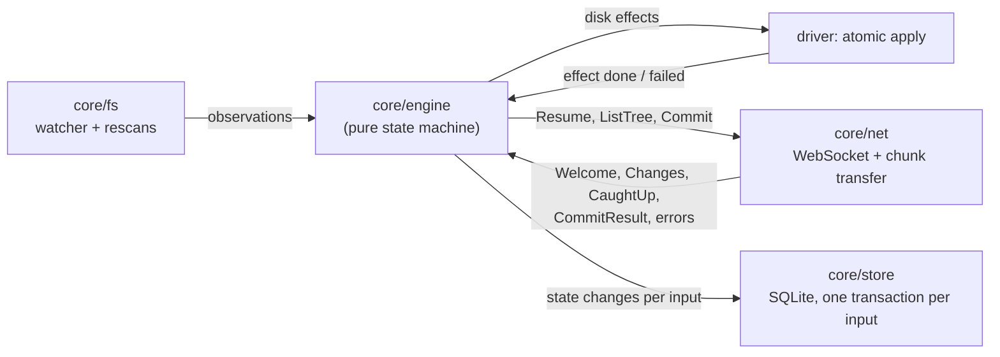

## 1. Context

The engine owns sync decisions for one space on one device. Its interface is a single entry point, `handle(now_ms, input)`, which updates the engine state and queues outputs. After each call the driver persists the state changes in one store transaction and only then executes the queued outputs, so every output is backed by durable state (write-ahead).

Inputs:

| Input | From | Meaning |
|---|---|---|
| `Observed(changes, root_check)` | fs driver | What the disk looks like now at some paths: created, modified (with chunked `Content`), renamed, removed. Produced by `core/fs` rescans, so it describes state rather than raw watcher events. `root_check` is the result of the root checks of §6.2 made for this batch; removals in a batch without a passing check are not trusted (§6.1) |
| `Rescanned(entries)` | fs driver | A full or subtree listing after startup, an event overflow or a crash |
| `EffectDone(id, identity)`, `EffectFailed(id, observed)` | fs driver | Result of a disk effect, with fresh observations on failure. **[changed]** For an effect that creates or writes an entry, `EffectDone` carries the file identity of the new entry, so L tracks the entry the effect made rather than the one it replaced. After a restart, the driver first recovers the effect record (§5.3) and reports its outcome the same way |
| `Connected(Welcome)`, `Disconnected` | net | Session state |
| `Changes(records)`, `CaughtUp(head_seq)`, `ResyncRequired(reason)`, `TreePage(page)` | net | Server log and bootstrap |
| `CommitResult(result)`, `CommitFailed(commit_id, error)` | net | Outcome of the commit in flight |
| `UserOps(ops)`, `UserDecision(decision)` | app | Restores requested in the UI; answers to the mass-delete prompt |

Outputs: `Resume`, `ListTree`, `SendCommit(commit)`, `ApplyEffect(effect)`, `Problem(problem)` (something only a person can fix) and `AskUser(question)`.

The engine never sees file bytes. Files are described by their `Content` (size, mtime, executable bit, chunk list, manifest digest; spec §5.1), which the driver computes with `core/chunk`. Two contents are equal for sync purposes when size, manifest digest and executable bit are equal; mtime alone is not a change.
